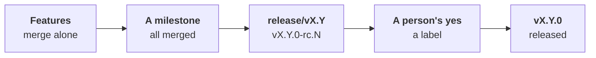

# The release candidate



At `merge: {autonomy: enterprising}`, a person checks the result once a
milestone, not each pull request: features merge by the policy, and the
person tries the milestone's release candidate. Their yes ships the
version; at every level, no version ships without one
([ADR-0060](adr/0060-the-person-is-on-the-loop.md#4-a-person-validates-by-the-issues-kind)).

```yaml
# .workline/config.yaml
merge: {autonomy: enterprising}
```

## The flow

- **A feature or a task merges alone** once every gate passes, as a
  fix does at `normal`
  ([the developer's merge](../roles/developer/docs/merge.md)).
- **It goes into a milestone** named by a version, `v1.4`: the product
  owner puts it there when it makes the issue ready; one readied
  before, `workline follow` before it merges. The next open milestone
  whose candidate is not cut, its version not out yet; none, the next
  minor version, opened.
- **Its issues all closed**, `workline follow` cuts `release/v1.4` from
  `main` and asks the release tool for `1.4.0-rc.1` there. It opens the
  candidate's issue in the milestone, labelled `workline:candidate`.
- **The release tool tags** `v1.4.0-rc.1` and publishes it as a
  pre-release. workline tags nothing
  ([ADR-0017](adr/0017-the-release-manager.md)).
- **The person tries it**, then puts the label `workline:accepted` on the
  candidate's issue (GitLab: `workline::accepted`).
- **On that yes**, `workline follow` asks the release tool for `1.4.0`
  on the branch, closes the issue and the milestone. The tool tags and
  publishes the version.

## Where the yes is given

- **A label on the candidate's issue**: one click, bulk-able, the same
  label as a pull request's yes, on GitHub and GitLab alike.
- **Why not the release pull request**: on a release branch, its label
  starts a run the App's key may not use (the default branch only,
  [ADR-0044](adr/0044-the-apps-key-stays-with-the-default-branchs-runs.md)); an
  issue's event runs on the default branch.
- **Why not the GitHub pre-release**: unticking "pre-release" makes no
  `v1.4.0` tag, and GitLab has no such switch.
- **Who**: a person who may push and merge; a bot's label, or one put
  before the newest candidate was tagged, is taken off, said on the
  issue.
- **What ships is what was tried**: the branch holds nothing past the
  candidate but the versions the tool bumps and its changelog; else the
  label is taken off until the next candidate.

## A problem in the candidate

- **Put it in an issue of the milestone.** Fixed and merged into `main`,
  workline copies the fix onto `release/v1.4`, as `git cherry-pick -x`,
  and asks for `1.4.0-rc.2`; the candidate's issue says so.
- **A copy that does not apply** is said, and left to a person.
- **Features of the next milestone** stay on `main`: a milestone whose
  candidate is cut takes no more.

## A refused candidate

- **Close the candidate's issue** to refuse it.
- **Features and tasks then wait** for a person's yes on each pull request, as at
  `normal`, until a person who may push and merge closes the issue that
  says it (as a revert's, [at `normal`](merge-policy-normal.md)).
- **Fixes still merge alone.** Once the milestone's new issues are
  merged and copied, the next candidate's issue opens.

## What the summary says

| Finding | When |
|---|---|
| `milestone-set` | a feature or a task put in the next milestone |
| `candidate-cut` | a branch cut, or the next candidate's issue opened |
| `candidate-version-past` | a milestone left open whose version is released already: not cut |
| `candidate-copied`, `candidate-copy-failed` | a fix copied onto the branch, or left to a person |
| `candidate-shipped` | the version asked for on a person's yes |
| `candidate-yes-reset`, `candidate-waits` | a yes taken off, or not taken: a bot's, before the tag, past what was tried |
| `candidate-refused`, `candidate-refusal-ignored` | a candidate closed by a person, or by a hand that may not refuse it |
| `candidate-unsupported` | the forge lists no milestone's issues |

## Set up

- **The release tool on the branch**: with release-please, copy
  [release-candidate.yml](../ci/github/release-candidate.yml) to
  `.github/workflows/`. It merges the tool's pull request into
  `release/v*` at once, the version decided before, and marks an
  `-rc.N` a pre-release.
- **Let GitHub Actions create pull requests** (Settings, Actions,
  General): that workflow runs with the job's own token.
- **The yes reaches workline**:
  [workline-merge.yml](../ci/github/workline-merge.yml) runs `follow` on a
  candidate's label and close too.
- **Stop release-please on `main`**: its release pull request there
  would ship features nobody tried.

## Not yet

- **GitLab**: the engine reads milestones, cuts the branch and reads the
  yes there; no template runs a release tool on `release/v*`, and a
  label on an issue reaches `follow` only at its next run
  ([#881](https://github.com/JN0V/workline/issues/881)).
- **Other release tools** than release-please: workline asks for a
  version by release-please's `Release-As:` footer only.
- **A fix after the version shipped**: no patch release from
  `release/vX.Y` yet
  ([#880](https://github.com/JN0V/workline/issues/880)).
- **The version's notes**: they list what changed since the last
  candidate only, and `main` does not get the version's changelog: the
  next candidate's notes list the last one's changes again
  ([#879](https://github.com/JN0V/workline/issues/879)).
