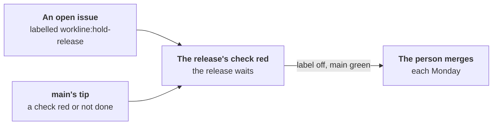

# What holds a release, and when to release



A release tool cuts the release, from its merge request
([ADR-0017](adr/0017-the-release-manager.md)). workline holds that
merge request while the forge says the release must wait
([ADR-0051](adr/0051-a-check-sits-where-its-catch-is-worth-its-cost.md#cut-1-the-release-weekly)).
Nothing is run again for it: what is read is the forge's.

## When to release

- **Each Monday**: the person merges the release tool's open merge
  request, once the week's sample and evaluation have run.
- **A patch release sooner** when a fix touches a real user.
- **No scheduler**: merging is the person's decision.

## What holds it

The release tool's merge request (its branch, as `release: branches:`
names them, [config](config.md)) blocks, its check red, while:

- **an open issue carries the label `workline:hold-release`**: whoever
  may label issues holds the release. Take the label off, or close the
  issue, to let it go. Each such issue is named in the check.
- **a check on the default branch's tip is red, or not done**: the tests
  ran there after the merge, so they are read, never run again. The red
  ones are named; the release waits for them green.
- **what holds it could not be read**: the forge not answering, or a
  token that may not read issues or checks. Never read as a pass.

The same holds `workline route release` given a forge, at a tag or by
hand. With no forge (`--forge none`), nothing can be read: said as a
warning.

Create the label once, so people find it in the forge's list:

```sh
gh label create workline:hold-release --description "Holds the release while this issue is open"   # GitHub
glab label create --name workline:hold-release --description "Holds the release while this issue is open"   # GitLab
```

## Read again

- **GitHub**: [workline-release.yml](../ci/github/workline-release.yml)
  runs the release pull request's last workline run again:
  - when the label is put on an issue or taken off, or such an issue is
    closed, reopened or deleted;
  - when main's workflows end after a push, none still running: list
    each one in its `workflow_run`, the tests' too.
  - `judge` reads with its own token: `issues`, `checks`, `statuses` and
    `actions` read, as [workline.yml](../ci/github/workline.yml) gives;
    the gardening's `dry-run` gets the same.
- **GitLab**: no pipeline starts on a label. Once the label is off, or
  main green, run the release merge request's `workline:judge` job
  again. It reads with `GITLAB_TOKEN` (`read_api`); the job's own token
  reaches no issue, so the release is held, said.

## On workline itself

workline's own release pull request also builds the binary with
GoReleaser, as the tag's release will: `workline version` must say the
version the pull request releases. Not shipped in the templates.
