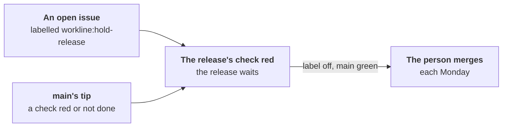

---
sources:
  - internal/line/hold.go#releaseHolds
  - internal/line/hold.go#waitHolds
  - internal/line/hold.go#onlyPending
  - internal/line/hold.go#onlyUnread
  - internal/forge/hold.go#HoldLabel
  - internal/forge/hold.go#tipOf
  - internal/forge/hold.go#github.Holding
  - internal/forge/hold.go#gitlab.Holding
  - internal/release/release.go#Settings.IsBranch
  - internal/forge/gitlab.go#gitlab.connect
  - defaults/ci/gitlab/workline.gitlab-ci.yml#workline:propose
checked: e2e165c2d
verified: agent:claude-code
judged-in-parts: 786d304
---
# What holds a release, and when to release



A release tool cuts the release, from its merge request
([ADR-0017](adr/0017-the-release-manager.md)). workline holds that
merge request while the forge says the release must wait
([ADR-0051](adr/0051-a-check-sits-where-its-catch-is-worth-its-cost.md#cut-1-the-release-weekly)).
Nothing is run again for it: what is read is the forge's.

## When to release

- **Each Monday**: the person merges the release tool's open merge
  request, once the week's sample and evaluation have run.
- **A patch release sooner** when a fix touches a real user.
- **No scheduler**: merging is the person's decision.

## What holds it

The release tool's merge request (its branch, as `release: branches:`
names them, [config](config.md)) blocks, its check red, while:

- **an open issue carries the label `workline:hold-release`**: whoever
  may label issues holds the release. Take the label off, or close the
  issue, to let it go. Each such issue is named in the check.
- **a check on the default branch's tip is red, or not done**: the tests
  ran there after the merge, so they are read, never run again. The red
  ones are named; the release waits for them green. A check cancelled
  there, and not run again, is passed over: it would never end (on
  GitHub, a newer run of its concurrency group took its place).
- **what holds it could not be read**: the forge not answering, or a
  token that may not read issues or checks. Never read as a pass.

The same holds `workline route release` given a forge, at a tag or by
hand. With no forge (`--forge none`), nothing can be read: said as a
warning.

Create the label once, so people find it in the forge's list:

```sh
gh label create workline:hold-release --description "Holds the release while this issue is open"   # GitHub
glab label create --name workline:hold-release --description "Holds the release while this issue is open"   # GitLab
```

## Read again

- **While main's checks run**: the release's check waits for them,
  pending, then turns green or red with them, 30 minutes at most
  (`route --release-wait 30m` in both templates:
  [GitHub's](github/release-holds.md)). A forge's required
  check cannot say "pending" otherwise: a job that ended is green or
  red. Only when nothing else holds the release. A read of the forge
  that fails meanwhile does not end the wait.
- **GitHub**: the release pull request's check is run again on a
  label's change, and once main's runs end
  ([what holds a release on GitHub](github/release-holds.md)).
- **GitLab**: no pipeline starts on a label. Once the label is off, or
  main green after the wait ran out, run the release merge request's `workline:propose` job
  again. It reads with `GITLAB_TOKEN` (`read_api`); the job's own token
  reaches no issue, so the release is held, said.

## On workline itself

workline's own release pull request also builds the binary with
GoReleaser: [workline's own workflows](github/own-workflows.md). Not
shipped in the templates.
