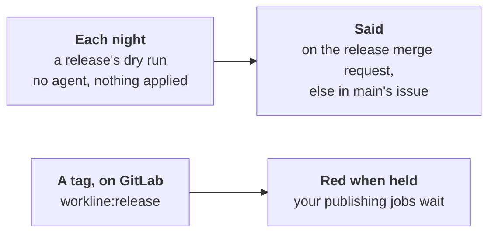

# The release: a dry run each night, a check at the tag



workline cuts no releases: a release tool does
([ADR-0017](adr/0017-the-release-manager.md)). It says, before the
release, what would hold it, and checks it where the release is cut
([ADR-0050](adr/0050-each-act-has-its-moment-and-a-wait-budget.md#3-the-moment-table)).
Nobody waits for either.

## Each night, a dry run

`workline route release --dry-run`: what would hold the release if it
were cut now.

- **On what**: the release tool's merge request open into the branch,
  its head checked out, then put back: merging it is the release. None
  open: the branch's tip. A tip that is a release already, nothing
  since: nothing to cut, said.
- **What runs**: the `release` line, every step, the first that holds
  stopping none. No agent, nothing applied: the docs made suspect since
  the last release, the docs due then, the gates your `release` line
  runs, every finding counted.
- **Said, never a block**: the line passes; what would block is listed
  as warnings.
- **Where a person sees it**, `workline apply --release-dry-run`:
  - a release merge request open: one comment on it, posted once
    something holds, edited when what it lists changes, saying so when
    nothing holds any more;
  - else a part of the default branch's issue
    ([main after a merge](main-after-merge.md)), *The next release*,
    taken out when nothing holds. Each writer leaves the other's part as
    it is.
- **The release still waits where it is cut**: its merge request's
  verdict, or `workline route release` before the tag. The night's
  documentalist judges its docs with the agent
  ([at the release](../roles/documentalist/docs/push.md#a-release-tools-pull-request)).

## In CI

- **GitHub**: the jobs `dry-run` (contents and pull requests read, no
  secret) and `dry-run-post` (the App's token), in
  [the gardening](../ci/github/workline-gardening.yml) and
  [the release docs](../ci/github/workline-release-docs.yml): every
  night between them.
- **GitLab**: `workline:release:dry-run` and
  `workline:release:dry-run:post`, on each schedule but the sample's.
- **Your release's gates**: install their tools in the dry run's job, as
  in the gates' ([gates in CI](gates-in-ci.md)).
- **One writer of the issue at a time**: the post shares main's issue
  job's concurrency group (GitHub) or resource group (GitLab).

## At a tag, on GitLab

`workline:release` runs on a tag pipeline, whoever pushed the tag: a
person, or a release tool.

- **The release's line**, no agent, no token: the docs made suspect
  since the release before this one, the gates your `release` line runs.
- **Red when held**: have the jobs that publish need it, so a held
  release is never published:

  ```yaml
  publish:
    stage: deploy
    needs: [workline:release]
    rules: [{if: $CI_COMMIT_TAG}]
    release: {tag_name: $CI_COMMIT_TAG, description: "Release $CI_COMMIT_TAG"}
    script: [echo "publishing $CI_COMMIT_TAG"]
  ```

- **The tag is the release, not the last one**: the last release is the
  highest tag before it. A tag at HEAD is never taken for the release a
  run compares with.
- **A release merge request** (releaser-pleaser's) is judged as the
  release on each of its pipelines already; its tag is checked again.
- **A tool that tags and publishes in one job** (semantic-release): run
  `workline route release --ai none` before it, in that job; it runs
  only if that passed.

On GitHub, the release tool's pull request is the release: its verdict
holds it, pending while docs are due, listed in a comment on each push
and judged at night
([ADR-0050, §7](adr/0050-each-act-has-its-moment-and-a-wait-budget.md#7-decided-by-the-maintainer-on-2026-10-19)).

## By hand, for another CI

```sh
workline route release --dry-run --forge github --json > dry-run.json   # no agent, writes nothing
workline apply --release-dry-run dry-run.json --forge github             # the token, no agent
workline route release --ai none --forge none                             # at the tag; non-zero holds it
```

- The agent is never asked by the dry run: `--ai` naming one is refused.
- Without a forge (`--forge none`), the dry run is the branch's tip;
  nothing is posted.
