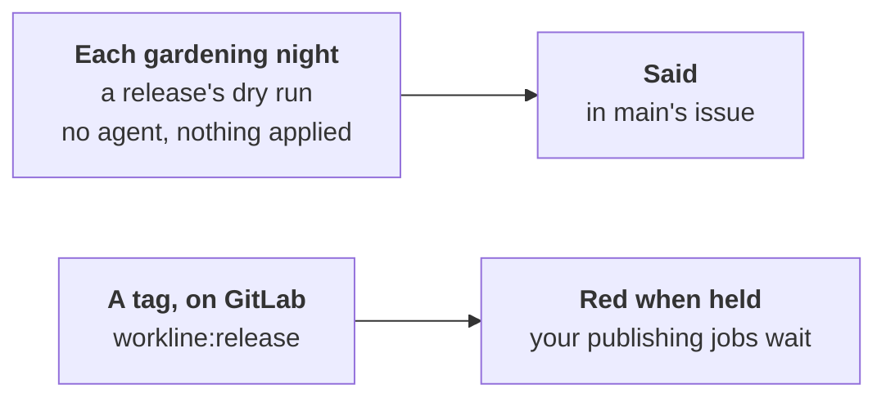

# The release: a dry run each night, a check at the tag



workline cuts no releases: a release tool does
([ADR-0017](adr/0017-the-release-manager.md)). It says, before the
release, what would hold it, and checks it where the release is cut.
Nobody waits for either. What holds the release tool's merge request,
and when to merge it: [what holds a release](release-holds.md).

- **The release never waits for the docs**
  ([ADR-0051](adr/0051-a-check-sits-where-its-catch-is-worth-its-cost.md#cut-1-the-release-weekly)):
  the documentalist is not on the `release` line; gardening keeps the
  docs true.
- **The `release` line runs your gates**: none by default
  (`routing: {events: {release: [...]}}`, [config](config.md)).

## Each night, a dry run

`workline route release --dry-run`: what would hold the release if it
were cut now.

- **On what**: the branch's tip. A tip that is a release already,
  nothing since: nothing to cut, said.
- **What runs**: the `release` line, every step, the first that holds
  stopping none. No agent, nothing applied.
- **Said, never a block**: the line passes; what would block is listed
  as warnings.
- **Where a person sees it**, `workline apply --release-dry-run`: a part
  of the default branch's issue ([main after a merge](main-after-merge.md)),
  *The next release*, taken out when nothing holds. Each writer leaves
  the other's part as it is.

## In CI

- **GitHub**: the jobs `dry-run` (contents, issues, checks, statuses
  and actions read: [what holds a release](release-holds.md); no secret) and
  `dry-run-post` (the App's token, issues write), in
  [the gardening](../ci/github/workline-gardening.yml).
- **GitLab**: `workline:release:dry-run` (no token) and
  `workline:release:dry-run:post`, on each schedule but the sample's.
- **Your release's gates**: install their tools in the dry run's job, as
  in the gates' ([gates in CI](gates-in-ci.md)).
- **One writer of the issue at a time**: the post shares main's issue
  job's concurrency group (GitHub) or resource group (GitLab).

## At a tag, on GitLab

`workline:release` runs on a tag pipeline, whoever pushed the tag: a
person, or a release tool.

- **The release's line**, no agent, no token: the gates your `release`
  line runs. No forge, so no [hold](release-holds.md) is read there: said.
- **Red when held**: have the jobs that publish need it, so a held
  release is never published:

  ```yaml
  publish:
    stage: deploy
    needs: [workline:release]
    rules: [{if: $CI_COMMIT_TAG}]
    release: {tag_name: $CI_COMMIT_TAG, description: "Release $CI_COMMIT_TAG"}
    script: [echo "publishing $CI_COMMIT_TAG"]
  ```

- **A tool that tags and publishes in one job** (semantic-release): run
  `workline route release --ai none` before it, in that job; it runs
  only if that passed.

On GitHub, the release tool's pull request is a pull request like
another: its checks hold it.

## By hand, for another CI

```sh
workline route release --dry-run --forge github --json > dry-run.json   # no agent, writes nothing
workline apply --release-dry-run dry-run.json --forge github             # the token, no agent
workline route release --ai none --forge none                             # at the tag; non-zero holds it
```

- The agent is never asked by the dry run: `--ai` naming one is refused.
- Without a forge (`--forge none`), nothing is posted.
