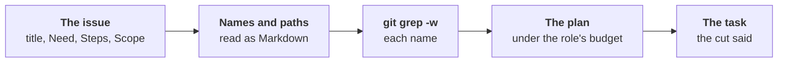

# The code picker

How the product owner, the tester and the reviewer get the code an issue
names: one picker, any language, no build
([ADR-0063 §8](../adr/0063-every-open-issue-is-due-waiting-or-done.md#8-one-code-picker-and-tools-where-the-agent-has-them)).
Each role used to cut code its own way; round 3 of the C++ trial put 8 of
its 11 defects there.

## What it reads

- **The text**: the title, the body (Need, Steps, Validation, Scope),
  a person's comments; for the product owner, the lines of the file an
  issue was imported from that name its item, never that file.
- **Paths named outright**: the Scope's words in backticks, the product
  owner's `sources`. A folder gives its own files, a pattern the files it
  matches, the tests aside when code matches too.
- **Paths in the text**: a file the commit holds, or the one file with
  that name; for the product owner, a link to a file on the forge too.
- **Names**: the words written as code, as the reviewer's judge reads
  them: in backticks, called (`f(`), or shaped as a name (`load_all`,
  `answerItems`). Not an acronym (`CSV`, `MQTT`): a format as often as
  code. Not a keyword nor a language's own type.

## What it gives, in order

Under the role's budget, each piece once a task:

1. **Lines named after a file**: `a.go:12`, `a.go:12-30`, "docs/x.md,
   lines 6353 to 6353". The lines, the function around each end, else
   15 lines either side.
2. **Each definition of a name**, whole, its comment up to 20 lines
   above ([code navigation](../research/code-navigation.md): Go by its
   parser, other languages by a pattern and braces or indentation; C++
   methods defined out of their class too).
   - Those in a file the issue is about first: a file named, or the one
     file defining another name it writes (`enableLED` in `LED.h`). A
     name defined there is that one: one of the same name elsewhere is
     counted, not given (`loop()` in every component).
   - Then the project's own, 12 a name at most.
   - The functions a definition there calls, defined in its file, 3 a
     definition at most, each whole: `loop()` says little,
     `updateEffects()` it calls says what it does.
   - Copies in tests, examples and tools last, 2 a name, the rest counted.
3. **The lines naming a name in a file named**: the function around
   each, 40 lines at most, else 3 lines either side.
4. **A file named, whole** when what it adds fits; else, nothing of it
   given yet, its first lines.
5. **The other places naming a name**, the rarer name first, code before
   docs, 6 a name at most, the rest counted.
6. **The tester's test**: the nearest file matching `test-paths` (its
   folder's, named after the code, else its module's, else the project's
   first). A fifth of the budget is kept for it while the code is
   planned, said when the code wanted it; given once, never also as
   code. The tester's only: the product owner and the reviewer write no
   test, and the room would be tokens spent for nothing.

The files the tester's agent asked for at its last run come right after
the definitions (between 2 and 3): whole, else their first lines.

**The tester's declarations** (its `Depth`, 2): what a new test builds
against, so that it asks once, not a header at a time (the C++ copy's
#36 asked for a new set at each of three runs).

- **A file named** that does not fit whole, or asked for and not
  fitting whole: its declarations first, the pieces above shown whole
  in them; whole later, if what it adds still fits.
- **Then the files included or imported**, two steps deep inside the
  project, as their declarations: the test's own includes first (they
  build today), then those of the Scope's files, of the files asked for
  and of the definitions given, the most used a line first. A file two
  steps away counts the names the declarations one step away use; one
  none of whose names is used is left a path.
- **Then a test asked for**: whole, else its first lines.
- **Declarations**: each signature, type and member kept, each body cut
  to its opening line and `…`, comment lines and blank lines out. By
  braces or indentation, one rule a family, braces that do not balance
  giving none; a block is a container by a
  word (`class`, `struct`, `namespace`, `interface`, `impl`, …), the
  imports by one row of patterns a family
  ([research](../research/code-outline.md)). Ruby, Lua and shell have
  none: whole or cut, as before.

A binary file gives nothing: no line, and `logo.png` names neither
`logo` nor `png`.

## What the task says

- **Each file**: whole, its first lines (`cut: the first N lines`), its
  pieces, each with why it is given, or its declarations ("its
  declarations, each body left out as `…`", and why: named, asked
  for, included by a file).
- **The cut**: a piece the budget ran out in, where it goes on to; what
  is named past the budget; files named with nothing given, by size.
- **Counted, not shown**: definitions past the caps, other places
  naming a name.
- **One step away, as paths**: the files the code, the declarations
  and the test given include or import, not given (the table of
  [imports.go](../../internal/codepick/imports.go): C and C++, Python,
  JavaScript and TypeScript, Go, the JVM's, Rust, Ruby, PHP, Lua,
  shell), and those defining the types the code derives from.
- **Given above**: a file given for an earlier issue of the same task.

## Read again only for code not given

- **The product owner's pre** lists the files it gave, by issue
  (`code-given` in the run's folder).
- **A `sources` naming only those, beside a Scope**: the Scope written
  in the same run stands, no `needs-code`, nothing read again
  ([refining](backlog-acts/refine.md)). Without a Scope, or beside an
  `ask`, the issue is read again as before.
- **Naming code not given** is still read again, with that code
  (`needs-code`, the "name the code, be read again" protocol of agents
  with no tools).
- **Its Scope names every file the change edits**, each copy of a
  function it fixes; `sources` holds up to 5 of them.

## Each role

| Role | Budget | Shown |
|---|---|---|
| [Product owner](backlog-acts/reading.md) | `code-lines-max` (1500), shared among the issues read | numbered lines, each file's last commits |
| [Tester](../../roles/tester/README.md) | `code-lines-max` (1500) | lines as they are, the tests beside after |
| [Reviewer, a spec](../../roles/reviewer/docs/spec.md) | `code-lines-max` (600); the judge's `judge-lines-max` (200) | numbered lines |

- **Same everywhere**: the same picker on a person's machine and in CI,
  with any agent or none.
- **Not here**: the reviewer's judge on a change's finding reads from the
  finding's cause ([judge](../../roles/reviewer/docs/judge.md)).
- **Read tools, the tester first**: under `claude`, the tester's agent
  also reads a copy of the project (Read, Glob, Grep), the pick its
  start, what it read logged
  ([ADR-0063 §8](../adr/0063-every-open-issue-is-due-waiting-or-done.md#8-one-code-picker-and-tools-where-the-agent-has-them));
  the product owner and the reviewer at step 9.
