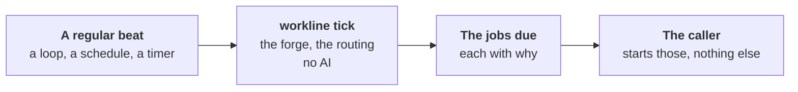

# The tick



`workline tick` lists the line's jobs due now
([ADR-0069](adr/0069-one-wake-every-five-minutes-starts-what-is-due.md),
[#1665](https://github.com/JN0V/workline/issues/1665)).

- **It decides, it starts nothing**: no agent, nothing written. A
  workflow, a pipeline or a machine's timer starts what it lists.
- **Safe every minute**: the same state gives the same list. A job
  whose run is queued, waiting or running is not listed again.
- **Never a guess**: a read that fails lists no job that needs it, and
  says why on stderr. It exits 0 all the same.
- **The workflows do not call it yet**: the beat that does comes in the
  next slices of [#1611](https://github.com/JN0V/workline/issues/1611).

## What it lists

| Job | Due when | Its run's name |
|---|---|---|
| `reconcile` | every tick; or its `gap` passed, when set | `workline develop reconcile` |
| `backlog` | Ready below `routing.wip.ready`, and Ready moved since the last backlog run ([#1549](https://github.com/JN0V/workline/issues/1549)) | `workline gardening backlog` |
| `nightly` | its `at` passed, no run since; not timed unless set | `workline gardening nightly` |
| `docs` | its `at` passed, no run since; `7 18 * * 0` shipped | `workline gardening docs` |
| `merge` | its `gap` passed since its last run; `60` shipped | `workline merge` |
| `sample` | its `at` passed, no run since; `43 5 * * 1` shipped | `workline sample` |
| `seeds` | its `at` passed, no run since; not timed unless set | `workline test seeds` |

- **A run's name is its key**: a run going under it keeps the job off
  the list; a run started under it since the job's time makes it done,
  whoever started it, green or not.
- **Runs from before the tick**: a gardening run named `workline
  gardening` counts as a backlog run, a `workline develop heartbeat` as
  a reconcile.
- **`--issues`**: in the place of the reconcile, each issue's step,
  review round and tester's answer the reconciler finds due, as its own
  job: `develop` (`workline develop #<n>`), `round` (`workline develop
  round !<n>`), `answer` (`workline answer !<n>`). It reads what the
  reconciler reads, each issue's comments among them.

## The times

In `.workline/config.yaml`, under `routing.timed`, job by job:

```yaml
routing:
  timed:
    nightly: {at: "17 2 * * *"}   # a cron, UTC
    merge: {gap: 15}              # minutes since its last run started
    sample: off
```

- **`at` or `gap`**, never both: the config is refused, naming the job.
- **Neither is a late limit**: a job hours late runs once.
- **`backlog`** takes no time: `off`, or Ready's rule.
- **Not set**, a job keeps its shipped time, in the table above.

## Run it

```sh
workline tick                     # one line per job due
workline tick --json              # [{"job": …, "why": …, "key": …}], [] when none
workline tick --json --issues     # each issue's step, round and answer, as its own job
workline tick --now 2026-11-16T02:20:00Z --json   # a fixed clock, for tests
```

- **`--forge`**: where the issues and the runs are read; the project's
  `forge` setting by default.
- **Runs are read on GitHub** (and the conformance tests' fake forge).
  On GitLab, a forge kept in the clone or none, the runs are said not
  read: the reconcile alone is listed.

## Cost

- **No agent, no token** of a model.
- **GitHub reads, each tick**: the runs going (4 calls), each timed
  job's workflow back to its time (1 call a page of 100, 5 pages at
  most), the open issues when Ready's target is set (1 call a page),
  and each issue's label events past Ready when Ready is below it.
- **`--issues`**: the reconciler's reads, about 20 calls.
- **Conditional reads** (an ETag's 304 costs no quota) are not used
  yet: the forge layer has none.
