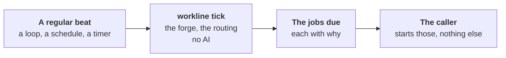

---
sources:
  - cmd/workline/tick.go#tickCmd
  - internal/tick/tick.go#jobs
  - internal/tick/tick.go#Due
  - internal/routing/timed.go#TimedJobs
  - internal/routing/timed.go#checkTimed
  - internal/forge/runs.go#ErrNoRuns
  - internal/forge/runs.go#github.RunsGoing
  - internal/line/tick.go#BacklogDue
  - defaults/ci/github/workline-loop.yml#on
  - defaults/ci/github/workline-loop.yml#jobs.loop
checked: e81df7b34
verified: agent:claude-code
---
# The tick



`workline tick` lists the line's jobs due now
([ADR-0069](adr/0069-one-wake-every-five-minutes-starts-what-is-due.md),
[#1665](https://github.com/JN0V/workline/issues/1665)).

- **It decides, it starts nothing**: no agent, nothing written. A
  workflow, a pipeline or a machine's timer starts what it lists.
- **Safe every minute**: the same state gives the same list. A job
  whose run is queued, waiting or running is not listed again.
- **Never a guess**: a read that fails lists no job that needs it, and
  says why on stderr. It exits 0 all the same.
- **On GitHub, a loop calls it**, a dry run by default: it logs what it
  would start; turned on, it starts exactly that
  ([the GitHub loop](#the-github-loop)).

## What it lists

| Job | Due when | Its run's name |
|---|---|---|
| `reconcile` | every tick; or its `at` or `gap`, when set | `workline develop reconcile` |
| `backlog` | Ready below its target, and Ready moved since the last backlog run ([#1549](https://github.com/JN0V/workline/issues/1549)); or, Ready full or not, an Urgent issue (`workline:priority/1`) with no state or in `to-refine`, its label put on since the last backlog run started, the reason naming it; its labels unread, said not read and none listed ([#2322](https://github.com/JN0V/workline/issues/2322)) | `workline gardening backlog` |
| `nightly` | its `at` passed, no run since; not timed unless set | `workline gardening nightly` |
| `docs` | its `at` passed, no run since; `7 18 * * 0` shipped | `workline gardening docs` |
| `merge` | its `gap` passed since its last run; `60` shipped | `workline merge` |
| `sample` | its `at` passed, no run since; `43 5 * * 1` shipped | `workline sample` |
| `seeds` | its `at` passed, no run since; not timed unless set | `workline test seeds` |

- **A run's name is its key**: a run going under it keeps the job off
  the list; a run started under it since the job's time makes it done,
  whoever started it, green or not, but for the nightly and the
  backlog, where only a succeeded run counts. A run under another name
  is not seen.
- **Runs from before those names**: a gardening run named `workline
  gardening` counts as a backlog run, a `workline develop heartbeat` as
  a reconcile
  ([#1761](https://github.com/JN0V/workline/issues/1761)).
- **The nightly keeps the backlog**: a `workline gardening nightly` run
  or a `workline gardening docs and backlog` run (the template's full
  Sunday run, the product owner too) counts as a backlog run too, when
  it succeeded; a docs run alone does not
  ([#1765](https://github.com/JN0V/workline/issues/1765)). That full
  run counts as a docs run too.
- **Going**: a run requested, queued, waiting, pending or in progress,
  started in the last day: one waiting longer on a person's approval
  is not read as going.
- **`--issues`**: in the place of the reconcile, each issue's step,
  review round and tester's answer the reconciler finds due, as its own
  job.

## The times

In `.workline/config.yaml`, under `routing.timed`, job by job:

```yaml
routing:
  timed:
    nightly: {at: "17 2 * * *"}   # a cron, UTC
    merge: {gap: 15}              # minutes since its last run started
    sample: off
```

- **`at` or `gap`**, never both, and one of them but for the
  reconcile: the config is refused, naming the job.
- **Neither is a late limit**: a job hours late runs once.
- **`backlog`** takes no time: `off`, or Ready's rule.
- **Not set**, a job keeps its shipped time, in the table above.

## Run it

```sh
workline tick                     # one line per job due, or "nothing due"
workline tick --json              # [{"job": …, "why": …, "key": …}], [] when none
workline tick --json --issues     # each issue's step, round and answer, as its own job
workline tick --now 2026-11-16T02:20:00Z --json   # a fixed clock, for tests
```

- **`--forge`**: where the issues and the runs are read; the project's
  `forge` setting by default.
- **Runs are read on GitHub** (and the tests' fake forge). Elsewhere
  (GitLab, a forge kept in the clone, a command's, none) the runs are
  said not read: only a reconcile with no time set is listed.

## The GitHub loop

[workline-loop.yml](../defaults/ci/github/workline-loop.yml) holds the
beat on GitHub, whose own schedule runs late or not at all
([ADR-0069's amendment](adr/0069-one-wake-every-five-minutes-starts-what-is-due.md#amendment-2026-11-17-a-beat-every-minute-no-event-moves-the-line)).

- **One long job**: `workline tick --forge github --json` every beat,
  on the default branch fetched again; its clone kept between beats,
  and the answers tick keeps in `.git/workline` with it ([cost](#cost)).
- **A dry run by default**: each job tick lists is logged, as tick
  prints it, and nothing starts; the run's notice, at its end, counts
  them by name. A beat's log:

  ```text
  beat 12, 14:03:01 UTC: 2 due, a dry run
  would dispatch {"job":"reconcile","why":"every tick","key":"workline develop reconcile"}
  would dispatch {"job":"docs","why":"its time …","key":"workline gardening docs"}
  ```

- **Dispatching**, with the repository variable
  `WORKLINE_LOOP_DISPATCH` set to `true`
  ([turn it on](#turn-dispatching-on)): each job tick lists is started,
  `gh workflow run`, nothing else; logged `dispatched {…}`.
  - **Its workflow**: `reconcile` in workline-develop.yml
    (`reconcile=true`); `backlog`, `nightly`, `docs` in
    workline-gardening.yml (`job=<job>`); `merge` in workline-merge.yml;
    `sample` in workline-sample.yml; `seeds` in workline's own test.yml
    (`job=seeds`).
  - **Once**: a job going is not listed; a key dispatched under a beat
    and a minute ago is held (`held {…}`), its run maybe not listed yet:
    `HOLD_SECONDS`, 240, never under the beat + 60 s.
  - **A dispatch that fails** is said, and tried again at the next beat
    tick lists it.
  - **A job the loop does not know** is said, not started.
- **One at a time**: its concurrency group; a run started while a loop
  runs starts nothing.
- **Before GitHub's 6 h**: after 340 minutes of beats, it dispatches its
  successor, which waits in the group; not after a crash or a cancel.
- **Restarted** by its hourly schedule, or by hand (Run workflow).
- **Its release**: v0.79.0 at least; an older one has no `tick`, and the
  loop says so and stops.
- **Its beat**: 180 s, or the variable `WORKLINE_LOOP_BEAT_SECONDS`.
  The job token's 1,000 calls an hour are the whole repository's; 60 s
  only where a tick costs little quota ([cost](#cost)).
- **Tick failing 10 beats in a row**: the loop stops, says why, and
  starts no successor; its hourly schedule tries again.
- **Its cost on a private repository**: about 1,440 runner minutes a day.
  Public repositories are not billed.
- **workline's own workflows**: which the loop starts in place of
  their triggers ([own workflows](github/own-workflows.md)).

### Turn dispatching on

- **Before**: the dry run's notices, a day, list what you expect.
- **Set the reconcile's time**: with none, a reconcile is due every
  beat no reconcile run is going. A `gap` keeps its calls in budget:

  ```yaml
  routing:
    timed:
      reconcile: {gap: 15}
  ```

- **Then**: Settings → Secrets and variables → Actions → Variables →
  `WORKLINE_LOOP_DISPATCH` = `true`. The next loop run reads it: cancel
  the one going, then Run workflow, to take it now. `false` or unset is
  a dry run again.
- **Runs an event starts**: tick sees a run by its name only. One
  started under another name, as a run named by its pull request, is
  not seen: a job tick lists may run beside it.

## Cost

- **No agent, no token** of a model.
- **The beat's budget**: the tick's calls an hour stay under a quarter
  of the job token's 1,000
  ([ADR-0069 §3](adr/0069-one-wake-every-five-minutes-starts-what-is-due.md#3-api-cost)).
  - **A quiet trial copy**: 5 calls of quota its first beat, then 0 to
    2 a beat, the others answered 304
    ([#1764](https://github.com/JN0V/workline/pull/1764),
    [#1783](https://github.com/JN0V/workline/pull/1783)); 60 s holds.
  - **A busy repository**: about 10 calls of quota a beat, even read
    conditionally: 600 an hour at 60 s, 200 at 180 s. Hence 180 s.
  - **A dispatch** is 1 call more.
- **GitHub reads, each tick**: the runs going (1 call: the last day's
  runs, every workflow, while fewer than 100), each timed job's
  workflow back to its time, and, for the backlog, the issues.
- **Conditional reads**: each listing read again sends its last answer's
  `ETag`; GitHub's `304 Not Modified` costs no quota
  ([#1762](https://github.com/JN0V/workline/issues/1762)).
  - Said on stderr: `workline: tick: 5 GitHub calls, 0 of them cost
    quota (5 answered 304 Not Modified)`.
