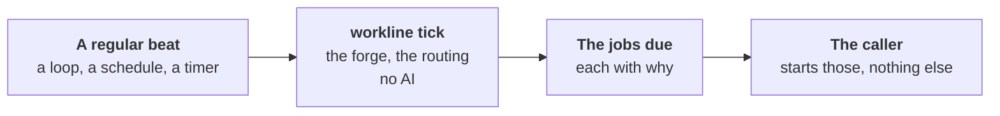

# The tick



`workline tick` lists the line's jobs due now
([ADR-0069](adr/0069-one-wake-every-five-minutes-starts-what-is-due.md),
[#1665](https://github.com/JN0V/workline/issues/1665)).

- **It decides, it starts nothing**: no agent, nothing written. A
  workflow, a pipeline or a machine's timer starts what it lists.
- **Safe every minute**: the same state gives the same list. A job
  whose run is queued, waiting or running is not listed again.
- **Never a guess**: a read that fails lists no job that needs it, and
  says why on stderr. It exits 0 all the same.
- **On GitHub, a loop calls it**, a dry run for now: it logs what it
  would start, and starts nothing ([the GitHub loop](#the-github-loop)).

## What it lists

| Job | Due when | Its run's name |
|---|---|---|
| `reconcile` | every tick; or its `at` or `gap`, when set | `workline develop reconcile` |
| `backlog` | Ready below `routing.wip.ready`, and Ready moved since the last backlog run ([#1549](https://github.com/JN0V/workline/issues/1549)) | `workline gardening backlog` |
| `nightly` | its `at` passed, no run since; not timed unless set | `workline gardening nightly` |
| `docs` | its `at` passed, no run since; `7 18 * * 0` shipped | `workline gardening docs` |
| `merge` | its `gap` passed since its last run; `60` shipped | `workline merge` |
| `sample` | its `at` passed, no run since; `43 5 * * 1` shipped | `workline sample` |
| `seeds` | its `at` passed, no run since; not timed unless set | `workline test seeds` |

- **A run's name is its key**: a run going under it keeps the job off
  the list; a run started under it since the job's time makes it done,
  whoever started it, green or not.
- **Gardening runs named by their job**: the templates name each run
  `workline gardening docs`, `nightly` or `backlog`, from its schedule
  or the input `job` of a run by hand; with no job, `workline gardening
  by hand`, no job's
  ([#1761](https://github.com/JN0V/workline/issues/1761)).
- **Runs from before those names**: a gardening run named `workline
  gardening` counts as a backlog run, a `workline develop heartbeat` as
  a reconcile.
- **The nightly keeps the backlog**: a `workline gardening nightly` run
  counts as a backlog run too; a docs run does not
  ([#1765](https://github.com/JN0V/workline/issues/1765)).
- **Going**: a run requested, queued, waiting, pending or in progress.
- **`--issues`**: in the place of the reconcile, each issue's step,
  review round and tester's answer the reconciler finds due, as its own
  job: `develop` (`workline develop #<n>`), `round` (`workline develop
  round !<n>`), `answer` (`workline answer !<n>`). It reads what the
  reconciler reads, each issue's comments among them.

## The times

In `.workline/config.yaml`, under `routing.timed`, job by job:

```yaml
routing:
  timed:
    nightly: {at: "17 2 * * *"}   # a cron, UTC
    merge: {gap: 15}              # minutes since its last run started
    sample: off
```

- **`at` or `gap`**, never both, never neither: the config is refused, naming the job.
- **Neither is a late limit**: a job hours late runs once.
- **`backlog`** takes no time: `off`, or Ready's rule.
- **Not set**, a job keeps its shipped time, in the table above.

## Run it

```sh
workline tick                     # one line per job due
workline tick --json              # [{"job": …, "why": …, "key": …}], [] when none
workline tick --json --issues     # each issue's step, round and answer, as its own job
workline tick --now 2026-11-16T02:20:00Z --json   # a fixed clock, for tests
```

- **`--forge`**: where the issues and the runs are read; the project's
  `forge` setting by default.
- **Runs are read on GitHub** (and the conformance tests' fake forge).
  On GitLab, a forge kept in the clone or none, the runs are said not
  read: the reconcile alone is listed.

## The GitHub loop

[workline-loop.yml](../defaults/ci/github/workline-loop.yml) holds the
beat on GitHub, whose own schedule runs late or not at all
([ADR-0069's amendment](adr/0069-one-wake-every-five-minutes-starts-what-is-due.md#amendment-2026-11-17-a-beat-every-minute-no-event-moves-the-line)).

- **One long job**: `workline tick --forge github --json` every minute,
  its checkout kept between beats, so the conditional reads' cache in
  `.git/workline` too.
- **A dry run**: each job tick lists is logged, as tick prints it, and
  nothing starts. The run's notice counts them:

  ```text
  beat 12, 14:03:01 UTC: 2 due, a dry run
  would dispatch {"job":"reconcile","why":"every tick","key":"workline develop reconcile"}
  would dispatch {"job":"docs","why":"its time …","key":"workline gardening docs"}
  ```

- **Dispatching comes later**: the repository variable
  `WORKLINE_LOOP_DISPATCH` is read; `true` is said not built yet, and the
  beat stays a dry run.
- **One at a time**: its concurrency group; a restart while a loop runs
  (job `alive`) starts nothing.
- **Before GitHub's 6 h**: after 340 minutes of beats, it dispatches its
  successor, which waits in the group; not after a crash or a cancel.
- **Restarted** by its hourly schedule, or by hand (Run workflow).
- **Its release**: v0.79.0 at least; an older one has no `tick`, and the
  loop says so and stops.
- **Its beat**: 60 s, or the variable `WORKLINE_LOOP_BEAT_SECONDS`; a
  longer one spares the job token's 1,000 calls an hour.
- **Its cost on a private repository**: about 1,440 runner minutes a day.
  Public repositories are not billed.
- **The other workflows keep their triggers** for now;
  [a test](../tests/conformance/triggers_test.go) lists each one's.

## Cost

- **No agent, no token** of a model.
- **GitHub reads, each tick**: the runs going (1 call: the last day's
  runs, every workflow), each timed job's workflow back to its time
  (1 call a page of 100, 5 pages at most), the open issues when Ready's
  target is set (1 call a page), and each issue's label events past
  Ready when Ready is below it.
- **Conditional reads**: each listing read again sends its last answer's
  `ETag`; GitHub's `304 Not Modified` costs no quota, and the last
  answer is used
  ([#1762](https://github.com/JN0V/workline/issues/1762)).
  - Kept in the clone, `.git/workline/etags.json`, a day at most.
  - The times asked are to the hour, so that the same listing is asked
    from one minute to the next.
  - Said on stderr: `5 GitHub calls, 0 of them cost quota (5 answered
    304 Not Modified)`.
- **`--issues`**: the reconciler's reads, about 20 calls, not
  conditional.
- **A run going for more than a day**, waiting on a person's approval,
  is not read as going.
