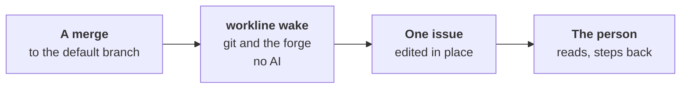

---
sources:
  - internal/wake/wake.go#readTree
  - internal/wake/wake.go#readRole
  - internal/wake/wake.go#readForge
  - internal/wake/wake.go#isBug
  - internal/wake/wake.go#adrPath
  - internal/wake/wake.go#isADR
  - internal/wake/wake.go#roleFile
  - internal/wake/wake.go#isPrompt
  - internal/wake/wake.go#Window
  - internal/wake/wake.go#AreaFixes
  - internal/wake/wake.go#Label
  - internal/wake/wake.go#engineSource
  - internal/wake/wake.go#engineTests
  - internal/wake/wake.go#engineGlob
  - internal/wake/wake.go#commandGlob
  - internal/wake/wake.go#ruleCode
  - internal/wake/wake.go#command
  - internal/wake/wake.go#level
  - internal/wake/wake.go#Options
  - internal/wake/wake.go#git.mergePolicy
  - internal/stall/stall.go#Read
  - internal/stall/stall.go#DefaultHours
  - internal/forge/wake.go#github.Labelled
  - cmd/workline/wake.go#wakeCmd
checked: e2e165c2d
verified: agent:claude-code
---
# The wake

After each merge, the wake prints where the line may be drifting
([ADR-0068 §8](adr/0068-the-line-steps-back-on-its-own-drift.md#8-the-wake-script-print-only)).

- **Print only**: it never fails a check, never holds a merge, never
  calls an agent. A trigger met exits 0.
- **Facts, not judgement**: each trigger is read from files and the
  forge, never from a title or a commit's type, which the judged choose.
- **Its limit**: a tripwire for honest drift; a mechanism hidden in
  existing code escapes it.

## The triggers

| Section | Printed when the merge… |
|---|---|
| Growth of the contract | adds or changes an ADR; adds a role, a setting of a role, a command, a rule code |
| Prompts that steer the line | changes a role's prompt (its words before → after), its `levels` table or its default level |
| Symptoms without cause | lands while one file is fixed by 3 merges in 14 days; an issue a merge closed is open again, or closed by two merges |
| Laundered needs | merges a merge request that closes no issue, an app's routine one left out |
| Nobody bypasses | merges a head without the App's `workline/accepted` (with a `merge:` policy); follows a change of the default branch's ruleset |
| Stalled pull requests | finds a developer's open pull request, a Draft too, whose head has not moved for `routing.stalled-hours` (12 by default), its verdict not a pass |
| The cord | finds the label `step-back` on an open issue or merge request |

- **A fix** is a merge closing an issue the forge labels a bug: `bug`,
  or a scoped one ending so (`type::bug`).
- **A prompt** is a Markdown file in a role's folder, `roles/<name>/`,
  its README and `docs/` left out.
- **The contract** is read as workline lays it out: `roles/*/role.yaml`'s
  `settings`, `{name: "…"}` under `cmd/`, `Rule: "…"` in Go. A project
  laid out otherwise gets its ADRs and the forge's triggers.

## More

- [The wake's issue](wake-issue.md): one issue, edited in place, each
  trigger kept 7 days, the cord, what was not read.
- [Running the wake](wake-run.md): the command, its job on GitHub,
  and GitLab.
- [The wake's cost](wake-cost.md): no agent, a few forge reads.
