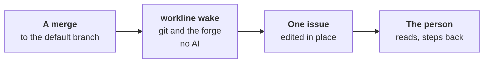

# The wake



After each merge, the wake prints where the line may be drifting
([ADR-0068 §8](adr/0068-the-line-steps-back-on-its-own-drift.md#8-the-wake-script-print-only)).

- **Print only**: it never fails a check, never holds a merge, never
  calls an agent. A trigger met exits 0.
- **Facts, not judgement**: each trigger is read from files and the
  forge, never from a title or a commit's type, which the judged choose.
- **Its limit**: a tripwire for honest drift; a mechanism hidden in
  existing code escapes it.

## The triggers

| Section | Printed when the merge… |
|---|---|
| Growth of the contract | adds or changes an ADR; adds a role, a setting of a role, a command, a rule code |
| Prompts that steer the line | changes a role's prompt (its words before → after), its `levels` table or its default level |
| Symptoms without cause | lands while one file is fixed by 3 merges in 14 days; an issue a merge closed is open again, or closed by two merges |
| Laundered needs | merges a merge request that closes no issue |
| Nobody bypasses | merges a head without the App's `workline/accepted` (with a `merge:` policy); follows a change of the default branch's ruleset |
| The cord | finds the label `step-back` on an open issue or merge request |

- **A fix** is a merge closing an issue the forge labels a bug: `bug`,
  or a scoped one ending so (`type::bug`).
- **A prompt** is a Markdown file in a role's folder, `roles/<name>/`,
  its README and `docs/` left out.
- **The contract** is read as workline lays it out: `roles/*/role.yaml`'s
  `settings`, `{name: "…"}` under `cmd/`, `Rule: "…"` in Go. A project
  laid out otherwise gets its ADRs and the forge's triggers.

## The issue

- **One issue**, *workline: where the line may be drifting*, opened when
  something is listed; edited in place when what it lists changes;
  never commented on.
- **Each trigger is kept 7 days**, the newest read of it: someone
  reading once a week reads each one.
- **The cord**: anyone, a person or a role, puts `step-back` on an issue
  or a merge request; the next merge lists it. The wake makes the label
  when it is missing.
- **What was not read** is said under *Not read*, never taken for
  nothing found: no forge, a read refused. Closing links unread, no
  merge is said to close none; its issue unread, the issue is left as it
  is.

## Run it

```sh
workline wake                                      # HEAD's first parent..HEAD, git alone
workline wake --forge github --range <before>..<after>
workline wake --forge github --range <before>..<after> --issue   # keep the issue
```

- **`--forge none`**, or no forge set: git's triggers alone; the
  forge's are said unread.
- **`--json`**: what it read, as data.
- **On GitHub**: the job `wake` of
  [workline-apply.yml](../.github/workflows/workline-apply.yml), on a
  push to `main`, with `issues: write`, `pull-requests: read` and
  `statuses: read`; the App's token when there is one.
- **GitLab and other CI**: the same command after a push to the default
  branch, `--forge gitlab`; GitLab keeps no `workline/accepted`, so that
  trigger is not read there. Not in the templates yet.

## Cost

- **No agent, no token** of a model
  ([ADR-0051](adr/0051-a-check-sits-where-its-catch-is-worth-its-cost.md)).
- **Forge reads**: the merges of 14 days (a page of 100 a call), their
  closing issues (50 merge requests a call on GitHub, one each on
  GitLab), the label, the rulesets, the statuses of the merged heads.
  About 15 s on workline's history.
