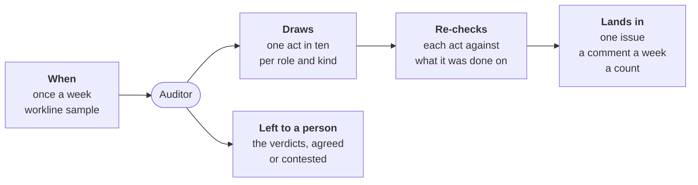

# Auditor

For people: what the role does and how to set it. The AI never reads this
file. All roles: [docs/roles.md](../../docs/roles.md).

**Does**:

- draws, each week, one in ten of every role's acts done alone, per kind:
  the docs whose `checked` the documentalist moved, the product owner's acts, the
  reviewer's judged findings, the committer's rewrites, the tester's
  acts, the developer's code;
- asks a judge, one call an act, whether the act holds against what it
  was done on; its question is a file per kind of act, its criteria;
- calls an act false only with a quote of the material that the engine
  finds again; else the act is listed for a person;
- settles a dispute with a panel of three judges;
- keeps the verdicts and counts them, and opens an issue for a true
  finding the judge dropped.

**Does not**:

- run on an event: no hook nor merge request wakes it, `workline sample`
  does, weekly;
- apply anything: a false `checked` is put back by a merge request a
  person reviews;
- read on a model that acted: the judge is the best independence
  available ([ADR-0005](../../docs/adr/0005-independence-takes-the-best-level-available.md));
- speak for a person: their 👍 or 👎 on the week's comment is theirs
  ([ADR-0068 §7](../../docs/adr/0068-the-line-steps-back-on-its-own-drift.md#7-a-persons-yes-is-assisted-never-delegated)).

## When, what it costs

- **When**: weekly, scheduled by the forge's CI
  ([how to schedule it](../../docs/weekly-sample.md)), or by hand with
  `workline sample`.
- **Outputs**: one issue, a comment a week with its acts numbered, and a
  count rewritten from every week.
- **Without AI**: what is drawn is listed for a person, with no verdict.
- **Cost**: one call an act, a week capped by `ai-max-tokens`
  ([what it costs](../../docs/weekly-sample.md#what-it-costs)).
- **Status**: [beta](../../docs/adr/0036-a-roles-status-is-earned-by-written-criteria.md);
  [where it stands](docs/status.md); each try in its pull request.

## Settings

- **Where**: the weekly sample's settings sit under `sample:` in the
  documentalist's `settings` in `.workline/config.yaml`
  ([config reference](../../docs/config.md)).
- **Who reads**: `judge`, an `--ai` value, and `at-least`, the
  independence it must have; `panel`, the three judges of a dispute
  ([who reads](../../docs/weekly-sample.md#who-reads)).
- **Which acts**: `after`, to leave out what was checked before a
  commit ([settings](../../docs/weekly-sample.md#settings)).
- **Cap**: `ai-max-tokens`, the tokens a week may spend
  ([what it costs](../../docs/weekly-sample.md#what-it-costs)).
- **Every key**, and the week and the judge:
  [the weekly sample](../../docs/weekly-sample.md#settings).

## More

- [The weekly sample](../../docs/weekly-sample.md): who reads, what it
  writes, the week's tokens.
- [Where it stands](docs/status.md): the criteria to leave beta, what is
  built, what is missing.
- [ADR-0046](../../docs/adr/0046-the-auditor-re-checks-every-roles-acts.md):
  why every role's acts are drawn, and how the verdicts are counted.
