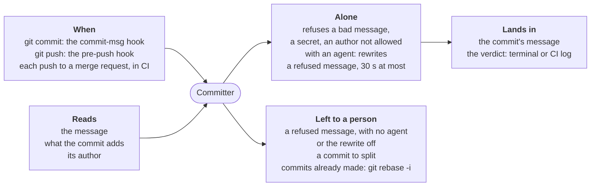

---
sources:
  - roles/committer/role.yaml
  - defaults/routing.yaml#events
  - cmd/workline/main.go#hookCmd
  - cmd/workline/main.go#prePush
  - internal/builtin/committer/committer.go#Pre
  - internal/builtin/committer/committer.go#checkRange
checked: c46a93d6c
verified: agent:claude-code
judged-in-parts: eb16524
---
# Committer

For people: what the role does and how to set it. The AI never reads this
file. All roles: [docs/roles.md](../../docs/roles.md).

**Does**: checks each commit message (format, length, internal codes), the
secrets and forbidden terms a commit adds (gitleaks) and the author's
identity; with an agent, has it rewrite a refused message in your words,
30 s at most.
**Does not**: check that a commit holds one change (planned:
[#192](https://github.com/JN0V/workline/issues/192)), split a commit, edit
code, rewrite commits already made (on a merge request it lists them, for
`git rebase -i`), or ask an agent about a message that passes.

| Event | Fired by | Checks |
|---|---|---|
| `commit-msg` | the global git hook (`workline hooks install --global`) | the message being written, what the commit adds |
| `pre-push` | the global hook, when `.workline/config.yaml` routes it | every commit pushed |
| `merge-request` | CI (`workline route merge-request --input range=<base>..<head>`) | every commit of the range; [the subject a squash lands](docs/squash-title.md) |

The global hook still hands over to the hooks installed before workline
([workline hooks](../../docs/commands-setup.md#workline-hooks)).

## Settings

Under `roles: {committer: {settings: …}}` in `.workline/config.yaml`
([config reference](../../docs/config.md)); defaults from role.yaml. The
last three, also in [your own config](../../docs/config.md#your-own-config),
a list there adding to the project's:

| Key | Default | |
|---|---|---|
| `subject-max` | `72` | characters in the subject |
| `body-max-lines` | `12` | body lines, comments, blanks and trailers aside |
| `types` | `feat fix docs test refactor perf build ci chore revert` | allowed types |
| `internal-codes` | `\b[A-Z]{1,4}(-NEW)?-[0-9]+\b` | codes refused in the subject |
| `internal-codes-maybe` | `\b[A-Za-z]{1,3}[0-9]{2,}\b` | codes with no dash, judged |
| `allowed-identities` | `[]` | author addresses allowed, as patterns; empty with no user list: not checked |
| `forge-identities` | `[]` | addresses the forge commits with, written whole: allowed, never turning the check on alone |
| `rewrite` | `true` | an agent rewrites a refused message at a commit ([rewrite](docs/rewrite.md#rewrite-the-agent-30-s-at-most)) |
| `ai-max-seconds` | `30` | the rewrite's time, every call together: past it, refused with the reasons |
| `internal-codes-allow` | `UTF-8`, `SHA-256`, `RFC-…`, `v1`, the `ESP32` and `ESP8266` chips… | public names that look like codes |

`enforce: {<rule>: warn}` (or `off`) beside `settings` softens one rule
([config reference](../../docs/config.md)).

**Outputs**: the verdict on the terminal or in the job's log; `--json`,
`--sarif`, `--code-quality` in CI ([options](../../docs/usage.md#options-of-run-role-and-route)).
It writes nothing to a forge.
**Cost**: no call when the message passes; one call of a light model,
effort low, per refused message, and one more of a stronger model if the
rewrite is refused (`promote-after: 1`), within `ai-max-seconds`.
**Status**: [built](../../docs/adr/0036-a-roles-status-is-earned-by-written-criteria.md),
used daily here since 2026-09 ([where it stands](docs/status.md)).

## In detail

- [The checks](docs/checks.md): the message's rules, run with no agent;
  [the squash title](docs/squash-title.md) on a merge request.
- [Secrets and identity](docs/secrets.md): gitleaks on what a commit
  adds and says, the term lists, the author's address.
- [The rewrite](docs/rewrite.md): the agent, 30 s at most, and how its
  message is judged.

## Tried for real

- **The rewrite**, 2026-09-24: four messages of this repository the hook
  had refused, replayed with their diff and Claude (haiku). Until the
  instruction asked to keep the author's words, rewrites traded precise
  words for vague ones ("specify" became "test"); after, twice in a row,
  each kept the type, the scope and the words, and only cut.
- **The hooks**, 2026-10-06: a copy of a real repository with its own
  `core.hooksPath`, no agent. doctor said `hooks-bypassed` and printed the
  line to add, or the `git config --local --unset core.hooksPath` to run;
  done, `AC-3 fix the thing` was blocked (`internal-code`, `format`). Not
  tried: a hook reading `pre-push`'s input after workline's line; husky or
  lefthook themselves.
- **Daily use**: up to 2026-10-09, the maintainer ran it on all their
  commits, and validated the role from that use.
