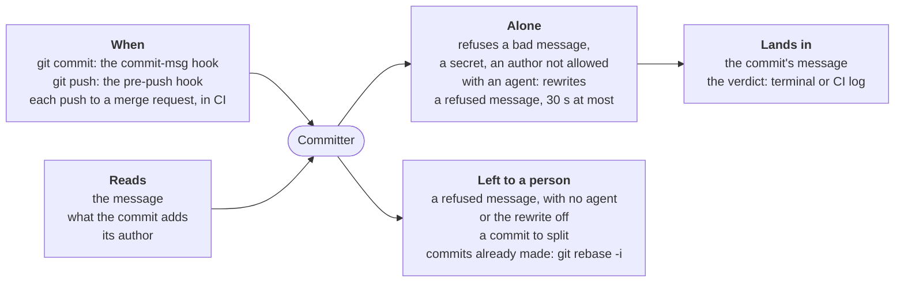

# Committer

For people: what the role does and how to set it. The AI never reads this
file. All roles: [docs/roles.md](../../docs/roles.md).

**Does**: checks each commit message (format, length, internal codes), the
secrets and forbidden terms a commit adds (gitleaks) and the author's
identity; with an agent, has it rewrite a refused message in your words,
30 s at most.
**Does not**: check that a commit holds one change (planned:
[#192](https://github.com/JN0V/workline/issues/192)), split a commit, edit
code, rewrite commits already made (on a merge request it lists them, for
`git rebase -i`), or ask an agent about a message that passes.

| Event | Fired by | Checks |
|---|---|---|
| `commit-msg` | the global git hook (`workline hooks install --global`) | the message being written, what the commit adds |
| `pre-push` | the global hook, when `.workline/config.yaml` routes it | every commit pushed |
| `merge-request` | CI (`workline route merge-request --input range=<base>..<head>`) | every commit of the range |

The global hook still hands over to the hooks installed before workline.

## Settings

Under `roles: {committer: {settings: …}}` in `.workline/config.yaml`
([config reference](../../docs/config.md)); defaults from role.yaml. The
last three, also in [your own config](../../docs/config.md#your-own-config),
a list there adding to the project's:

| Key | Default | |
|---|---|---|
| `subject-max` | `72` | characters in the subject |
| `body-max-lines` | `12` | body lines, comments, blanks and trailers aside |
| `types` | `feat fix docs test refactor perf build ci chore revert` | allowed types |
| `internal-codes` | `\b[A-Z]{1,4}(-NEW)?-[0-9]+\b` | codes refused in the subject |
| `internal-codes-maybe` | `\b[A-Za-z]{1,3}[0-9]{2,}\b` | codes with no dash, judged |
| `allowed-identities` | `[]` | author addresses allowed, as patterns; empty with no user list: not checked |
| `forge-identities` | `[]` | addresses the forge commits with, written whole: allowed, never turning the check on alone |
| `rewrite` | `true` | an agent rewrites a refused message at a commit ([below](#rewrite-the-agent-30-s-at-most)) |
| `ai-max-seconds` | `30` | the rewrite's time, every call together: past it, refused with the reasons |
| `internal-codes-allow` | `UTF-8`, `SHA-256`, `RFC-…`, `v1`, the `ESP32` and `ESP8266` chips… | public names that look like codes |

`enforce: {<rule>: warn}` (or `off`) beside `settings` softens one rule.

**Outputs**: the verdict on the terminal or in the job's log; `--json`,
`--sarif`, `--code-quality` in CI. It writes nothing to a forge.
**Cost**: no call when the message passes; one call of a light model,
effort low, per refused message, and one more of a stronger model if the
rewrite is refused (`promote-after: 1`), within `ai-max-seconds`.
**Status**: [built](../../docs/adr/0036-a-roles-status-is-earned-by-written-criteria.md),
used daily here since 2026-09 ([where it stands](docs/status.md)).

## Check (`pre`, no AI)

On `commit-msg` (the git hook), the message being written; on `merge-request`
and `pre-push`, every commit of the range given as `--input range=<base>..<head>`
(the pre-push hook gives the commits being pushed).

| Rule | Refuses |
|---|---|
| `format` | a subject that does not read `type(scope): summary`, with a type from `types` |
| `blank-after-subject` | a second line that is not empty: git would read it as part of the subject |
| `subject-length` | a subject over `subject-max` characters (72) |
| `body-length` | a body over `body-max-lines` lines (12), not counting comments, blank lines and trailers |
| `internal-code` | a reference that means nothing outside the project (`AC-3`) in the subject; it belongs in a trailer (`Refs: AC-3`) |
| `possible-internal-code` | a code with no dash (`F207`), as often a public name (`nRF52`): the agent judges it |

- `internal-codes-allow` lists public names that look like an internal
  code (`SHA-256`, `RFC-1234`); a refusal gives the line that lets one
  through, yours or the project's. The [reviewer](../reviewer/README.md)
  reads the same lists in the comments a change adds.
- `internal-codes-maybe` holds the patterns of codes with no dash. The
  agent may keep one; without AI it blocks; on commits already made, it is
  only a warning.

Messages git writes itself (`Merge …`, `Revert "…"`, `fixup! …`, `squash! …`,
`amend! …`) are not checked. A message that passes asks no agent.

### Secrets and forbidden terms

- **What the commit adds** (on `commit-msg`), or every commit of the
  range, is scanned with [gitleaks](https://github.com/gitleaks/gitleaks),
  before the message: no rewrite fixes a secret, so a `leak` blocks without
  asking the agent, at its file and line.
- **The message** is scanned too (`gitleaks stdin`), without what git
  strips from it (comments, the diff of `commit -v`): a `leak` there names
  its line, and the agent is not asked either, since the message would
  carry the match to it. A rewrite is scanned like the message it replaces.
- The two scans run side by side: a commit waits for one, about 0.4 s.
- The match is never printed. Without gitleaks, the commit goes on and the
  verdict says so (`secrets-not-checked`).

gitleaks' own rules find secrets. Terms that must never reach a repository
are rules of the user's, in lists kept outside it, gitleaks taking the first
config it finds:

1. `GITLEAKS_CONFIG` or `GITLEAKS_CONFIG_TOML`, when set;
2. the repository's `.gitleaks.toml`, gitignored: this repository's terms,
   which may extend the common list (`[extend] path = "…"`);
3. the common list, `workline/gitleaks.toml` in the user's config folder
   (`~/.config/` on Linux), which extends gitleaks' rules
   (`[extend] useDefault = true`);
4. gitleaks' rules alone.

A rule's id is printed: name no term in it. gitleaks lets
its own config through, so the committer refuses a commit adding a private
`.gitleaks.toml` — gitignored, or a link — (`term-list-staged`); one a
project commits to share its allowlist is not private.

### Identity

An author or committer address outside the allow list blocks (`identity`).

- **Checked**: the one git will record, on `commit-msg` — `git var`, so an
  address given for one commit (`-c user.email`, `--author`) is caught too
  — and those of every commit of the range. An empty address is refused.
- **The list**: the project's `allowed-identities` setting (patterns;
  noreply addresses, for a public repository) and the user's own, one
  pattern a line, in `workline/allowed-identities` in their config folder.
  Both empty, identities are not checked, and nothing is said.
- **The forge's own commits**: the project's `forge-identities` names the
  addresses its forge commits with — on GitHub, its App's bot
  (`<id>+<app>[bot]@users.noreply.github.com`) and the web's merges
  (`noreply@github.com`) — so a user's list lets them through
  ([#107](https://github.com/JN0V/workline/issues/107)). Each is matched
  exactly, case included, never as a pattern; alone, they never turn the
  check on.

## Rewrite (the agent, 30 s at most)

- **On by default**, with an agent
  ([ADR-0050](../../docs/adr/0050-each-act-has-its-moment-and-a-wait-budget.md)):
  the agent gets the findings and the staged diff, and proposes one
  `commit-message`, or a `note` to split the commit.
- **30 s at most**: the hook says which agent rewrites, and how long at
  most, before it starts. Past `ai-max-seconds`, every call and retry
  together, the message is refused with its reasons, and kept.
- **Its seconds said**: `14 s in all — committer 14 s (rewrite 13 s)`;
  over its 30 s, [said once](../../docs/spec/routing.md#each-steps-seconds-a-moments-budget);
  each call's in its run's `out/calls.jsonl`.
- **`rewrite: false`**, the project's or yours, turns it off; so does a
  project's `ai: none`, and no agent at all. The hook then refuses in about
  a second, keeps your message in the file git named, and prints
  `git commit -e -F <that file>` to take it up again.

## Judge (`post`, no AI)

- The rewrite must pass the same checks, but `possible-internal-code`: the
  agent judged it.
- It must keep every trailer of the original (`Co-Authored-By:`, `Refs:`…), on
  its own line in the last paragraph (`trailer-dropped`).
- A rewrite keeps the author's type, scope and breaking mark, when the header
  was not what was refused; adding a scope the author left out is allowed
  (`header-changed`).
- It adds no line git could read as a `Workline-` trailer, however its
  key is cased or spaced: those are the engine's (`trailer-added`).
- One commit, one message: several proposals are refused (`several-messages`).
- A `note` ends the run as `human`: a person splits the commit.

A refused rewrite is asked once more, of a stronger model (`promote-after: 1`).
A rewrite that passes replaces the message, and the commit goes on; the hook
prints the message committed, since it is no longer the one you wrote.

- **It says it is a rewrite**: the engine adds `Workline-Role: committer`
  and `Workline-Model: <agent>:<model>` to its trailers, so the
  [weekly sample](../../docs/ci.md#the-weekly-sample) draws it
  ([ADR-0046](../../docs/adr/0046-the-auditor-re-checks-every-roles-acts.md)).
- **Never your words**: nothing of the message it replaced reaches the
  commit, its internal codes above all.
- **Still your commit**: workline never takes a rewritten commit for one
  it made itself; the line judges it as yours.

## Tried for real

- **The rewrite**, 2026-09-24: four messages of this repository the hook
  had refused, replayed with their diff and Claude (haiku). Until the
  instruction asked to keep the author's words, rewrites traded precise
  words for vague ones ("specify" became "test"); after, twice in a row,
  each kept the type, the scope and the words, and only cut.
- **The hooks**, 2026-10-06: a copy of a real repository with its own
  `core.hooksPath`, no agent. doctor said `hooks-bypassed` and printed the
  line to add, or the `git config --local --unset core.hooksPath` to run;
  done, `AC-3 fix the thing` was blocked (`internal-code`, `format`). Not
  tried: a hook reading `pre-push`'s input after workline's line; husky or
  lefthook themselves.
- **Daily use**: up to 2026-10-09, the maintainer ran it on all their
  commits, and validated the role from that use.
