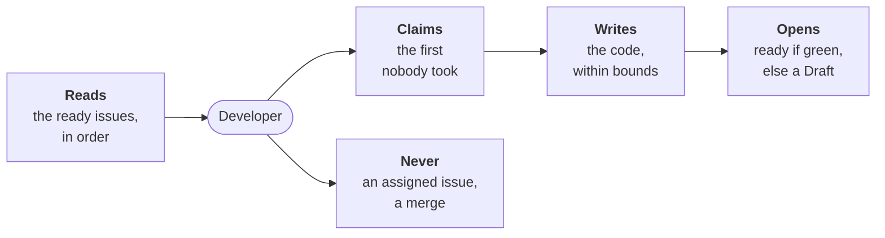

---
sources:
  - roles/developer/role.yaml
  - ci/github/workline-develop.yml
  - internal/developer
checked: aea0b546
verified: agent:claude-code
---
# Developer



For people: what the role does and how to set it. The AI never reads this
file. All roles: [docs/roles.md](../../docs/roles.md). Where it stands:
[status](docs/status.md); its design:
[ADR-0054](../../docs/adr/0054-the-developer-takes-a-ready-issue-to-a-pull-request.md).

**Does**, today (the eight steps of the
[build plan](../../docs/adr/0054-the-developer-takes-a-ready-issue-to-a-pull-request.md#build-plan)):

- **Picks** the first ready issue in the backlog's order that nobody
  took: [the pick](docs/pick.md).
- **Claims** it, with an agent set: a label and a comment on the issue,
  the record the [auditor](../auditor/role.yaml) can read; its card to
  the board's doing column ([boards](../../docs/boards.md)).
- **Writes the code**, with an agent, in a worktree of the code: it
  reads, edits and runs the tests there ([the agent](docs/agent.md)).
  Its diff is held to its bounds: a file outside the Scope, a frozen
  acceptance test, a file that steers agents or a gate's are reverted,
  no agent judging; on its pull request, the same bounds are a check,
  whoever pushed ([the bounds](docs/bounds.md)). A test that does not
  fit, it objects to on the tester's Draft.
- **Proves it** on the project's tests, the tester's `test-command`,
  then opens its pull request: ready when green with no cap reached,
  else a Draft ([the proof and the caps](docs/proof.md)).
- **Opens it on the tester's Draft**, the acceptance tests with it,
  its code and tests in commits apart, its record hidden on it; in CI,
  the agent holds no forge token ([the pull request](docs/pull-request.md)).
- **Runs when routed**: when an issue is labelled ready, and on the
  schedule ([the triggers](docs/triggers.md)).
- **Fixes the review** of its pull request, a fresh run a verdict or
  a person's comment; the five whys at round three, a person past
  round five ([the review loop](docs/review-loop.md)).
- **Its fixes merge alone** at the merge policy's `normal`, every gate
  passed; a feature waits for a person's yes. The issue's labels tell
  which, never the agent ([the merge](docs/merge.md)).
- **With no agent**: names the issue it would take; claims nothing.

**Measured** on planted issues and a copy of a real repository:
[where it stands](docs/status.md#measured).

**Never**: merge, approve, put `workline:accepted`, unassign a person,
close or move an issue.

## Run it

```sh
workline develop --ai none           # names the issue it would take
workline develop --ai claude         # claims it, writes the code; any agent: claude, cmd:<command>
workline develop --issue 42 --ai none
workline develop --merge-request 7 --ai claude   # a review round on its pull request
workline develop --bounds --merge-request 7      # its bounds on its pull request, no agent
```

- **`--ai`**: the agent is a choice: none, `claude`, `cmd:<any
  command>`; the project's `ai` setting by default. What each gets:
  [the agent](docs/agent.md).
- **`--forge`**: GitHub, GitLab, the local forge or a command's; the
  project's `forge` setting by default.
- **In CI**: route it on `issue` and `schedule`; the GitHub and GitLab
  templates run it, and a review round on its pull request
  ([the triggers](docs/triggers.md)).

## Run it locally

Each run with an agent says once, in its output and in the pull
request's description:

> the agent runs with your account's rights; the forge's guards decide what merges

- **What it means**: the agent works as you, as your own coding agent
  does: your files, your git credentials, your forge login.
- **What still guards the project**: the default branch's protection,
  its required checks, the review and the merge policy
  ([ADR-0058](../../docs/adr/0058-the-forge-guards-the-project-not-the-agents-environment.md)).
  A pull request with your commits waits for your yes.
- **Set those guards first**: an unprotected default branch is as open
  to the agent as to you.
- **In CI**, it says the CI job's rights instead: what the job's token may do, the CI config decides.

## Settings

In `.workline/config.yaml`, under `roles: {developer: {settings: …}}`:

| Setting | Default | What it does |
|---|---|---|
| `claim-label` | `workline:developing` | the label that says the developer took an issue |
| `ai-max-tokens` | 300000 | what a run's agent calls may spend; reached, a Draft |
| `ai-max-turns` | 100 | the turns one call of its agent may take; reached, a Draft |
| `ai-max-seconds` | 1200 | what a run waits on its agent, then kills it; reached, a Draft |
| `proof-seconds` | 600 | how long the project's tests may run on its code; past it, a Draft |
| `proof-command` | none | the tests on the folders its change touches, `{packages}` in it; none, the whole suite ([the proof](docs/proof.md#what-runs)) |
| `review-rounds` | 5 | the review rounds it runs on its pull request |
| `person` | `workline:human` | the label its pull request gets past the last round |

The tests it runs are the tester's `test-command` and `test-report`
([the tester](../tester/README.md)), or `proof-command` on the touched
folders. In CI, the judge job takes the project's setup steps first
([the triggers](docs/triggers.md#the-projects-environment)).

## Cost

- **The pick, the bounds and the proof**: no agent, no token; one listing of the
  open issues and one of the open merge requests.
- **The code**: one agent call a run, `ai-max-tokens` at most.
- **The proof**: one run of the project's tests, `proof-seconds` at most.
