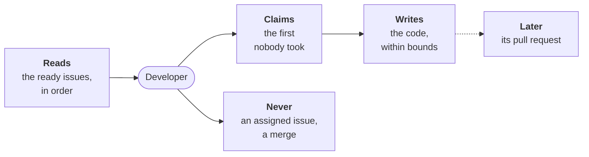

---
sources:
  - roles/developer/role.yaml
  - internal/developer
checked: 9d472ac7
verified: agent:claude-code
---
# Developer



For people: what the role does and how to set it. The AI never reads this
file. All roles: [docs/roles.md](../../docs/roles.md). Where it stands:
[status](docs/status.md); its design:
[ADR-0054](../../docs/adr/0054-the-developer-takes-a-ready-issue-to-a-pull-request.md).

**Does**, today (steps 1 and 2 of the
[build plan](../../docs/adr/0054-the-developer-takes-a-ready-issue-to-a-pull-request.md#build-plan)):

- **Picks** the first ready issue in the backlog's order that nobody
  took: [the pick](docs/pick.md).
- **Claims** it, with an agent set: a label and a comment on the issue,
  the record the [auditor](../auditor/role.yaml) can read.
- **Writes the code**, with an agent, held to its bounds: a file
  outside the Scope, a frozen acceptance test, a file that steers
  agents or a gate's are refused, no agent judging
  ([the bounds](docs/bounds.md)). A test that does not fit, it objects
  to on the tester's Draft.
- **With no agent**: names the issue it would take; claims nothing.

**Does not, yet**: prove the Verification, open the pull request, fix
the review's findings (steps 3 to 6). The code lands in the working
tree.

**Never**: merge, approve, put `workline:accepted`, unassign a person,
close or move an issue.

## Run it

```sh
workline develop --ai none           # names the issue it would take
workline develop --ai claude         # claims it, writes the code; any agent: claude, cmd:<command>
workline develop --issue 42 --ai none
```

- **`--forge`**: GitHub, GitLab, the local forge or a command's; the
  project's `forge` setting by default.
- **In CI**: not routed yet; the triggers are step 5.

## Settings

In `.workline/config.yaml`, under `roles: {developer: {settings: …}}`:

| Setting | Default | What it does |
|---|---|---|
| `claim-label` | `workline:developing` | the label that says the developer took an issue |

## Cost

- **The pick and the bounds**: no agent, no token; one listing of the
  open issues and one of the open merge requests.
- **The code**: one agent call a run, `ai-max-tokens` at most.
