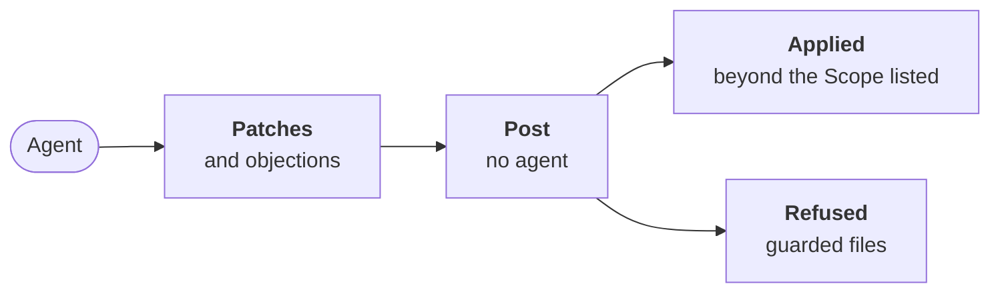

---
sources:
  - roles/developer/code/bounds.go
  - internal/work/scope.go
  - roles/developer/code/developer.go
  - roles/developer/code/worktree.go
  - roles/developer/code/words.go
  - roles/developer/code/prbounds.go
  - defaults/ci/github/workline-bounds.yml
  - defaults/ci/gitlab/workline-bounds.gitlab-ci.yml
  - internal/steer/steer.go
  - internal/kit/devmark
checked: 7c650fc50
verified: agent:claude-code
---
# The bounds: what its code may never touch

Part of [the developer](../README.md). Step 2 of
[ADR-0054's plan](../../../docs/adr/0054-the-developer-takes-a-ready-issue-to-a-pull-request.md#what-bounds-it).

The issue's Scope is a hint, not a fence
([ADR-0065, change 2](../../../docs/adr/0065-code-only-what-converges-language-knowledge-in-packs.md#2-scope-as-paths-a-hint-not-a-fence)):
a file beyond it is applied and listed on the pull request
([below](#beyond-the-scope)). Only guarded files are refused.

## What it checks

The agent proposes patches, or edits a worktree
([below](#a-worktree-its-diff-is-the-code)). The engine's judge step,
with no agent, checks each file a patch touches, in this order. The
first rule that matches refuses the whole patch, whatever the Scope:

| Rule | The file is… |
|---|---|
| `outside-repo` | a path out of the repository (`../x`, `/etc/x`) |
| `gate-file` | under `.workline/`, `.github/workflows/`, `.github/actions/`, `.gitlab/ci/`, or `.gitlab-ci.yml`; a script a gate's check runs; a check's `config` |
| `steering-file` | a path the project's `CODEOWNERS` lists, the files that define oversight ([what never merges alone](../../../docs/merge-policy-normal.md#what-never-merges-alone)); an agent file (AGENTS.md, CLAUDE.md…); with no `CODEOWNERS`, a page an agent file links to or imports |
| `acceptance-test-edit` | a test the tester froze on its open Draft ([the hand-over](../../tester/docs/hand-over.md)) |

Another role's prompt, a role's folder, a file named a prompt are
applied: the reviewer reads them
([ADR-0068 §4](../../../docs/adr/0068-the-line-steps-back-on-its-own-drift.md#4-the-guard-is-guarded)).

Any other file is applied. One the Scope does not hold, as read next,
is beyond it: listed, never refused.

**What the Scope holds**: its paths and globs, the product owner's
`sources`, and the tests beside them, new ones too:
[what the Scope holds](bounds-scope.md).

**Every patch refused** when the engine cannot read the gates' config
or the files that steer agents (`bounds-unread`), the error said,
rather than one let past.

A patch naming no file, or a diff header whose two names cannot be told
apart with no other line naming them, is refused (`patch-unread`).
A rename or a deletion is checked on both sides, a name git quotes read
back. A gate's `config`
path is compared cleaned (`./x`, `x/`); a folder covers its files.

## A worktree: its diff is the code

Its agent works in a worktree
([ADR-0056](../../../docs/adr/0056-the-developers-agent-works-in-a-sandbox-with-tools.md);
what each agent gets: [the agent](agent.md)).

- **Where**: the commit its code starts from (the tester's Draft, or
  the commit read), checked out in the run's folder. The agent runs
  there, its path in `WORKLINE_WORKTREE`, and edits in place.
- **Never under `.git/`**: a run's folder there (the default, no
  `WORKLINE_RUNS_DIR`) has its worktree in a temporary folder of its
  own, its path in the run's `worktree.at`: Claude Code edits no file
  under `.git/` ([#1304](https://github.com/JN0V/workline/issues/1304)).
  An interrupted run's tree is removed with its run, 50 runs later.
- **What is taken**: the diff against that commit, new files in,
  whatever the agent committed, a deleted file a deletion; one patch a
  file, held to the rules above. A file's mode is not read: an
  executable script edited keeps its mode
  ([#1330](https://github.com/JN0V/workline/issues/1330)).
- **Not its code**: the empty files `claude` creates for its sandbox
  (`.env*`, `package.json` and 15 more), removed once it ran
  ([the agent](agent.md#claude)). An empty file the agent writes, such
  as an `__init__.py`, stays its code.
- **Refused before the rules**: a link out of the tree
  (`symlink-out`); another link, a binary, a submodule (`not-text`).
- **Reverted**: a refused file leaves nothing. The worktree stays
  while the agent may be asked again, then the engine removes it,
  whatever post did; only what passes the bounds goes on.

## On the pull request

The same rules hold on its pull request, as a check on the agent's
commits; a guarded file only a person's commits changed does not block:
[the bounds on the pull request](bounds-check.md).

## Why these rules

- **Gate files**: a gate checks the code; the code's author never
  changes what checks it. Only a person does.
- **Steering files**: they steer every agent, the developer's too.
  Whatever the Scope says, a person changes them.
- **Frozen tests**: the tester wrote them from the issue's scenarios,
  before the code ([ADR-0055](https://github.com/JN0V/workline/pull/648)).
  The developer objects; it never edits them.
- **No fence on the Scope**: the Scope is written before the code; the
  files a change needs are the developer's to find, as a human
  developer's are. An edit off the task is judged by the reviewer, and
  belongs in another issue
  ([principle 8](../../../docs/PRINCIPLES.md)); why, in
  [ADR-0065](../../../docs/adr/0065-code-only-what-converges-language-knowledge-in-packs.md#why-the-fence-goes).

## Beyond the Scope

The developer owns the files: a change may need one the product owner
did not foresee, a build file, a test fake, a helper
([ADR-0065, change 2](../../../docs/adr/0065-code-only-what-converges-language-knowledge-in-packs.md#2-scope-as-paths-a-hint-not-a-fence)).

- **Applied**: never refused, never asked of the product owner; no
  `workline:scope-ask`. A change bigger than its issue is a size
  question ([ADR-0064](../../../docs/adr/0064-size-is-a-target-not-a-wall.md)).
- **Its reason**: the agent writes one line for each such file in its
  worktree's `.workline/beyond.yaml`, `path: why`, as
  [its question](agent.md) says; the file never reaches the branch.
- **Listed**: under `## Beyond the Scope` on the pull request, each
  file with its reason, or "no reason given by its agent"; a review
  round lists its own in its commit's message and its comment. The
  verdict says them (`beyond-scope`, info); the record keeps them.
- **Judged**: the reviewer's
  [`intent` lens](../../reviewer/prompts/lenses/intent.md) reads the list and
  flags a file off the task; the auditor samples the lists
  ([ADR-0046](../../../docs/adr/0046-the-auditor-re-checks-every-roles-acts.md)).
- **Before**: a file outside the Scope was refused, and the step asked
  the product owner to widen it. An issue still blocked by such an ask
  is read as before.

## What happens to a refusal

- **Left out**: the refused patch is not applied; the others are.
- **Said**: a `warn` finding for each file, named by its rule.
- **Recorded**: the claim's comment lists each file and why; its record
  keeps `refused: [{file, rule}]`, for the [auditor](../../../docs/adr/0046-the-auditor-re-checks-every-roles-acts.md).
- **A person's file**, a gate's, one that steers agents, not text:
  named on top of its pull request, under
  [Left for a person](pull-request.md#its-body).

## What else it refuses

- **Labels and comments of the agent's** (`not-the-developers`): the
  claim is the engine's; it never accepts, merges, closes or moves an
  issue. Two comments are allowed: an objection, one note.
- **An objection** to a frozen test. The agent
  writes the test, its line, the scenario, the kind and why in its
  worktree's objections file, as [its question shows](agent.md); the
  file never reaches the branch. The engine
  posts it on that line of the tester's Draft, opened by
  `workline:objection`, in [the tester's form](../../tester/docs/objections.md).
  The tester keeps or rewrites the test.
- **The scenario is the issue's**
  ([#913](https://github.com/JN0V/workline/issues/913)): the question
  lists the Validation's scenario names in the file's form, and which
  test covers which, as the tester declared them. A test's id the
  tester declared (`CartTest.addsItem`) is posted on the scenario it
  covers, whatever its name; a test's name maps by nothing else, and an
  objection naming no scenario is not posted, said: the tester could
  not read it
  ([ADR-0065](../../../docs/adr/0065-code-only-what-converges-language-knowledge-in-packs.md#4-the-agent-says-which-test-covers-which-scenario)).
- **One comment per test and line**: an objection still open on its
  line is not posted twice; one on another line of the same test opens
  its own. The developer's comment on the Draft counts those posted
  and those still open.
- **An objection to a test that is not frozen** for the issue, or
  missing a field, or when the Draft's commit cannot be read: refused,
  said.
- **One note on its own issue**: what the agent left out, plain text
  naming no issue included. Posted there once, made inert (no heading,
  tag or mention), cut to 4,000 bytes; the same text in the pull
  request's `## Left out` ([the pull request](pull-request.md)). A
  second note, or one elsewhere, is refused (`not-the-developers`).

## Not yet

- **A refused patch beside kept code is not asked again**: the code is
  applied without it, the refusal said; the proof (step 3) shows what
  is missing.
- **Where the code goes**: a branch of its own, proven, opened ready
  or as a Draft ([the proof](proof.md)); a refused file is said in its
  `## Left out` ([the pull request](pull-request.md)).
