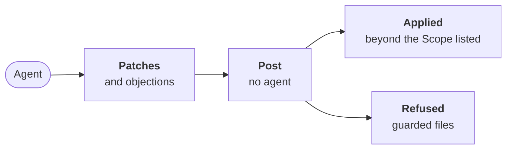

---
sources:
  - internal/developer/bounds.go
  - internal/work/scope.go
  - internal/developer/developer.go
  - internal/developer/worktree.go
  - internal/developer/words.go
  - internal/developer/prbounds.go
  - ci/github/workline-bounds.yml
  - ci/gitlab/workline-bounds.gitlab-ci.yml
  - internal/steer/steer.go
checked: 8ddc4e54
verified: agent:claude-code
---
# The bounds: what its code may never touch

Part of [the developer](../README.md). Step 2 of
[ADR-0054's plan](../../../docs/adr/0054-the-developer-takes-a-ready-issue-to-a-pull-request.md#what-bounds-it).

The issue's Scope is a hint, not a fence
([ADR-0065, change 2](../../../docs/adr/0065-code-only-what-converges-language-knowledge-in-packs.md#2-scope-as-paths-a-hint-not-a-fence)):
a file beyond it is applied and listed on the pull request
([below](#beyond-the-scope)). Only guarded files are refused.

## What it checks

The agent proposes patches, or edits a worktree
([below](#a-worktree-its-diff-is-the-code)). The engine's judge step,
with no agent, checks each file a patch touches, in this order. The
first rule that matches refuses the whole patch, whatever the Scope:

| Rule | The file is… |
|---|---|
| `outside-repo` | a path out of the repository (`../x`, `/etc/x`) |
| `gate-file` | under `.workline/`, `.github/workflows/`, `.github/actions/`, `.gitlab/ci/`, or `.gitlab-ci.yml`; a script a gate's check runs; a check's `config` |
| `steering-file` | a path the project's `CODEOWNERS` lists, the files that define oversight ([what never merges alone](../../../docs/merge-policy-normal.md#what-never-merges-alone)); an agent file (AGENTS.md, CLAUDE.md…); with no `CODEOWNERS`, a page an agent file links to or imports |
| `acceptance-test-edit` | a test the tester froze on its open Draft ([the hand-over](../../tester/docs/hand-over.md)) |

Another role's prompt, a role's folder, a file named a prompt are
applied: the reviewer reads them
([ADR-0068 §4](../../../docs/adr/0068-the-line-steps-back-on-its-own-drift.md#4-the-guard-is-guarded)).

Any other file is applied. One the Scope does not hold, as read below,
is beyond it: listed, never refused.

**What the Scope holds:**

- the paths and globs in backticks in the issue's Scope
  ([ADR-0065, change 2](../../../docs/adr/0065-code-only-what-converges-language-knowledge-in-packs.md#2-scope-as-paths-a-hint-not-a-fence)):
  - a path, a line after it taken off (`parts.go:943`); a bare file
    name read as the one tracked file whose path ends with it;
  - a glob as the files it matches, new ones too (`core/session/**`,
    `src/calc/*.sh`), never its whole folder;
  - a new file's path, on a line `New:` as the product owner writes it;
  - a path with a `/` only when it has a file's extension, ends with
    `/`, or its first folder is the repository's (`dorny/paths-filter`
    or `actions/checkout@v4.1`, an Action, holds nothing);
  - never a name alone: a class (`TracingViewModel`) or a module
    (`core:session`) holds no file. Its code is beyond the Scope;
- the paths in plain words in the Scope that the repository holds, a
  file or a folder (`docs/ci.md, internal/doctor`);
- the product owner's `sources` for the issue;
- the tests beside them, new or not: a test file in a Scope file's
  folder or under a Scope folder (`mul_test.go` beside `mul.go`). A
  test file is one the project's
  [one definition](../../tester/README.md#settings) names: the tester's
  `test-paths`, else the listed [packs'](../../../docs/packs.md) with
  the built-in generic patterns, else those alone
  ([ADR-0065](../../../docs/adr/0065-code-only-what-converges-language-knowledge-in-packs.md#3-one-definition-of-a-test-file)).
  A Scope `src` holds no test at the root;
- a new test file beside the Scope
  ([ADR-0063, §9](../../../docs/adr/0063-every-open-issue-is-due-waiting-or-done.md#9-the-developers-write-fence)):
  - a test file by that definition, not in the commit the rules are
    read at;
  - its home, its code's folder by the tester's `test-homes`, is a
    Scope path's folder, holds one, or is in one:
    `app/src/test/kotlin/x/FakeRepo.kt` beside a Scope
    `app/src/main/kotlin/x/Repo.kt`, with
    `{tests: "**/src/test/kotlin/**", code: "**/src/main/kotlin/**"}`;
  - unset, the listed packs' homes, then the generic ones: the folder
    holding its `test` or `tests` folder, else its own:
    `Storage/test/test_name/test_name.cpp` beside a Scope
    `Storage/include/Storage.h`;
  - a test the definition misses is code: beyond the Scope, listed;
    `workline doctor` says how to set `test-paths`;
  - one named like a class of the main code is beside it too: the
    reviewer's [`tests` lens](../../reviewer/lenses/tests.md) judges
    whether it replaces that class when the tests run (a JVM
    classpath);
  - the root is a home only to a Scope file at the root: a Scope
    `src/x.py` holds no `tests/test_x.py`;
  - a test written so stays beside the Scope in the next rounds, its
    record naming it, though the pull request's head holds it;
  - a folder pattern takes any new file under it: `*/test/**` takes a
    `test/CMakeLists.txt` or a `conftest.py` too; name files
    (`**/test_*.cpp`) for tests alone;
  - said and folded in: listed on the pull request and on the issue
    (`workline:scope-kept`), added to the Scope at the product owner's
    next refine;
  - an existing helper or fixture a frozen test may read, away from
    the Scope's folders, is never one: it is beyond the Scope; the
    reviewer checks a listed helper that sets up the test runner
    (Kotest's `ProjectConfig`): it changes how every test runs.

**Never in the Scope**: a Scope or source naming the repository's root
(`.`, `./`): it is dropped, else every file would be in it.

**Every patch refused** when the engine cannot read the gates' config
or the files that steer agents (`bounds-unread`), the error said,
rather than one let past.

A patch naming no file, or a diff header whose two names cannot be told
apart with no other line naming them, is refused (`patch-unread`).
A rename or a deletion is checked on both sides, a name git quotes read
back. A gate's `config`
path is compared cleaned (`./x`, `x/`); a folder covers its files.

## A worktree: its diff is the code

Its agent works in a worktree
([ADR-0056](../../../docs/adr/0056-the-developers-agent-works-in-a-sandbox-with-tools.md);
what each agent gets: [the agent](agent.md)).

- **Where**: the commit its code starts from (the tester's Draft, or
  the commit read), checked out in the run's folder. The agent runs
  there, its path in `WORKLINE_WORKTREE`, and edits in place.
- **Never under `.git/`**: a run's folder there (the default, no
  `WORKLINE_RUNS_DIR`) has its worktree in a temporary folder of its
  own, its path in the run's `worktree.at`: Claude Code edits no file
  under `.git/` ([#1304](https://github.com/JN0V/workline/issues/1304)).
  An interrupted run's tree is removed with its run, 50 runs later.
- **What is taken**: the diff against that commit, new files in,
  whatever the agent committed, a deleted file a deletion; one patch a
  file, held to the rules above. A file's mode is not read: an
  executable script edited keeps its mode
  ([#1330](https://github.com/JN0V/workline/issues/1330)).
- **Not its code**: the empty files `claude` creates for its sandbox
  (`.env*`, `package.json` and 15 more), removed once it ran
  ([the agent](agent.md#claude)). An empty file the agent writes, such
  as an `__init__.py`, stays its code.
- **Refused before the rules**: a link out of the tree
  (`symlink-out`); another link, a binary, a submodule (`not-text`).
- **Reverted**: a refused file leaves nothing. The worktree stays
  while the agent may be asked again, then the engine removes it,
  whatever post did; only what passes the bounds goes on.

## On the pull request

The same rules hold on its pull request, as a check: whoever pushed
its commits, the agent, a person or the engine
([ADR-0058](../../../docs/adr/0058-the-forge-guards-the-project-not-the-agents-environment.md#4-the-developers-bounds-become-a-check-on-its-pull-request)).
The check above, before the push, stays a fast first pass.

- **Run**: `workline develop --bounds --merge-request <n>`, or the
  developer listed on the `merge-request` event's line
  (`routing.events.merge-request`). No agent.
- **Which pull requests**: a `workline/developer/<n>` branch, held to
  issue `n`'s bounds. Another branch is a person's: it passes, said
  (`not-a-developers-branch`), and is reviewed as theirs.
- **What it reads**: each file the head changed since its merge base,
  its rules read at the base's tip, never at the head: a pull request
  cannot loosen its own check. The head and base: `--input
  range=<base>..<head>`, else the branches as fetched.
- **Frozen tests**: from the tester's record, with each test's blob. A
  test as the tester wrote it passes; changed or deleted, it blocks,
  deleted even when the range shows no trace of it. Frozen tests it
  cannot read (a record unread, a start commit not fetched) block,
  `frozen-tests-unknown`, never a pass.
  - A test file two Drafts froze, testers adding to a file the base
    holds, is read against the issue's own Draft.
- **A refused file blocks**, named with its rule; a link out of the
  tree is `symlink-out`. Its next round or a person reverts it.
- **A file beyond the Scope passes**, said (`beyond-scope`, info),
  whoever pushed it: the reviewer's `intent` lens judges it.
- **Kept for the auditor**: a comment on the pull request,
  `sticky=developer/bounds`, its hidden record `act: bounds` with each
  file refused and each beyond the Scope, kept even when it blocks.

### In CI

- **GitHub**: [workline-bounds.yml](../../../ci/github/workline-bounds.yml),
  the check `workline bounds`; require it on the default branch, its
  source GitHub Actions ([set up](../../../docs/ci-github.md#set-up)).
  - It runs on `pull_request_target`: the default branch's copy of
    the workflow, never the pull request's.
  - It never runs the pull request's code: the base checked out, the
    head fetched for git to diff, a read token, no agent.
  - A job apart, with the App's key, keeps its verdict on the pull
    request. Another branch's pull request skips the job, which the
    rule takes as passed.
  - A workflow on the branch naming a job `workline bounds` adds a
    second check of that name: both are required, so the red one
    still blocks.
- **GitLab**: the job `workline:bounds`
  ([the file](../../../ci/gitlab/workline-bounds.gitlab-ci.yml)). GitLab
  runs a merge request's pipeline from its own branch: a pipeline
  execution policy (Ultimate) or code owners (Premium) keep the job;
  on Free, the review. `workline doctor` reads the tier
  ([on GitLab](../../../docs/gitlab/bounds.md)).

## Why these rules

- **Gate files**: a gate checks the code; the code's author never
  changes what checks it. Only a person does.
- **Steering files**: they steer every agent, the developer's too.
  Whatever the Scope says, a person changes them.
- **Frozen tests**: the tester wrote them from the issue's scenarios,
  before the code ([ADR-0055](https://github.com/JN0V/workline/pull/648)).
  The developer objects; it never edits them.
- **No fence on the Scope**: the Scope is written before the code; the
  files a change needs are the developer's to find, as a human
  developer's are. An edit off the task is judged by the reviewer, and
  belongs in another issue
  ([principle 8](../../../docs/PRINCIPLES.md)); why, in
  [ADR-0065](../../../docs/adr/0065-code-only-what-converges-language-knowledge-in-packs.md#why-the-fence-goes).

## Beyond the Scope

The developer owns the files: a change may need one the product owner
did not foresee, a build file, a test fake, a helper
([ADR-0065, change 2](../../../docs/adr/0065-code-only-what-converges-language-knowledge-in-packs.md#2-scope-as-paths-a-hint-not-a-fence)).

- **Applied**: never refused, never asked of the product owner; no
  `workline:scope-ask`. A change bigger than its issue is a size
  question ([ADR-0064](../../../docs/adr/0064-size-is-a-target-not-a-wall.md)).
- **Its reason**: the agent writes one line for each such file in its
  worktree's `.workline/beyond.yaml`, `path: why`, as
  [its question](agent.md) says; the file never reaches the branch.
- **Listed**: under `## Beyond the Scope` on the pull request, each
  file with its reason, or "no reason given by its agent"; a review
  round lists its own in its commit's message and its comment. The
  verdict says them (`beyond-scope`, info); the record keeps them.
- **Judged**: the reviewer's
  [`intent` lens](../../reviewer/lenses/intent.md) reads the list and
  flags a file off the task; the auditor samples the lists
  ([ADR-0046](../../../docs/adr/0046-the-auditor-re-checks-every-roles-acts.md)).
- **Before**: a file outside the Scope was refused, and the step asked
  the product owner to widen it. An issue still blocked by such an ask
  is read as before.

## What happens to a refusal

- **Left out**: the refused patch is not applied; the others are.
- **Said**: a `warn` finding for each file, named by its rule.
- **Recorded**: the claim's comment on the issue lists each file and
  why. "A person must do it" when the file is a gate's or steers
  agents. Its hidden record keeps `refused: [{file, rule}]`, for the
  [auditor](../../../docs/adr/0046-the-auditor-re-checks-every-roles-acts.md).

## What else it refuses

- **Labels and comments of the agent's** (`not-the-developers`): the
  claim is the engine's. The developer never accepts, merges, closes
  or moves an issue. The catalogue holds no merge to propose.
- **Two comments are allowed.** An objection to a frozen test, and one
  note on its own issue.
- **An objection** to a frozen test. The agent
  writes the test, its line, the scenario, the kind and why in its
  worktree's objections file, as [its question shows](agent.md); the
  file never reaches the branch. The engine
  posts it on that line of the tester's Draft, opened by
  `workline:objection`, in [the tester's form](../../tester/README.md#frozen-tests-and-objections).
  The tester keeps or rewrites the test.
- **The scenario is the issue's**
  ([#913](https://github.com/JN0V/workline/issues/913)): the question
  lists the Validation's scenario names in the file's form, and which
  test covers which, as the tester declared them. A test's id the
  tester declared (`CartTest.addsItem`) is posted on the scenario it
  covers, whatever its name; a test's name maps by nothing else, and an
  objection naming no scenario is not posted, said: the tester could
  not read it
  ([ADR-0065](../../../docs/adr/0065-code-only-what-converges-language-knowledge-in-packs.md#4-the-agent-says-which-test-covers-which-scenario)).
- **One comment per test and line**: an objection still open on its
  line is not posted twice; one on another line of the same test opens
  its own. The developer's comment on the Draft counts those posted
  and those still open.
- **An objection to a test that is not frozen** for the issue, or
  missing a field, or when the Draft's commit cannot be read: refused,
  said.
- **One note on its own issue**: what the agent left out. A note in
  plain text, naming no issue, is on its own issue. The engine
  posts it there as one comment, made inert (no heading, no tag, no
  mention), cut to 4,000 bytes; the same text goes in the pull
  request's `## Left out` ([the pull request](pull-request.md)). A
  second note, or one on another issue, is refused and said
  (`not-the-developers`).

## Not yet

- **A refused patch beside kept code is not asked again**: the code is
  applied without it, the refusal said; the proof (step 3) shows what
  is missing.
- **Where the code goes**: a branch of its own, proven, opened ready
  or as a Draft ([the proof](proof.md)); a refused file is said in its
  `## Left out` ([the pull request](pull-request.md)).
