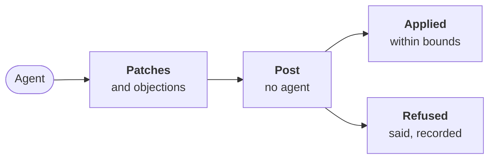

---
sources:
  - internal/developer/bounds.go
  - internal/developer/developer.go
  - internal/steer/steer.go
checked: 1d79329d
verified: agent:claude-code
---
# The bounds: what its code may never touch

Part of [the developer](../README.md). Step 2 of
[ADR-0054's plan](../../../docs/adr/0054-the-developer-takes-a-ready-issue-to-a-pull-request.md#what-bounds-it).

## What it checks

The agent proposes patches. The engine's judge step, with no agent,
checks each file a patch touches, in this order. The first rule that
matches refuses the whole patch:

| Rule | The file is… | Refused even if the Scope names it |
|---|---|---|
| `gate-file` | under `.workline/`, `.github/workflows/`, `.github/actions/`, `.gitlab/ci/`, or `.gitlab-ci.yml`; a script a gate's check runs; a check's `config` | yes |
| `steering-file` | a file that steers agents: AGENTS.md, CLAUDE.md, a page they link, a prompt; a file in a role's folder (`roles/<name>/`, its `role.yaml` there) | yes |
| `acceptance-test-edit` | a test the tester froze on its open Draft ([the hand-over](../../tester/docs/hand-over.md)) | yes |
| `outside-scope` | none of the paths below | — |

**What it may touch:**

- the paths in backticks in the issue's Scope;
- the product owner's `sources` for the issue;
- the tests beside them: a name holding `test` or `spec`, in the
  same folder, under a Scope folder, or in a `test`/`tests` folder.

A rename or a deletion is checked on both sides.

## What happens to a refusal

- **Left out**: the refused patch is not applied; the others are.
- **Said**: a `warn` finding for each file, named by its rule.
- **Recorded**: the claim's comment on the issue lists each file and
  why. "A person must do it" when the file is a gate's or steers
  agents. Its hidden record keeps `refused: [{file, rule}]`, for the
  [auditor](../../../docs/adr/0046-the-auditor-re-checks-every-roles-acts.md).

## What else it refuses

- **Labels and comments of the agent's** (`not-the-developers`): the
  claim is the engine's. The developer never accepts, merges, closes
  or moves an issue. The catalogue holds no merge to propose.
- **One comment is allowed: an objection** to a frozen test. The agent
  gives the test, its line, the scenario, the kind and why. The engine
  posts it on that line of the tester's Draft, opened by
  `workline:objection`, in [the tester's form](../../tester/README.md#frozen-tests-and-objections).
  The tester keeps or rewrites the test.
- **An objection to a test that is not frozen** for the issue, or
  missing a field: refused, said.

## Not yet

- **A refused patch is not asked again**: the code is applied without
  it; the proof (step 3) shows what is missing.
- **Where the code goes**: the working tree, for now; the pull request
  is step 4.
