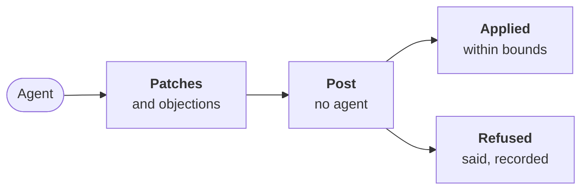

---
sources:
  - internal/developer/bounds.go
  - internal/developer/developer.go
  - internal/developer/worktree.go
  - internal/developer/words.go
  - internal/developer/prbounds.go
  - ci/github/workline-bounds.yml
  - ci/gitlab/workline-bounds.gitlab-ci.yml
  - internal/steer/steer.go
checked: 59a004d4
verified: agent:claude-code
---
# The bounds: what its code may never touch

Part of [the developer](../README.md). Step 2 of
[ADR-0054's plan](../../../docs/adr/0054-the-developer-takes-a-ready-issue-to-a-pull-request.md#what-bounds-it).

## What it checks

The agent proposes patches, or edits a worktree
([below](#a-worktree-its-diff-is-the-code)). The engine's judge step,
with no agent, checks each file a patch touches, in this order. The
first rule that matches refuses the whole patch:

| Rule | The file is… | Refused even if the Scope names it |
|---|---|---|
| `gate-file` | under `.workline/`, `.github/workflows/`, `.github/actions/`, `.gitlab/ci/`, or `.gitlab-ci.yml`; a script a gate's check runs; a check's `config` | yes |
| `steering-file` | a file that steers agents: AGENTS.md, CLAUDE.md, a page they link, a prompt; a file in a role's folder (`roles/<name>/`, its `role.yaml` there) | yes |
| `acceptance-test-edit` | a test the tester froze on its open Draft ([the hand-over](../../tester/docs/hand-over.md)) | yes |
| `outside-scope` | none of the paths below | — |

**What it may touch:**

- the paths in backticks in the issue's Scope, a line after one taken
  off (`parts.go:943`), a bare name read as the one file that has it,
  a pattern as the files it matches (`src/calc/*.sh`, a new one too);
  a path with a `/` only when it has a file's extension, ends with `/`,
  or its first folder is the repository's (`dorny/paths-filter` or
  `actions/checkout@v4.1`, an Action, bounds nothing);
- the paths in plain words in the Scope that the repository holds, a
  file or a folder (`docs/ci.md, internal/doctor`);
- the product owner's `sources` for the issue;
- the tests beside them: `test` or `spec` a word of the name
  (`mul_test.go`, `test_mul.py`, `MulTest.java`, not `latest.go`), in a
  Scope file's folder or under a Scope folder, or in a `test`/`tests`
  folder that sits there. A hidden file is no test (`.env.test`). A
  Scope `src` lets in no test at the root;
- a new test file beside the Scope, the write fence
  ([ADR-0063, §9](../../../docs/adr/0063-every-open-issue-is-due-waiting-or-done.md#9-the-developers-write-fence)):
  - it matches the tester's `test-paths` patterns
    ([its settings](../../tester/README.md#settings)) and is not in
    the commit the rules are read at;
  - its home, the folder holding its first `test`, `tests`, `spec` or
    `__tests__` folder, else its own, is a Scope path's folder, holds
    one, or is in one: `Storage/test/test_name/test_name.cpp` beside a
    Scope `Storage/include/Storage.h`;
  - the root is a home only to a Scope file at the root: a Scope
    `src/x.py` lets in no `tests/test_x.py`;
  - a kept test stays the fence's in the next rounds, its record naming
    it, though the pull request's head holds it;
  - a folder pattern lets in any new file under it: `*/test/**` takes a
    `test/CMakeLists.txt` or a `conftest.py` too; name files
    (`**/test_*.cpp`) for tests alone;
  - said and folded in: listed on the pull request and on the issue
    (`workline:scope-kept`), added to the Scope at the product owner's
    next refine ([below](#asking-the-product-owner-for-files)).

**Never in bounds:**

- a Scope or source naming the repository's root (`.`, `./`): it is
  dropped, else every file would be in bounds;
- anything, when the engine cannot read the gates' config or the files
  that steer agents: every patch is refused (`bounds-unread`), the
  error said, rather than one let past.

A patch naming no file, or a diff header whose two names cannot be told
apart with no other line naming them, is refused (`patch-unread`).
A rename or a deletion is checked on both sides, a name git quotes read
back. A gate's `config`
path is compared cleaned (`./x`, `x/`); a folder covers its files.

## A worktree: its diff is the code

Its agent works in a worktree
([ADR-0056](../../../docs/adr/0056-the-developers-agent-works-in-a-sandbox-with-tools.md);
what each agent gets: [the agent](agent.md)).

- **Where**: the commit its code starts from (the tester's Draft, or
  the commit read), checked out in the run's folder. The agent runs
  there, its path in `WORKLINE_WORKTREE`, and edits in place.
- **What is taken**: the diff against that commit, new files in,
  whatever the agent committed, a deleted file a deletion; one patch a
  file, held to the rules above. A file's mode is not read.
- **Not its code**: the empty files `claude` creates for its sandbox
  (`.env*`, `package.json` and 15 more), removed once it ran
  ([the agent](agent.md#claude)). An empty file the agent writes, such
  as an `__init__.py`, stays its code.
- **Refused before the rules**: a link out of the tree
  (`symlink-out`); another link, a binary, a submodule (`not-text`).
- **Reverted**: a refused file leaves nothing. The worktree stays
  while the agent may be asked again, then the engine removes it,
  whatever post did; only what passes the bounds goes on.

## On the pull request

The same rules hold on its pull request, as a check: whoever pushed
its commits, the agent, a person or the engine
([ADR-0058](../../../docs/adr/0058-the-forge-guards-the-project-not-the-agents-environment.md#4-the-developers-bounds-become-a-check-on-its-pull-request)).
The check above, before the push, stays a fast first pass.

- **Run**: `workline develop --bounds --merge-request <n>`, or the
  developer listed on the `merge-request` event's line
  (`routing.events.merge-request`). No agent.
- **Which pull requests**: a `workline/developer/<n>` branch, held to
  issue `n`'s bounds. Another branch is a person's: it passes, said
  (`not-a-developers-branch`), and is reviewed as theirs.
- **What it reads**: each file the head changed since its merge base,
  its rules read at the base's tip, never at the head: a pull request
  cannot loosen its own check. The head and base: `--input
  range=<base>..<head>`, else the branches as fetched.
- **Frozen tests**: from the tester's record, with each test's blob. A
  test as the tester wrote it passes; changed or deleted, it blocks,
  deleted even when the range shows no trace of it. Frozen tests it
  cannot read (a record unread, a start commit not fetched) block,
  `frozen-tests-unknown`, never a pass.
- **A refused file blocks**, named with its rule; a link out of the
  tree is `symlink-out`. Its next round or a person reverts it.
- **Kept for the auditor**: a comment on the pull request,
  `sticky=developer/bounds`, its hidden record `act: bounds` with each
  file refused, kept even when it blocks.

### In CI

- **GitHub**: [workline-bounds.yml](../../../ci/github/workline-bounds.yml),
  the check `workline bounds`; require it on the default branch, its
  source GitHub Actions ([set up](../../../docs/ci-github.md#set-up)).
  - It runs on `pull_request_target`: the default branch's copy of
    the workflow, never the pull request's.
  - It never runs the pull request's code: the base checked out, the
    head fetched for git to diff, a read token, no agent.
  - A job apart, with the App's key, keeps its verdict on the pull
    request. Another branch's pull request skips the job, which the
    rule takes as passed.
  - A workflow on the branch naming a job `workline bounds` adds a
    second check of that name: both are required, so the red one
    still blocks.
- **GitLab**: the job `workline:bounds`
  ([the file](../../../ci/gitlab/workline-bounds.gitlab-ci.yml)). GitLab
  runs a merge request's pipeline from its own branch: a pipeline
  execution policy (Ultimate) or code owners (Premium) keep the job;
  on Free, the review. `workline doctor` reads the tier
  ([on GitLab](../../../docs/gitlab/bounds.md)).

## Why these rules

- **Gate files**: a gate checks the code; the code's author never
  changes what checks it. Only a person does.
- **Steering files**: they steer every agent, the developer's too.
  Whatever the Scope says, a person changes them.
- **Frozen tests**: the tester wrote them from the issue's scenarios,
  before the code ([ADR-0055](https://github.com/JN0V/workline/pull/648)).
  The developer objects; it never edits them.
- **Outside the scope**: anything found there belongs in an issue
  ([principle 8](../../../docs/PRINCIPLES.md)).

## Asking the product owner for files

A step whose code lies wholly outside the bounds asks the product owner,
whose Scope it is
([ADR-0063, §9](../../../docs/adr/0063-every-open-issue-is-due-waiting-or-done.md#9-the-developers-write-fence)):

- **Its first step**, no pull request yet: the issue goes back to
  refine, the product owner's state, with the files, its agent's note
  and the `workline:scope-ask` mark (`scope-asked`). A Scope naming no
  file is the same: every file is outside it. The product owner widens
  the Scope and readies it, or readies it as it is, why said.
- **A review round**: the issue is blocked, the product owner woken at
  once on the mark; it widens the Scope and sends the issue back to
  ready ([review held](review-held.md)).
- **The same files asked again**, whatever the head: blocked for a
  person, no mark. A file not asked before is a new ask. The files
  asked are kept in the developer's record, from claim to claim.
- **Part of its code in bounds**: applied, the rest refused and said;
  no ask.

## What happens to a refusal

- **Left out**: the refused patch is not applied; the others are.
- **Said**: a `warn` finding for each file, named by its rule.
- **Recorded**: the claim's comment on the issue lists each file and
  why. "A person must do it" when the file is a gate's or steers
  agents. Its hidden record keeps `refused: [{file, rule}]`, for the
  [auditor](../../../docs/adr/0046-the-auditor-re-checks-every-roles-acts.md).

## What else it refuses

- **Labels and comments of the agent's** (`not-the-developers`): the
  claim is the engine's. The developer never accepts, merges, closes
  or moves an issue. The catalogue holds no merge to propose.
- **Two comments are allowed.** An objection to a frozen test, and one
  note on its own issue.
- **An objection** to a frozen test. The agent
  writes the test, its line, the scenario, the kind and why in its
  worktree's objections file, as [its question shows](agent.md); the
  file never reaches the branch. The engine
  posts it on that line of the tester's Draft, opened by
  `workline:objection`, in [the tester's form](../../tester/README.md#frozen-tests-and-objections).
  The tester keeps or rewrites the test.
- **The scenario is the issue's**
  ([#913](https://github.com/JN0V/workline/issues/913)): the question
  lists the Validation's scenario names in the file's form. A test's
  name that spells one (`TestNotVouchedFor` for "Not vouched for") is
  posted as that scenario; one that spells none is not posted, said:
  the tester could not read it.
- **One comment per test and line**: an objection still open on its
  line is not posted twice; one on another line of the same test opens
  its own. The developer's comment on the Draft counts those posted
  and those still open.
- **An objection to a test that is not frozen** for the issue, or
  missing a field, or when the Draft's commit cannot be read: refused,
  said.
- **One note on its own issue**: what the agent left out. A note in
  plain text, naming no issue, is on its own issue. The engine
  posts it there as one comment, made inert (no heading, no tag, no
  mention), cut to 4,000 bytes; the same text goes in the pull
  request's `## Left out` ([the pull request](pull-request.md)). A
  second note, or one on another issue, is refused and said
  (`not-the-developers`).

## Not yet

- **A refused patch beside kept code is not asked again**: the code is
  applied without it; the proof (step 3) shows what is missing.
- **Where the code goes**: a branch of its own, proven, opened ready
  or as a Draft ([the proof](proof.md)); a refused file is said in its
  `## Left out` ([the pull request](pull-request.md)).
