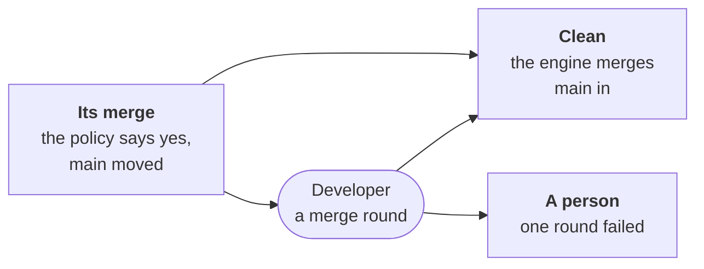

---
sources:
  - roles/developer/code/conflict.go
  - internal/engine/uptodate.go
  - internal/engine/engine.go
  - internal/engine/code.go
  - roles/developer/code/review.go
checked: 8cfadcb5
verified: agent:claude-code
---
# A pull request behind main

Another request merged first, and this one no longer merges
([ADR-0067](../../../docs/adr/0067-a-role-request-behind-main-merges-main-in.md)).
`main` is merged in, never rebased: no commit loses its id, nothing is
force-pushed.

## When

- **When the policy would merge it** (`workline follow`): the
  developer's request, its verdict passed, accepted or a fix.
- **Its verdict red, its head behind `main`**: `main` may have fixed the
  cause, a role's bug among them. The engine merges `main` in as its own
  commit, and the checks run again on the new head; once a tip of
  `main`, never with a person's token
  ([#1676](https://github.com/JN0V/workline/issues/1676)).
- **In conflict**: git's merge of `main`, in memory, meets a conflict.
  Said on the request and its issue, in the refused merge's comment
  (`**Not merged: it conflicts with main**`), the files named; edited
  when the round fails, or the engine brings it up to date.
- **In conflict, nothing said yet**: `main` moved into the developer's
  request since its last round. The reconciler finds the merge round
  due all the same, from git's merge of `main`.
- **Clean, held by the forge** (a base that must be up to date): the
  engine merges `main` in alone, no agent, and pushes the merge.
- **Clean, on the local forge, `main` having changed one of its files**:
  no check runs on `main` there, so the engine merges `main` in, runs
  the whole test command on the merge, and moves the branch there only
  green; the next reconcile reviews it, then it merges. Red: nothing
  moves, said on the request and its issue
  ([#1370](https://github.com/JN0V/workline/issues/1370)).
- **Never**: a green request that merges clean, the forge not holding
  it: it merges as it is, nothing pushed to it.

## The merge round

- **Due at the next reconcile**, before any review finding.
- **With no agent**: it says the conflict waits, merges nothing and
  records nothing; the next run with an agent takes it at the same head.
- **Its worktree**: the branch's head with `main` merged in, git's
  markers in the files in conflict.
- **Its task**: settle each conflict, keeping both changes; nothing
  else. An edit to another file is refused; a frozen test is the
  tester's, by an objection.
- **Its note**: a line a file, how it settled it, in its answer, never
  a file it writes; said in the round's comment on the request
  ([#1371](https://github.com/JN0V/workline/issues/1371)).
- **The engine commits it**, two parents, the branch's head first:
  - no marker left in the files in conflict;
  - the whole test command green on the merge, both requests' tests in
    it;
  - pushed with no force; the checks and the reviewer read it next.

## One round only

- **Markers left, edits that do not apply, or tests red**: nothing
  pushed, its issue blocked for a person, the reason on the request and
  the issue.
- **The person**: merges `main` into the branch, settles it, pushes;
  never a rebase. Then moves the issue back by its label.
- **A person's yes** covers the head it was given on: a settled merge is
  a new head, asked again; the engine's clean merge keeps it.
