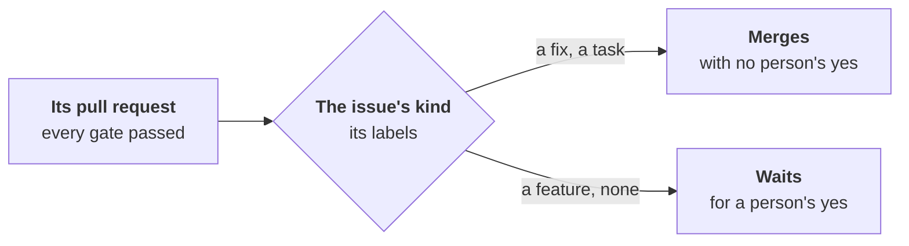

---
sources:
  - internal/developer/merge.go
  - internal/engine/code.go
  - internal/sample/developer.go
checked: 93dac05e
verified: agent:claude-code
---
# The merge

The developer never merges: `workline follow` does, by the project's
merge policy
([ADR-0054](../../../docs/adr/0054-the-developer-takes-a-ready-issue-to-a-pull-request.md#a-person-on-the-loop-not-in-it),
step 7). At `cautious`, every pull request waits for a person's label.
At `normal`, a person's yes is asked by kind only.

## Fix or feature: the issue says

- **The kind is the issue's**, the one its pull request closes, named
  in the developer's record on it. Never the agent's say, never the
  branch's name, never the commit's subject.
- **Read from its labels**, whole names, case aside:

  | Kind | Labels |
  |---|---|
  | fix | `bug`, `fix`, `type::bug`, `Kind/Bug` |
  | feature | `enhancement`, `feature`, `type::feature`, `Kind/Feature` |
  | task | `task`, `chore`, `type::maintenance`, `Kind/Task` |

- **Two kinds on one issue**: a feature wins, then a fix: the safe side.
- **None**: it waits, and says which labels would tell it.
- **The issue cannot be read** (deleted, moved): that pull request
  waits; the others go on.

## What each gets, at `normal`

- **A fix or a task merges with no person's yes**, recorded as the kind
  `code`, once every gate passes:
  - workline's own, as the forge says it: opened and pushed by its App,
    every commit committed by it, each the tester's or the developer's
    by its `Workline-Role` trailer;
  - no file agents are told to read;
  - its record on the pull request read whole, not handed to a person;
  - its head's verdict passed, its checks not red;
  - no finding of the reviewer's open that blocks or is Important: a
    nit holds nothing.
- **A feature waits for a person's yes**, the label `workline:accepted`.
  Said in the job's summary (`waits-for-a-yes`) and once on the pull
  request: the label that accepts it, and how to change the kind.
- **A revert of a merged one** sends `code` back to a person's yes, as
  any kind ([at `normal`](../../../docs/merge-policy-normal.md)).

## The record

- **Merged alone**: workline's comment on the pull request, "Merging
  with no person's yes", the issue, its kind and the label that told
  it.
- **Held**: its comment "Waiting for a person's yes", the same words.
- **The auditor reads it** with the developer's code in its weekly
  sample: how it merged, beside the issue as it reads now
  ([ADR-0046](../../../docs/adr/0046-the-auditor-re-checks-every-roles-acts.md#amendment-2026-10-29-the-developers-row)).

## Not yet

- **GitHub's issue types** are not read: the labels only.
- **The project's own labels per kind**: the list above is fixed until
  the product owner's `kinds` setting is built
  ([the kind it sets](../../product-owner/docs/proposed-headings.md#the-kind-the-role-sets)).
- **A feature let merge alone**: no `merge.alone` for it yet.
