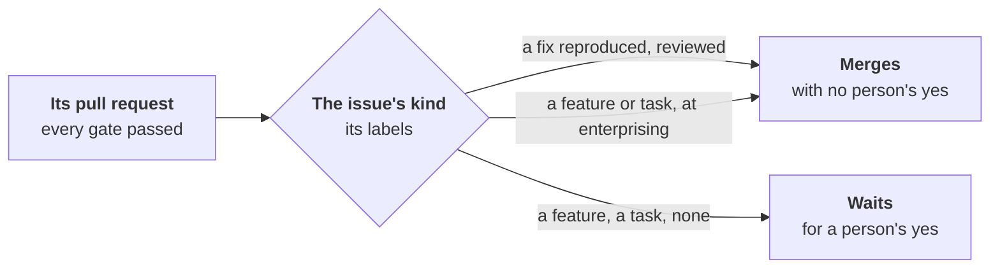

---
sources:
  - internal/developer/merge.go
  - internal/engine/code.go
  - internal/engine/candidate.go
  - internal/sample/developer.go
checked: a7fe9448
verified: agent:claude-code
---
# The merge

The developer never merges: `workline follow` does, by the project's
merge policy
([ADR-0054](../../../docs/adr/0054-the-developer-takes-a-ready-issue-to-a-pull-request.md#a-person-on-the-loop-not-in-it),
step 7). At `cautious`, every pull request waits for a person's label.
At `normal`, only a reproduced bug's fix, reviewed at its head, merges
alone. At `enterprising`,
a feature or a task merges too, and the yes moves to the milestone's
[release candidate](../../../docs/release-candidate.md).

## Fix or feature: the issue says

- **The kind is the issue's**, the one its pull request closes, named
  in the developer's record on it. Never the agent's say, never the
  branch's name, never the commit's subject.
- **Read from its labels**, whole names, case aside:

  | Kind | Labels |
  |---|---|
  | fix | `bug`, `fix`, `type::bug`, `Kind/Bug` |
  | feature | `enhancement`, `feature`, `type::feature`, `Kind/Feature` |
  | task | `task`, `chore`, `type::maintenance`, `Kind/Task` |

- **Two kinds on one issue**: a feature wins, then a fix: the safe side.
- **None**: it waits, and says which labels would tell it. The product
  owner sets one where none is
  ([the kind it sets](../../product-owner/docs/kind.md)).
- **The issue cannot be read** (deleted, moved): that pull request
  waits; the others go on.

## What each gets, at `normal`

- **A fix merges with no person's yes**, recorded as the kind
  `code`, once every gate passes:
  - workline's own, as the forge says it: opened and pushed by its App,
    every commit committed by it, each the tester's or the developer's
    by its `Workline-Role` trailer;
  - no file agents are told to read;
  - its record on the pull request read whole, its rounds not ended by a block;
  - its head's verdict passed, its checks not red;
  - no finding of the reviewer's open that blocks or is Important: a
    nit holds nothing. Its findings are read from the comment's hidden
    findings record: a comment with a table and no record, or a record
    that does not parse, holds the pull request for a person's yes.
- **A fix the reviewer read at its head**
  ([ADR-0065](../../../docs/adr/0065-code-only-what-converges-language-knowledge-in-packs.md#2-scope-as-paths-a-hint-not-a-fence)):
  - the reviewer's summary comment names the pull request's head, and
    its lenses read it, not only its rules;
  - or a rebase since: the record in that comment covers every commit
    of the head, by its change's patch id, as the reviewer reads it; the
    reviewer, finding nothing new, writes no summary then;
  - or the engine's own clean merge of `main` since: it adds no line to
    read, so the review of the head it merged into counts
    ([ADR-0067](../../../docs/adr/0067-a-role-request-behind-main-merges-main-in.md#amendment-2026-11-11-1370-on-the-local-forge-a-clean-merge-is-proven));
  - the reviewer in the merge-request line, its verdict not on the head
    yet: it waits for the reviewer, no person asked, until 24 h after
    the push (the question's delay,
    [ADR-0060](../../../docs/adr/0060-the-person-is-on-the-loop.md#1-questions-time-out-as-lazy-consensus));
  - past it, or with no reviewer in the line: it waits for a person's
    yes, said on it (`merge-waits=unreviewed`), the comment edited at
    each head: a team merges no change nobody read. A forge that keeps
    no push time (the local one) never has the delay said past;
  - the line's verdict on the head red (a role before the reviewer
    blocked): `verdict-red`, never "no review", and a person's yes does
    not lift it
    ([#1327](https://github.com/JN0V/workline/issues/1327)).
- **A fix, its bug reproduced first**
  ([ADR-0060](../../../docs/adr/0060-the-person-is-on-the-loop.md#4-a-person-validates-by-the-issues-kind)):
  - its record names the tester's Draft its code started from, and
    those tests; the tester opens a Draft only once its tests fail on
    the base;
  - its branch holds a commit of the tester's;
  - else it waits for a person's yes, said once on it
    (`merge-waits=unreproduced`): a fix with no failing test proves
    nothing.
- **A bug the tester cannot reproduce** never reaches here: its
  reporter is asked, then it is Blocked
  ([the hand-over](../../tester/docs/hand-over.md#a-bug-not-reproduced)).
- **A feature or a task waits for a person's yes**, the label
  `workline:accepted`: a `task` is a label an agent may put
  ([amended](../../../docs/adr/0060-the-person-is-on-the-loop.md#amendment-2026-11-03-a-task-waits-as-a-feature)).
  Said in the job's summary (`waits-for-a-yes`) and once on the pull
  request (`merge-waits=feature` or `merge-waits=task`): the label that
  accepts it, and how to change the kind.
- **A revert of a merged one** sends `code` back to a person's yes, as
  any kind ([at `normal`](../../../docs/merge-policy-normal.md)).

## At `enterprising`

- **A feature or a task merges with no person's yes**, by the same
  gates as a fix
  ([ADR-0060](../../../docs/adr/0060-the-person-is-on-the-loop.md#4-a-person-validates-by-the-issues-kind)).
- **Its issue goes into a milestone** first, the next open one, when it
  has none: the person tries that milestone's release candidate.
- **A candidate refused** sends features and tasks back to a person's yes on each
  pull request, said once on it, until a person lifts it
  ([the release candidate](../../../docs/release-candidate.md#a-refused-candidate)).

## The record

- **Merged alone**: workline's comment on the pull request, "Merging
  with no person's yes", the issue, its kind and the label that told
  it. Its head's checks still running, "To merge with no person's yes,
  once its checks pass": the forge's auto-merge waits for them.
- **Held**: its comment "Waiting for a person's yes", the same words.
- **The auditor reads it** with the developer's code in its weekly
  sample: how it merged, beside the issue as it reads now
  ([ADR-0046](../../../docs/adr/0046-the-auditor-re-checks-every-roles-acts.md#amendment-2026-10-29-the-developers-row)).

## Not yet

- **GitHub's issue types** are not read: the labels only.
- **The project's own labels per kind**: the list above is what the
  merge reads; the product owner's `kinds` setting names the label it
  sets, not yet what the merge reads.
- **A feature or a task let merge alone at `normal`**: only
  `enterprising` lets it, with a release candidate.
