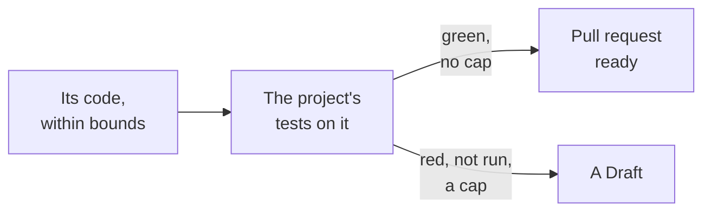

---
sources:
  - internal/developer/proof.go
  - internal/developer/developer.go
  - internal/tester/onchange.go
  - internal/tester/fresh.go
  - roles/developer/role.yaml
checked: 1b4ad84a
verified: agent:claude-code
---
# The proof and the caps: ready or a Draft

Part of [the developer](../README.md). Step 3 of
[ADR-0054's plan](../../../docs/adr/0054-the-developer-takes-a-ready-issue-to-a-pull-request.md#it-proves-locally-first).

## The proof

- **Where**: before anything is pushed, its code laid on a fresh
  checkout of the commit the run read ([below](#a-fresh-tree)); no
  agent.
- **What runs**: the tester's `test-command`, once, its JUnit report
  read ([the tester's settings](../../tester/role.yaml)). One setting
  for both roles: the project's tests.
- **The acceptance tests**: they run with the rest, its code laid on
  the tester's Draft when one is open ([the pull request](pull-request.md)).
- **Green**: tests reported, none red, the command exited 0.
- **Red**: a test failed, errored or was skipped, or the command failed.
- **Not run whole**: no `test-command`, a patch that does not apply, no
  report or one naming no test: not green, never a pass.

## A fresh tree

Step 3 of
[ADR-0056](../../../docs/adr/0056-the-developers-agent-works-in-a-sandbox-with-tools.md#the-proof-stays-the-engines).

- **Its agent's runs prove nothing**: it runs the tests in its worktree
  to iterate; a green it reports is not read.
- **Never in its agent's worktree**: the proof checks the start commit
  out in a repository of its own, apart, its code laid on it.
- **What the agent left is not there**: an ignored or untracked file
  outside its diff, a cache, a build output.
- **Nothing of the store the worktree shares is read**: it borrows the
  commits' contents only, never the store's refs, replacements, config,
  attributes or hooks, nor the machine's git config. A commit the agent
  put in the start commit's place changes neither its diff nor the proof.
- **The repository's hash**: the tree takes its object format, SHA-1
  or SHA-256.
- **Not whole, not run**: a start commit holding a submodule, or a
  file whose attributes name a filter (git-lfs, an encryption), is not
  checked out whole there. The proof does not run: unproven, the file
  named, a Draft. Never a red or a green on a pointer file.
- **Not apart yet**: the job's environment outside the tree (the home
  folder, tool caches, the path) is the one the agent ran in; the
  proof in the project's own environment is
  [#703](https://github.com/JN0V/workline/issues/703), on today's
  default branch [#701](https://github.com/JN0V/workline/issues/701).

## The caps

| Cap | Default | Reached |
|---|---|---|
| `ai-max-tokens` | 300000 | the run's agent calls spent it, as the agent reports it |
| `ai-max-turns` | 100 | one agent call took them all, as it reports it |
| `ai-max-seconds` | 1200 | the engine stops waiting and kills the agent |
| `proof-seconds` | 600 | the tests stopped past it |

- **A run's time**: the agent's wait and the tests' together, 30 min,
  [ADR-0054](../../../docs/adr/0054-the-developer-takes-a-ready-issue-to-a-pull-request.md#what-bounds-it)'s
  bound for a run. A project raising one lowers the other to keep it.
- **Turns**: told to each call whole, as `--max-turns` is; 100 is a
  start until measured
  ([ADR-0056](../../../docs/adr/0056-the-developers-agent-works-in-a-sandbox-with-tools.md#caps)).

How each agent is held ([ADR-0056](../../../docs/adr/0056-the-developers-agent-works-in-a-sandbox-with-tools.md#caps)):

| Cap | `claude` | `cmd:<any>` |
|---|---|---|
| time | killed with the commands it started | killed, its process group whole; `WORKLINE_MAX_SECONDS` tells it |
| turns | `--max-turns`; its `num_turns` read | `WORKLINE_MAX_TURNS` tells it; `turns` in `WORKLINE_CALL` read |
| tokens | read from its JSON after the run | `tokens-in`, `tokens-out` in `WORKLINE_CALL` read |

- **Not reported, not checked**: a call that writes no turns or
  tokens is held by its time alone; the run says so (`cap-not-checked`).
- **No live token cap**: tokens are read after the run; turns and time
  hold the agent meanwhile.
- **A cap reached**: a Draft, even when the tests are green. What the
  agent did so far is its code: bounded, proven, pushed. A run that
  needed more than it may spend is a person's to read.
- **Its agent failed** (exited in error, its answer unread): a Draft
  too, the reason in its Verification and its record (`agent-failed`).

## What it opens

- **Branch**: `workline/developer/<issue>`, the engine committing the
  code within bounds.
- **Ready**, green and no cap; **a Draft** otherwise, which wakes no
  agent ([ADR-0050](../../../docs/adr/0050-each-act-has-its-moment-and-a-wait-budget.md)).
- **Its body**: `Closes #<n>` — the pick skips the issue while it is
  open — and a `## Verification` saying what ran, each test red, each
  cap. Its other sections: [the pull request](pull-request.md).

## The record

- **In the claim's comment** on the issue: `proof` (result, command,
  tests passed, those red, why it did not run, `tree: fresh` and the
  commit checked out, `at`), `caps` (setting, spent, allowed), and the
  `turns` and `tokens` its agent reported using; a review round's, in
  its round.
- **Read by the auditor**
  ([ADR-0046](../../../docs/adr/0046-the-auditor-re-checks-every-roles-acts.md)).
