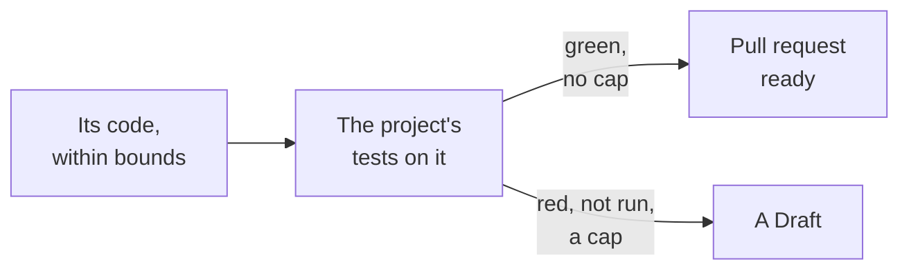

---
sources:
  - internal/developer/proof.go
  - internal/developer/developer.go
  - internal/tester/onchange.go
  - roles/developer/role.yaml
checked: e04c31ef
verified: agent:claude-code
---
# The proof and the caps: ready or a Draft

Part of [the developer](../README.md). Step 3 of
[ADR-0054's plan](../../../docs/adr/0054-the-developer-takes-a-ready-issue-to-a-pull-request.md#it-proves-locally-first).

## The proof

- **Where**: before anything is pushed, its code laid on the commit the
  run read, in a checkout apart; no agent.
- **What runs**: the tester's `test-command`, once, its JUnit report
  read ([the tester's settings](../../tester/role.yaml)). One setting
  for both roles: the project's tests.
- **The acceptance tests**: they run with the rest, its code laid on
  the tester's Draft when one is open ([the pull request](pull-request.md)).
- **Green**: tests reported, none red, the command exited 0.
- **Red**: a test failed, errored or was skipped, or the command failed.
- **Not run whole**: no `test-command`, a patch that does not apply, no
  report or one naming no test: not green, never a pass.

## The caps

| Cap | Default | Reached |
|---|---|---|
| `ai-max-tokens` | 300000 | the run's agent calls spent it |
| `ai-max-seconds` | 1200 | the engine stops waiting on the agent |
| `proof-seconds` | 600 | the tests stopped past it |

- **A run's time**: the agent's wait and the tests' together, 30 min,
  [ADR-0054](../../../docs/adr/0054-the-developer-takes-a-ready-issue-to-a-pull-request.md#what-bounds-it)'s
  bound for a run. A project raising one lowers the other to keep it.

- **A cap reached**: a Draft, even when the tests are green. A run that
  needed more than it may spend is a person's to read.
- **The agent not waited for**: no code, nothing to prove, no pull
  request; the claim stays.

## What it opens

- **Branch**: `workline/developer/<issue>`, the engine committing the
  code within bounds.
- **Ready**, green and no cap; **a Draft** otherwise, which wakes no
  agent ([ADR-0050](../../../docs/adr/0050-each-act-has-its-moment-and-a-wait-budget.md)).
- **Its body**: `Closes #<n>` — the pick skips the issue while it is
  open — and a `## Verification` saying what ran, each test red, each
  cap. Its other sections: [the pull request](pull-request.md).

## The record

- **In the claim's comment** on the issue: `proof` (result, command,
  tests passed, those red, why it did not run) and `caps` (setting,
  spent, allowed).
- **Read by the auditor**
  ([ADR-0046](../../../docs/adr/0046-the-auditor-re-checks-every-roles-acts.md)).
