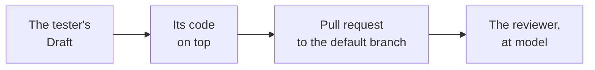

---
sources:
  - internal/developer/pullrequest.go
  - internal/developer/developer.go
  - internal/developer/credential.go
  - internal/engine/engine.go
  - internal/agent/claude.go
  - internal/builtin/reviewer/once.go
checked: 1738b65b
verified: agent:claude-code
---
# The pull request

Part of [the developer](../README.md). Step 4 of
[ADR-0054's plan](../../../docs/adr/0054-the-developer-takes-a-ready-issue-to-a-pull-request.md#build-plan).

## Where it starts

- **From the tester's Draft**, `workline/tester/issue-<n>`, when one
  is open: its acceptance tests are on the branch, so the proof runs
  them ([the proof](proof.md)).
- **The agent reads them**: its question holds each frozen test as the
  Draft has it; its checkout is the default branch's.
- **And the code it may touch**: the agent has no tools, so its
  question holds each file of the issue's Scope as it reads where its
  code starts, a folder's files, a path not there yet said; past about
  25k tokens, a file is named only. A review round shows them as its
  branch holds them. Without them, a real agent wrote no patch
  ([measured](status.md#measured)).
- **Its pull request goes to the branch the run is on**, the default
  branch in CI, never to the tester's. Merged, it brings the tests with
  it.
- **No Draft**: its code starts from the commit the run read.
- **Run again**, its branch is rebuilt: the tester's commits on it, even
  those the tester has since rewritten, are no person's; a person's
  commit leaves the branch to them.

## Who opens it

- **The engine, at apply**, with the forge's token the job holds: in CI
  the App's ([ADR-0044](../../../docs/adr/0044-the-apps-key-stays-with-the-default-branchs-runs.md)).
- **The agent holds no forge token**: the engine calls every agent with
  the forge's tokens, the App's key, the signing key and what a CI job
  holds that mints or carries one (GitHub's OIDC request token, GitLab's
  job token in its registry password and clone URL) taken out of its
  environment; its own login passes (principle 6).
- **Nor through git**: its git reads the repository's config. While git
  would hand it a credential, the engine does not start it: a run
  blocks, `credential-in-reach`, naming the key or the file, never its
  value; nothing claimed
  ([ADR-0056](../../../docs/adr/0056-the-developers-agent-works-in-a-sandbox-with-tools.md),
  step 2). Refused:
  - a header git sends (`http.*.extraheader`: a checkout's persisted
    token);
  - a credential helper left set, in any config git reads;
  - a URL holding a user and a token (a remote, a rewrite);
  - a file of saved credentials (`~/.git-credentials`).
  - In CI, the templates' judging jobs keep none
    ([the triggers](triggers.md#what-both-need)); on a machine,
    `git config credential.helper ''` in the repository stops git
    asking one.

## Its commits

- **Its tests apart**: a file with `test` or `spec` a word of its name
  (`x_test.go`, `test_x.py`, `x.spec.ts`, `XTest.java`; not
  `latest.go`), or in a test folder, goes in a commit of its own, `test: the tests beside the code
  of #<n>`; its code in another, the issue's title.
- **Each carries `Workline-Role: developer`** and the model that wrote
  it, as every commit workline makes.

## Its body

| Section | What it says |
|---|---|
| first line | `Closes #<n>` |
| `## Changes` | its code, its tests, the tester's acceptance tests it starts from |
| `## Left out` | each file refused at apply, and why; only when one was |
| `## Verification` | what ran and its result, each cap reached ([the proof](proof.md)) |
| `## Tried` | its tests in a checkout apart; not the issue's Verification commands, nor a person's use |

## Its record

- **Hidden in workline's own comment** on the pull request, kept up to
  date: the issue, the commit it starts from, its code and tests files,
  the proof, the caps, the refusals.
- **For its next runs** (the review loop, step 6) and **the auditor**,
  whose weekly sample draws its code once merged
  ([ADR-0046](../../../docs/adr/0046-the-auditor-re-checks-every-roles-acts.md#amendment-2026-10-29-the-developers-row)).

## How it is judged

- **The reviewer's floor rises to `model`** on a change whose commits
  the developer made: a finding is verified only by a judge of another
  model than the one that found it (`judge-at-least-by-role`,
  [the reviewer](../../reviewer/README.md)).
