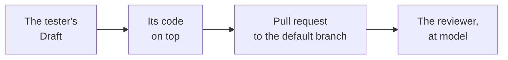

---
sources:
  - internal/developer/pullrequest.go
  - internal/developer/subject.go
  - internal/developer/developer.go
  - internal/engine/engine.go
  - internal/agent/claude.go
  - internal/builtin/reviewer/once.go
checked: f3fd0881
verified: agent:claude-code
---
# The pull request

Part of [the developer](../README.md). Step 4 of
[ADR-0054's plan](../../../docs/adr/0054-the-developer-takes-a-ready-issue-to-a-pull-request.md#build-plan).

## Where it starts

- **From the tester's Draft**, `workline/tester/issue-<n>`, when one
  is open: its acceptance tests are on the branch, so the proof runs
  them ([the proof](proof.md)).
- **The agent reads them** in its worktree, a checkout of the Draft:
  its question names their paths, and the Scope's, never pastes them
  ([the agent](agent.md#the-question)).
- **A review round** has no worktree yet: its question holds each file
  of the Scope as its branch holds it; past about 25k tokens, a file
  is named only. Without them, a real agent wrote no patch
  ([measured](status.md#measured)).
- **Its pull request goes to the branch the run is on**, the default
  branch in CI, never to the tester's. Merged, it brings the tests with
  it.
- **No Draft**: its code starts from the commit the run read.
- **Run again**, its branch is rebuilt: the tester's commits on it, even
  those the tester has since rewritten, are no person's; a person's
  commit leaves the branch to them.

## Who opens it

- **The engine, at apply**, with the forge's token the job holds: in CI
  the App's ([ADR-0044](../../../docs/adr/0044-the-apps-key-stays-with-the-default-branchs-runs.md)).
- **No forge token in its environment**: the engine calls every agent
  with the forge's tokens, the App's key, the signing key and what a CI
  job holds that mints or carries one (GitHub's OIDC request token,
  GitLab's job token in its registry password and clone URL) taken out
  of its environment; its own login passes.
- **The forge guards the project, not the agent's environment**
  ([ADR-0058](../../../docs/adr/0058-the-forge-guards-the-project-not-the-agents-environment.md)):
  - on a machine, the agent has the person's rights, their git
    credentials included, as their own coding agent has; nothing is
    refused;
  - in CI, the templates' judging jobs keep no write token in the clone
    ([the triggers](triggers.md#what-both-need));
  - the run says it once, `agent-rights` in its output, and its body
    under `## Verification`;
  - what merges, the forge's guards decide: protection, required
    checks, the review, the merge policy.

## Its commits

- **Its tests apart**: a file with `test` or `spec` a word of its name
  (`x_test.go`, `test_x.py`, `x.spec.ts`, `XTest.java`; not
  `latest.go`), or in a test folder, goes in a commit of its own; its
  code in another.
- **Subjects the project's commit check passes**: `type(scope): summary`
  ([#736](https://github.com/JN0V/workline/issues/736)):
  - type: `test` for its tests; for its code, the issue's kind: `fix`
    (bug), `feat` (feature, or no kind), `chore` (task);
  - scope: the folder every path of the issue's Scope sits in, none
    when they share none;
  - summary: the issue's title, lower-case first, its references and
    the codes the committer refuses taken out, cut on a word to the
    committer's `subject-max`;
  - a review round's fix: `fix: the review's findings on #<n>, round <r>`.
- **Its title is its code's subject**, cut shorter: a squash lands it
  with the forge's ` (#N)`, and GitLab marks a Draft with `Draft: `;
  both still fit the committer's limit
  ([ADR-0051](../../../docs/adr/0051-a-check-sits-where-its-catch-is-worth-its-cost.md)).
- **Each carries `Workline-Role: developer`** and the model that wrote
  it, as every commit workline makes.

## Its body

| Section | What it says |
|---|---|
| first line | `Closes #<n>` |
| `## Changes` | its code, its tests, the tester's acceptance tests it starts from |
| `## Left out` | each file refused at apply, and why; only when one was |
| `## Verification` | with whose rights its agent ran; what ran and its result, each cap reached ([the proof](proof.md)) |
| `## Tried` | its tests on a fresh checkout; not the issue's Verification commands, nor a person's use |

## Its record

- **Hidden in workline's own comment** on the pull request, kept up to
  date: the issue, the commit it starts from, its code and tests files,
  the proof, the caps, the refusals.
- **For its next runs** (the review loop, step 6) and **the auditor**,
  whose weekly sample draws its code once merged
  ([ADR-0046](../../../docs/adr/0046-the-auditor-re-checks-every-roles-acts.md#amendment-2026-10-29-the-developers-row)).

## How it is judged

- **The reviewer's floor rises to `model`** on a change whose commits
  the developer made: a finding is verified only by a judge of another
  model than the one that found it (`judge-at-least-by-role`,
  [the reviewer](../../reviewer/README.md)).
