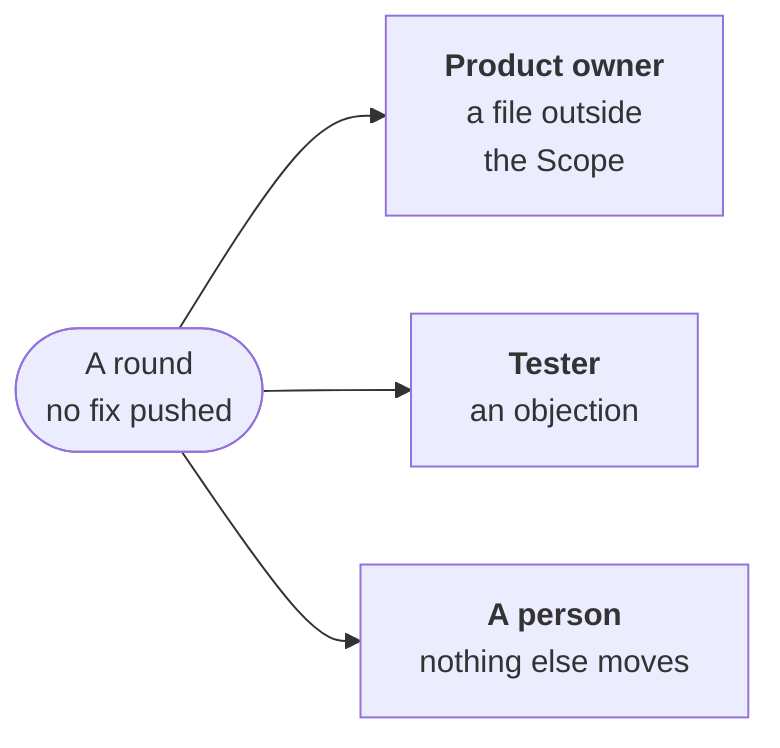

---
sources:
  - internal/developer/review.go
  - internal/developer/widen.go
  - internal/developer/rewrite.go
checked: d72f90e5
verified: agent:claude-code
---
# A round with no fix pushed

A review round ([the review loop](review-loop.md)) that pushes no fix
would leave its pull request as it is, nothing asked again at its head.
It asks the product owner, waits for the tester, or blocks its issue
for a person.

## A fix outside the Scope

The issue's Scope is the product owner's
([ADR-0060](../../../docs/adr/0060-the-person-is-on-the-loop.md#2-the-builders-part-is-the-product-owners-at-every-level));
a round asks it to widen it ([#921](https://github.com/JN0V/workline/issues/921)).

- **The agent names the file** in its note's `needs`, why in its text,
  and changes nothing for it:
  `- note: {text: "why the fix lies there", needs: [path]}`. A fix it
  makes there all the same is reverted by the [bounds](bounds.md), and
  counts as named.
- **No fix kept, a file named outside the Scope**: the round asks. A
  gate's file, a steering file or a frozen test is never asked for.
  The issue goes `workline:blocked`. Its comment names the files, the
  agent's note and the end of the red check's log.
- **The product owner answers at once**: the job that applied the
  round wakes it on the ask, no other news needed; the reconciler is
  the net.
  - It widens the Scope and sends the issue back to ready: the job
    that applied that starts the next round on the same pull request,
    not a new claim. It runs with the new bounds and puts the issue
    back in Doing ([#1013](https://github.com/JN0V/workline/issues/1013)).
    It asks again the red checks, and the reviewer's findings its last
    round asked, from its record: a green pull request resumes too
    ([#1022](https://github.com/JN0V/workline/issues/1022)).
  - Or it keeps the issue blocked, its reason written.
- **Once a head and a Scope**: asked again on the same, the issue is
  blocked for a person, with no ask; the person who widens it and puts
  it back to ready resumes the round. The rounds' cap bounds the rest.
- **A round that holds a reviewer's finding wrong** asks nothing: the
  reviewer decides.
- **A round before this**, no fix on a red check, runs once more at the
  same head, to ask, or to block as below.

## A red check it does not fix

A project check is asked once a head: a round on it that keeps no fix
and names no file outside the Scope would leave the pull request red,
nothing asked again ([#938](https://github.com/JN0V/workline/issues/938),
[ADR-0059](../../../docs/adr/0059-an-issue-moves-by-its-state-each-step-wakes-the-next.md#amendment-2026-11-03-a-red-check-with-no-fix-blocks-for-a-person)).

- **The issue goes `workline:blocked`, for a person**: its comment names
  the checks, the agent's note, where its objections to frozen tests
  went, and the end of the check's log. No mark: nothing for the
  product owner to widen.
- **Unless it objected**: its objection waits for the tester, below.
- **A person** fixes the check or the test, re-runs a flaky check, or
  widens the Scope, then moves the issue back to ready: the next round
  runs at the same head, the check asked again.

## A finding against a frozen test

A review finding whose fix turns a frozen test red is the tester's to
settle, or the product owner's, never the round's to force
([#987](https://github.com/JN0V/workline/issues/987),
[ADR-0059](../../../docs/adr/0059-an-issue-moves-by-its-state-each-step-wakes-the-next.md#amendment-2026-11-04-an-objection-waits-for-the-tester-a-green-head-is-kept)).

- **Its agent is told**: never undo the code a frozen test needs; object
  to the test, or name what the Scope lacks.
- **A green head is kept**: its last proof green, no red check asked. A
  fix the proof finds red on a frozen test is not pushed. A red test is
  a frozen one when one of its names (a test's, a subtest's) is a frozen
  file's name or a word in it.
  Red on its own tests only, it is pushed: the next round fixes them.
- **An objection waits for the tester**: posted on the Draft's lines,
  pushed code or not; the issue stays in Doing, the record saying it
  objected at this head.
  - **A rewrite**: the next round takes it
    ([a test the tester rewrote](review-loop.md#a-round)).
  - **A test kept**: news, read by the hourly reconciler. The round
    asks again at the same head what it held, the tester's answer
    named. No second wait there: no fix, it blocks for a person.
- **Neither objection nor file**, its fix held: blocked for a person,
  the red tests and the findings on the issue. Sent back, the findings
  are asked again.
- **A file outside the Scope**: the product owner is asked, as above;
  the green head stays meanwhile.
- **Past the rounds' cap**, a rewrite is not taken: the issue is
  blocked for a person, as any round past it.
