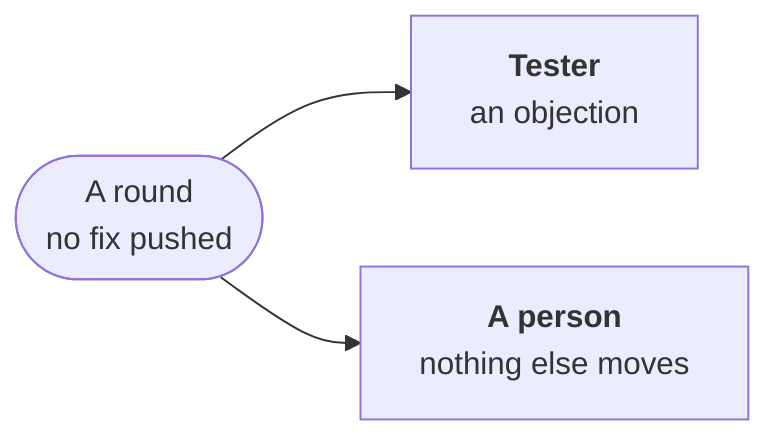

---
sources:
  - internal/developer/review.go
  - internal/developer/widen.go
  - internal/developer/rewrite.go
checked: 59a004d4
verified: agent:claude-code
---
# A round with no fix pushed

A review round ([the review loop](review-loop.md)) that pushes no fix
would leave its pull request as it is, nothing asked again at its head.
It waits for the tester, or blocks its issue for a person.

## A fix beyond the Scope

The issue's Scope is a hint, not a fence
([ADR-0065, change 2](../../../docs/adr/0065-code-only-what-converges-language-knowledge-in-packs.md#2-scope-as-paths-a-hint-not-a-fence)):
a round's fix in a file beyond it is made there and pushed, never asked
of the product owner.

- **Its reason**: one line in `.workline/beyond.yaml`, as for the first
  step ([beyond the Scope](bounds.md#beyond-the-scope)).
- **Listed**: in the pushed commit's message, under `Beyond the Scope:`,
  where the reviewer's `intent` lens reads it with the commits not
  reviewed yet; in the round's comment; in the record.
- **Before**: such a round asked the product owner to widen the Scope
  and blocked its issue ([#921](https://github.com/JN0V/workline/issues/921));
  an issue still blocked by such an ask is read as before.
- **A round that holds a reviewer's finding wrong** changes nothing for
  it: the reviewer decides.

## A red check it does not fix

A project check is asked once a head: a round on it that keeps no fix
would leave the pull request red,
nothing asked again ([#938](https://github.com/JN0V/workline/issues/938),
[ADR-0059](../../../docs/adr/0059-an-issue-moves-by-its-state-each-step-wakes-the-next.md#amendment-2026-11-03-a-red-check-with-no-fix-blocks-for-a-person)).

- **The issue goes `workline:blocked`, for a person**: its comment names
  the checks, the agent's note, where its objections to frozen tests
  went, and the end of the check's log.
- **Unless it objected**: its objection waits for the tester, below.
- **A person** fixes the check or the test, or re-runs a flaky check,
  then moves the issue back to ready: the next round
  runs at the same head, the check asked again.

## A finding against a frozen test

A review finding whose fix turns a frozen test red is the tester's to
settle, never the round's to force
([#987](https://github.com/JN0V/workline/issues/987),
[ADR-0059](../../../docs/adr/0059-an-issue-moves-by-its-state-each-step-wakes-the-next.md#amendment-2026-11-04-an-objection-waits-for-the-tester-a-green-head-is-kept)).

- **Its agent is told**: never undo the code a frozen test needs; object
  to the test.
- **A green head is kept**: its last proof green, no red check asked. A
  fix the proof finds red on a frozen test is not pushed. A red test is
  a frozen one when one of its names (a test's, a subtest's) is a frozen
  file's name or a word in it.
  Red on its own tests only, it is pushed: the next round fixes them.
- **An objection waits for the tester**: posted on the Draft's lines,
  pushed code or not; the issue stays in Doing, the record saying it
  objected at this head.
  - **A rewrite**: the next round takes it
    ([a test the tester rewrote](review-loop.md#a-round)).
  - **A test kept**: news, read by the hourly reconciler. The round
    asks again at the same head what it held, the tester's answer
    named. No second wait there: no fix, it blocks for a person.
- **No objection**, its fix held: blocked for a person, the red tests
  and the findings on the issue. Sent back, the findings are asked
  again.
- **Past the rounds' cap**, a rewrite is not taken: the issue is
  blocked for a person, as any round past it.
