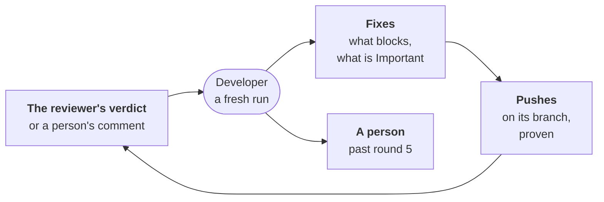

---
sources:
  - internal/developer/review.go
  - roles/developer/role.yaml
  - ci/github/workline-develop.yml
  - ci/gitlab/workline.gitlab-ci.yml
checked: 369e4cc8
verified: agent:claude-code
---
# The review loop

The developer fixes the review of its own pull request
([ADR-0054](../../../docs/adr/0054-the-developer-takes-a-ready-issue-to-a-pull-request.md#the-same-developer-fixes-the-reviews-findings),
step 6).

## A round

- **A fresh run**, woken by the reviewer's verdict or a person's
  comment on a pull request from `workline/developer/<n>`:
  `workline develop --merge-request <n>`.
- **No memory**: it reads its record on the pull request (the rounds
  before, the reviewer's runs read, the comments heard), the
  reviewer's comment and its comments on lines, and the issue. Nothing
  else.
- **A finding on its line**: its row shows only a title; the round
  reads it whole from the reviewer's comment on that line. Only
  workline's own account's comment is read.
- **What it asks the agent**: the findings that block, and those that
  warn and are Important; a person's comment, as a finding. Nits are
  counted, never asked.
- **Where its agent works**: as an issue run's
  ([the agent](agent.md)), in a worktree of its pull request's head,
  with tools, its [caps](proof.md#the-caps) the same. The question
  names the findings, the issue's Scope, the frozen tests and the test
  command; no code pasted. It answers a `note` a finding.
- **Its fix** is the worktree's diff, held to the issue's
  [bounds](bounds.md), proven on a fresh tree of the head
  ([the proof](proof.md)), then pushed on its branch, never forced.
  Red, it is pushed still and said: the forge's checks and the
  reviewer read it next. A fix that changes nothing pushes nothing;
  the round is counted still, its agent's notes said.
- **Its record**: one comment on the pull request says each round, what
  was asked and how it ended; its hidden line, for the next run and
  the [auditor](../../auditor/role.yaml), holds each round's turns,
  tokens and tools.
- **The reviewer decides a finding is fixed**
  ([ADR-0013](../../../docs/adr/0013-what-was-judged-is-not-asked-again.md)).

## When nothing runs

- **Nothing asked**: a verdict with nits only, or none at all.
- **Nothing new**: the reviewer ran no review since the last round,
  and no person spoke.
- **No agent**: the findings wait, no round counted.

## Rounds: five, the five whys at three

- **`review-rounds`** (5): the rounds it runs.
- **At round three**, a finding still there loads the shared
  [five whys skill](../../../skills/five-whys/SKILL.md): the analysis
  goes in the round's comment, the fix aims at its root cause. Without
  it, the answer is refused.
- **Past the last round**, no agent: the pull request gets the label
  `person` (`workline:human`) and says why. No round runs after it.

## What wakes it

- **GitHub**: [workline-develop.yml](../../../ci/github/workline-develop.yml),
  its `review` jobs. The reviewer's comment, written or edited by
  workline's App, or a comment of a person of the project.
  - A comment the job's own token writes wakes no workflow: the
    reviewer needs the App.
  - A comment on any pull request wakes it: a first job, `whose`, reads
    the branch in one call; on another's, nothing else runs.
- **GitLab**: the project's note webhook, pointed at its own trigger
  URL, starts a pipeline with `WORKLINE_TASK=review`; `MR_IID` and
  `MR_SOURCE_BRANCH` from a tool until the engine reads the event
  itself ([with GitLab alone](../../../docs/gitlab-trigger.md#a-label-or-a-comment-with-gitlab-alone)).
- **Off by default**: it runs only on the developer's own pull
  requests, which exist only where a project routes the developer
  ([the triggers](triggers.md)).
