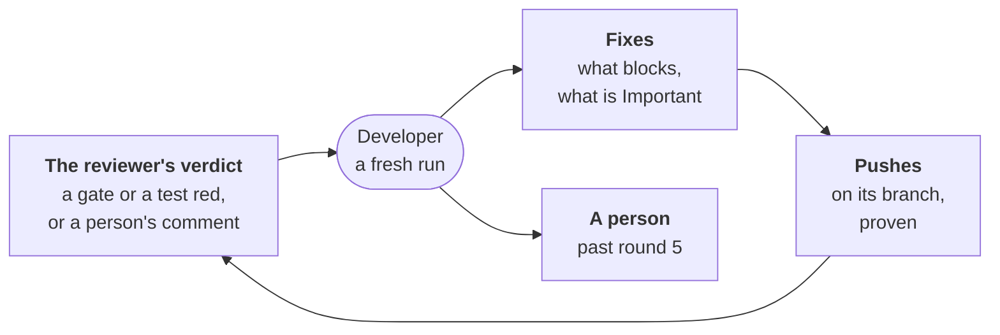

---
sources:
  - internal/developer/review.go
  - internal/developer/rewrite.go
  - internal/developer/gates.go
  - internal/developer/checks.go
  - internal/developer/widen.go
  - internal/developer/ready.go
  - internal/forge/checks.go
  - roles/developer/role.yaml
  - ci/github/workline-develop.yml
  - ci/gitlab/workline.gitlab-ci.yml
checked: 3ec4d022
verified: agent:claude-code
---
# The review loop

The developer fixes the review of its own pull request
([ADR-0054](../../../docs/adr/0054-the-developer-takes-a-ready-issue-to-a-pull-request.md#the-same-developer-fixes-the-reviews-findings),
step 6).

## A round

- **A fresh run**, woken by the reviewer's verdict, the gates' report,
  a project check red or a person's comment on a pull request from
  `workline/developer/<n>`:
  `workline develop --merge-request <n>`. With no forge
  ([`forge: local`](../../../docs/local-line.md#5-review-the-merge-request)),
  the reconciler runs it, in a worktree of the head.
- **No memory**: it reads its record on the pull request (the rounds
  before, the reviewer's runs read, the gates' report read, the
  comments heard), the reviewer's comment and its comments on lines,
  the gates' and the inspector's comments, the project's checks at its
  head, and the issue. Nothing else.
- **A gate red**: each new finding of the gates' summary comment is
  asked, at its place, with what [the inspector](../../inspector/README.md)
  said of it: why it matters, its fix. Only a report on its branch's
  head; once a report, its head kept in the record. A check that did
  not run asks nothing.
- **A project check red** ([#917](https://github.com/JN0V/workline/issues/917)):
  a check of the project's own CI failed at its branch's head, its
  tests run whole where the proof ran a part. Asked once every project
  check there is done, the end of its failed steps' log in the task
  (80 lines, 6 kB at most). Once a head: the head kept in the record.
  - **The project's**: workline's own are left out, a job of a
    workflow named `workline …`, a check or status named `workline…`:
    their records say what to fix.
  - **Read on GitHub**; the checks not read are said (`checks-unread`).
- **A test the tester rewrote** ([#939](https://github.com/JN0V/workline/issues/939)):
  after an objection, the tester's Draft holds an acceptance test
  otherwise than this branch.
  - **Taken as the tester's record names it**: the round lays it on
    its branch, the agent's worktree holding it, proves it with the
    rest and pushes it.
  - **The record follows**: its start commit moves to the Draft's
    head, so [the bounds](bounds.md) hold the new test.
  - **Not in the record**: never taken, and no round due for it.
- **The issue's body changed** ([#1271](https://github.com/JN0V/workline/issues/1271)):
  a person rewrote the issue after the code was written; the record
  keeps the body it read.
  - **Asked as a person's comment is**: the issue as it reads now is
    in the task; the agent holds its code to it.
  - **Once a body**: the new one kept in the record. A record from
    before has none to compare: nothing asked.
  - **A person's change only**: the engine's own `Blocked by` line,
    added or rewritten, starts no round.
  - **No event wakes it**: the hourly reconciler starts it, the issue
    saying so.
- **The reviewer's rules alone** ([#1040](https://github.com/JN0V/workline/issues/1040)):
  rules that hold the lenses count no review run. A summary read at
  another head is a new verdict all the same, its head kept in the
  record (`review-at`).
- **A finding in a frozen test**: the developer may not change that
  file. The round asks its agent to object to the test at that line,
  the finding as its why; [the tester](../../tester/README.md)
  rewrites it, and the next round takes the rewrite. Its Draft closed:
  nothing to object to, the rounds run out to a person.
- **A test finding on code is the tester's**
  ([#1265](https://github.com/JN0V/workline/issues/1265)): the tests
  lens finds a behaviour with no test, on a line of code, and the
  tester's Draft is open.
  - **Sent, not asked**: an objection of kind `missing` on a line of
    the Draft's tests, naming the pull request; the agent is told it,
    not asked to fix it. The tester adds the test or says why none is
    needed; a test added is taken by the next round.
  - **Once**: the record keeps it sent; a review raising it again asks
    no one.
  - **Alone**: no agent, no round counted; the rounds never run out on
    test findings.
  - **None needed, still blocking**: the tester answers on the pull
    request that no test is needed; the reviewer's judge weighs the
    reason, and a reason that holds lifts the block
    ([weighed](../../reviewer/docs/tester-answers.md)).
    The review still blocking on the finding, no round settles it: its issue goes `workline:blocked`,
    the reason on it and on the pull request, for a person who reads
    both.
  - **The developer's still**: one on a test file, one asked again from
    the record when a round resumes, or a row where the reviewer groups
    a finding of another lens under it (code to fix on the same line).
- **The reviewer's findings, from its record**
  ([#705](https://github.com/JN0V/workline/issues/705)): read from the
  hidden `workline:findings` line of its comment (each finding's lens,
  place, severity, text), never from its table's words.
  - **No record** beside a table, or one that does not parse: nothing
    asked, the run says why (`findings-record-unread`).
- **A finding on its line**: its row shows only a title; the round
  reads it whole from the reviewer's comment on that line. Only
  workline's own account's comment is read.
- **What it asks the agent**: the findings that block, and those that
  warn and are Important; a gate's new finding; a project check red;
  a person's comment, as a finding; the issue's new body. Nits are counted, never asked.
- **Where its agent works**: as an issue run's
  ([the agent](agent.md)), in a worktree of its pull request's head,
  with tools, its [caps](proof.md#the-caps) the same. The question
  names the findings, the issue's Scope, the frozen tests and the test
  command; no code pasted. It answers a `note` a finding.
- **Its fix** is the worktree's diff, held to the issue's
  [bounds](bounds.md), proven on a fresh tree of the head
  ([the proof](proof.md)), then pushed on its branch, never forced.
  Red, it is pushed still and said: the forge's checks and the
  reviewer read it next. A fix that changes nothing pushes nothing;
  the round is counted still, its agent's notes said.
- **Its record**: one comment on the pull request says each round, what
  was asked and how it ended; its hidden line, for the next run and
  the [auditor](../../auditor/role.yaml), holds each round's turns,
  tokens and tools.
- **The reviewer decides a finding is fixed**
  ([ADR-0013](../../../docs/adr/0013-what-was-judged-is-not-asked-again.md)).

## A round with no fix pushed

When a red check stays with no fix, or a finding fights a frozen test,
a round waits for the tester, or blocks its issue for a person; a fix
beyond the Scope is pushed and listed:
[a round with no fix pushed](review-held.md).

## A merge round

Its merge refused for a conflict with `main`: the round merges `main`
in and settles the markers only, before any finding
([behind main](conflict.md)).

## A Draft made green

Its pull request opened as a Draft — red, not run whole, or its agent
failed — is marked ready for review once its rounds make it green
([#969](https://github.com/JN0V/workline/issues/969)).

- **When**: nothing new is asked, and every project check at its head
  is done and green. With no project check, its last proof green.
- **What**: no agent; the engine marks it ready, a comment says so.
  The reviewer and the merge policy take it from there.
- **A Draft kept**: a cap reached in its record, or its agent failed
  with no round since, said in the verdict: a person marks it ready.

## When nothing runs

- **Nothing asked**: a verdict with nits only, or none at all.
- **Nothing new**: the reviewer ran no review since the last round,
  the gates reported nothing new on its head, no project check is red
  at a head not read, and no person spoke.
- **A project check still runs** at its head: the red ones wait for it.
- **No agent**: the findings wait, no round counted.

## Rounds: five, the five whys at three

- **`review-rounds`** (5): the rounds it runs; its autonomy level sets 3 at `cautious`, 8 at `enterprising`, unless set here ([autonomy](../../../docs/autonomy.md)).
- **At round three**, a finding still there loads the shared
  [five whys skill](../../../skills/five-whys/SKILL.md): the analysis
  goes in the round's comment, the fix aims at its root cause. Without
  it, the answer is refused.
- **Past the last round**, no agent: the reviewer and the developer do
  not agree on the code findings left; test findings still go to the
  tester, never counted against them. Its issue goes `workline:blocked`, the reason on it and on
  the pull request
  ([ADR-0059](../../../docs/adr/0059-an-issue-moves-by-its-state-each-step-wakes-the-next.md#6-disagreements-end-at-the-product-owner-then-blocked));
  no person is asked, no label on the pull request. No round runs after
  it.
- **At its issue's backstop**, no agent: the issue's runs, the rounds
  counted, reached 4× its normal
  ([routing](../../../docs/spec/routing.md#the-line-of-states)). No
  round runs (`backstop-crossed`); its issue goes `workline:blocked`,
  the reason on it and on the pull request, kept open.

## What wakes it

- **GitHub**: [workline-develop.yml](../../../ci/github/workline-develop.yml),
  its `review` jobs. The reviewer's comment or the gates', written or
  edited by workline's App, or a comment of a person of the project.
  - **A project workflow ended** on a `workline/developer/` branch
    (`workflow_run`, every workflow but workline's own): `whose`
    starts a round once all the project's runs on that head are done,
    one failed, whichever ended last; all green, on a Draft only, a
    round that marks it ready. GitHub sends no `check_run` nor
    `check_suite` event for its Actions' own checks.
  - A comment the job's own token writes wakes no workflow: the
    reviewer and the gates need the App.
  - **Hourly, the reconciler** starts a round an event missed, one run
    each, within `reconcile-max`
    ([#891](https://github.com/JN0V/workline/issues/891)).
  - A comment on any pull request wakes it: a first job, `whose`, reads
    the branch in one call; on another's, nothing else runs.
- **GitLab**: the project's note webhook, pointed at its own trigger
  URL, starts a pipeline with `WORKLINE_TASK=review`; `MR_IID` and
  `MR_SOURCE_BRANCH` from a tool until the engine reads the event
  itself ([with GitLab alone](../../../docs/gitlab-trigger.md#a-label-or-a-comment-with-gitlab-alone)).
  The hourly reconcile starts a round an event missed. GitLab shows the
  gates in its Code Quality report, no comment: a gate red is no round
  there yet, nor a failed pipeline.
- **Off by default**: it runs only on the developer's own pull
  requests, which exist only where a project routes the developer
  ([the triggers](triggers.md)).
