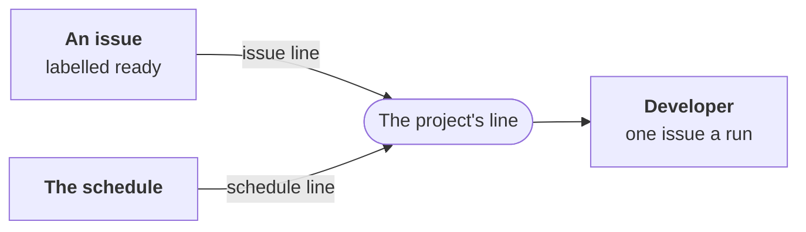

---
sources:
  - roles/developer/role.yaml
  - internal/developer/developer.go
  - internal/line/states.go
  - internal/line/round.go
  - internal/line/budget.go
  - ci/github/workline-develop.yml
  - ci/gitlab/workline.gitlab-ci.yml
checked: c1990cb1
verified: agent:claude-code
---
# The triggers



The developer runs where the project routes it
([ADR-0054](../../../docs/adr/0054-the-developer-takes-a-ready-issue-to-a-pull-request.md),
step 5). Nothing routes it by default: the project opts in.

## When an issue becomes ready

```yaml
routing:
  events: {issue: [tester, developer]}
```

- **CI runs** `workline route issue --target issue:<n>
  --open-merge-request`: that issue alone, if it is free to take
  ([the pick](pick.md)).
- **By its state**: the line runs the role the issue's state wakes
  ([the line of states](../../../docs/spec/routing.md#the-line-of-states)):
  ready wakes the developer; waiting for its tests
  (`workline:needs-tests`), the tester, when routed there too
  (`issue: [tester, developer]`). Any other state runs nothing, said.
- **GitHub**: copy
  [workline-develop.yml](../../../ci/github/workline-develop.yml). A
  person's `workline:` label wakes it; the engine's own labels never
  do.
  - **A person's answer**: a comment or a body edit on an issue bearing
    a `workline:` label starts its run, which asks the line, no agent,
    whether its step is due: a blocked issue's answer is read at once
    ([#1414](https://github.com/JN0V/workline/issues/1414)). A comment
    counts from the project's people or the issue's author.
  - **The next step**: once `apply` applied, it asks the line, no
    agent, whether the issue's new state is due, and starts that run
    (`workflow_dispatch`, which the job's own token may start). Not
    due, it asks again after 10 and 20 s: GitHub lists a comment the
    apply just wrote some seconds later.
  - **Back from a Scope ask**: a ready issue whose own pull request is
    open is no new claim. Its step is the review round on that pull
    request: the line lists it, and `apply` starts the round
    ([#1013](https://github.com/JN0V/workline/issues/1013)).
  - **Room freed**: then it asks the line which issues waited for room
    its move freed, as the developer taking a ready issue frees Ready,
    and starts each one's run
    ([#960](https://github.com/JN0V/workline/issues/960)).
  - **Hourly**, the `reconcile` job starts what an event missed, at most
    `reconcile-max` issues a run, the one waiting longest first, each
    its own run. Each reconcile
    starts the next, 55 minutes on: [the heartbeat](../../../docs/github/heartbeat.md),
    an environment to create once.
  - **Not on the heartbeat alone**: the schedule, or a `workline:` label
    on an issue, each hop of the line, starts it when no heartbeat waits
    and 55 minutes passed since the last that succeeded, read from the
    workflow's runs. One at a time
    ([#789](https://github.com/JN0V/workline/issues/789),
    [#853](https://github.com/JN0V/workline/issues/853)). Its cost: a
    job of a few seconds and 1 API call each such event; comments start
    none.
  - **One run an issue at a time**
    ([#806](https://github.com/JN0V/workline/issues/806)): a run of an
    issue's step is named `workline develop #<n>`. The reconciler and
    the night skip an issue with such a run queued or running; the next
    step starts its run even so, which ends at once if not due.
  - **Not due, ended at once**: `judge` asks the line first, no agent;
    a step acted on already ends there, before your setup steps and the
    agent are installed.
  - The `judge` job holds the agent and a read token, your setup steps
    run there ([below](#the-projects-environment)); `apply` holds the
    App's key, no AI key.
- **GitLab**: the project's issue webhook, pointed at its own trigger
  URL with `WORKLINE_TASK=issue`, starts a pipeline; the engine reads the
  event, and a state's label due starts that issue's own pipeline,
  `WORKLINE_TASK=develop` and `ISSUE_IID`, where the jobs
  `workline:develop:*` run it
  ([the line of states on GitLab](../../../docs/gitlab-trigger.md#the-line-of-states-on-it)).
  Hourly, a schedule with `WORKLINE_TASK=reconcile`.
- **Run by hand** with no issue: the first ready issue nobody took.

## On a schedule

```yaml
routing:
  events: {schedule: [documentalist, product-owner, reviewer, tester, developer]}
```

- **The gardening jobs run it**, on both forges: the first ready issue
  nobody took, one a run.
- **Tests first**: where the project routes the tester, on any event,
  an issue whose Validation names scenarios waits until the tester's
  Draft (`workline/tester/issue-<n>`) is open. The tester and the
  developer in one run so never take the same issue. An issue with no
  scenario gets no Draft: it does not wait.

## What both need

- **`--open-merge-request`**: its code goes to a pull request of its
  own. A line without it blocks (`no-merge-request`), the agent not
  asked, nothing claimed. `workline develop` always opens one.
- **Your test runner** in the judging job: the code is proven there
  ([the proof](proof.md)); [the project's environment](#the-projects-environment).
- **Two jobs**: the judge holds the agent and a read token for the
  pick; the engine gives the agent no forge token. The applying job
  holds the write token, no AI key.
- **No token left in the judge's clone**: the agent's git would read it
  ([the pull request](pull-request.md#who-opens-it)).
  - The judging jobs: the developer's own, and the gardening's, whose
    schedule may run it.
  - GitHub: they check out with `persist-credentials: false`; the
    review round takes its branch from that checkout, every branch
    fetched.
  - GitLab: they fetch every branch, then take the runner's job token
    out of the clone's git config (`.workline:no-credential`).
- **GitHub, one run an issue**: the concurrency group is on the judge
  job, after its `if`, named by the issue (`workline-issue-<n>`),
  whichever role its state wakes.
  - A label that is not workline's, or the engine's own, never takes
    the group, so it never drops an issue's waiting run.
  - GitHub keeps one run waiting a group: by issue, a dropped run is
    only the same issue labelled again.
  - Ready issues apart run side by side.
- **GitLab, one run an issue**: the jobs' `resource_group`,
  `workline-issue-<n>`, which queues that issue's runs.
- **The engine's own labels** start no step on GitHub: the job that
  set them starts the next one; the reconciler catches the rest.

## On its pull request

- **A review round**, the reviewer's verdict, the gates' report, a
  project workflow failed, all green on its Draft, or a person's comment on a pull request from
  `workline/developer/<n>`, a reply in a thread on a line too, noticed
  on GitHub by `workline-objection.yml`
  ([#1438](https://github.com/JN0V/workline/issues/1438)): no
  routing, the same workflow's `review` jobs on GitHub,
  `WORKLINE_TASK=review` on GitLab
  ([the review loop](review-loop.md#what-wakes-it)).
  - Merged or closed before the GitHub `review` job runs, its branch
    maybe deleted: no round, said, the run green
    ([#1420](https://github.com/JN0V/workline/issues/1420)).
- **The round's issue next**: once `review-apply` applied, it asks
  the line whether the issue's new state is due, and starts that run.
  Blocked on a Scope ask, the product owner reads it at once
  ([#1013](https://github.com/JN0V/workline/issues/1013)). GitLab's
  issue webhook does the same.
- **Hourly**, the reconciler starts a round an event missed, counted
  in `reconcile-max`. A round's run is named `workline develop round
  !<n>`, whatever woke it: none is started while one is queued or
  running.

## Two runs on one issue

- **The night's run and a ready label's**, where the schedule still
  routes the developer, may pick the same issue: the
  claim is written only at apply, after the agent coded.
- **Read again before apply**: once its agent answered, the run reads
  the issue again. Another run's label on it, an assignee, or the issue
  closed: it backs off (`taken-meanwhile`), nothing claimed, no pull
  request.
- **What is left open**: two runs whose agents code at the same time,
  or two ready issues with overlapping Scopes run side by side, can
  still both be taken. The forge holds no lock; a person closes the
  second pull request ([Missing](status.md#missing)).

## What a run leaves

- **An issue taken**: the claim's label and its record on the issue
  ([the pick](pick.md#the-claim)).
- **None to take**: the line's summary says "no ready issue waits for
  the developer", with each issue passed and why; nothing on the forge.
- **The API budget low**: a busy hour can spend the job token's GitHub
  budget. The run then waits for a reset within 5 minutes; further off,
  it is deferred, with no failure: its summary gives the reset's time,
  and the hourly reconciler runs the issue after it
  ([the API budget](../../../docs/github/calls.md#the-api-budget)).

Cases: `developer/routing-schedule-runs-developer`,
`routing-ready-runs-developer`, `routing-schedule-none-ready-said`,
`routing-needs-a-merge-request`, `skips-issue-without-tests`,
`backs-off-issue-taken-meanwhile`.

## The project's environment

The proof needs every tool your test job installs: one missing turns a
test red on the proof alone, and the pull request opens a Draft. Your
setup steps run in the developer's judging jobs (`judge`, `review`),
from the default branch, before the agent and the proof:

- **GitHub**: a composite action,
  `.github/actions/workline-setup/action.yml`, holding your test job's
  setup steps; [workline-develop.yml](../../../ci/github/workline-develop.yml)
  runs it when it is there.
- **GitLab**: redefine `.workline:setup` in your `.gitlab-ci.yml`, its
  `script` your test job's setup commands; the jobs
  `workline:develop:judge` and `workline:review:judge` run it. Their
  `image` too, when your tests need another.
- **None**: the runner, or the image, as it is.
- **A step that fails** fails the job, named in its log: never a red
  test.
- **Locally**: the person's machine, as it is.
- **A tool still missing**: the proof names it, when the test output
  says it was not found ([the proof](proof.md#what-it-opens)).

```yaml
# .github/actions/workline-setup/action.yml
name: workline setup
description: What the project's test job installs.
runs:
  using: composite
  steps:
    - uses: actions/setup-go@v5
      with: {go-version-file: go.mod}
```
