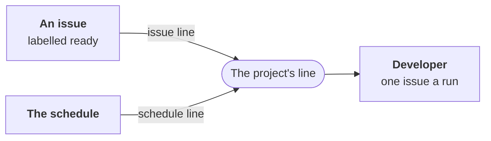

---
sources:
  - roles/developer/role.yaml
  - internal/developer/developer.go
  - ci/github/workline-develop.yml
  - ci/gitlab/workline.gitlab-ci.yml
checked: aea0b546
verified: agent:claude-code
---
# The triggers



The developer runs where the project routes it
([ADR-0054](../../../docs/adr/0054-the-developer-takes-a-ready-issue-to-a-pull-request.md),
step 5). Nothing routes it by default: the project opts in.

## When an issue becomes ready

```yaml
routing:
  events: {issue: [developer]}
```

- **CI runs** `workline route issue --target issue:<n>
  --open-merge-request`: that issue alone, if it is free to take
  ([the pick](pick.md)).
- **GitHub**: copy
  [workline-develop.yml](../../../ci/github/workline-develop.yml). The
  label `workline:ready` wakes it.
  - A label the job's own token puts starts no workflow on GitHub; the
    App's does ([the App](../../../docs/ci-github-app.md)). Without the
    App, the schedule takes the issue.
  - The `judge` job holds the agent and a read token, your setup steps
    run there ([below](#the-projects-environment)); `apply` holds the
    App's key, no AI key.
- **GitLab**: the project's issue webhook, pointed at its own trigger
  URL, starts a pipeline on the default branch, with
  `WORKLINE_TASK=develop`; `ISSUE_IID` from a tool until the engine
  reads the event itself
  ([with GitLab alone](../../../docs/gitlab-trigger.md#a-label-or-a-comment-with-gitlab-alone))
  ([the variables](../../../docs/gitlab-trigger.md#how-the-pipeline-knows-what-to-do));
  the jobs `workline:develop:*` run it.
- **Run by hand** with no issue: the first ready issue nobody took.

## On a schedule

```yaml
routing:
  events: {schedule: [documentalist, product-owner, reviewer, tester, developer]}
```

- **The gardening jobs run it**, on both forges: the first ready issue
  nobody took, one a run.
- **Tests first**: where the project routes the tester, on any event,
  an issue whose Validation names scenarios waits until the tester's
  Draft (`workline/tester/issue-<n>`) is open. The tester and the
  developer in one run so never take the same issue. An issue with no
  scenario gets no Draft: it does not wait.

## What both need

- **`--open-merge-request`**: its code goes to a pull request of its
  own. A line without it blocks (`no-merge-request`), the agent not
  asked, nothing claimed. `workline develop` always opens one.
- **Your test runner** in the judging job: the code is proven there
  ([the proof](proof.md)); [the project's environment](#the-projects-environment).
- **Two jobs**: the judge holds the agent and a read token for the
  pick; the engine gives the agent no forge token. The applying job
  holds the write token, no AI key.
- **No token left in the judge's clone**: the agent's git would read it
  ([the pull request](pull-request.md#who-opens-it)).
  - The judging jobs: the developer's own, and the gardening's, whose
    schedule may run it.
  - GitHub: they check out with `persist-credentials: false`; the
    review round takes its branch from that checkout, every branch
    fetched.
  - GitLab: they fetch every branch, then take the runner's job token
    out of the clone's git config (`.workline:no-credential`).
- **GitHub, one run an issue**: the concurrency group is on the judge
  job, after its `if`, named by the issue.
  - A label other than `workline:ready` never takes the group, so it
    never drops a ready issue's waiting run.
  - GitHub keeps one run waiting a group: by issue, a dropped run is
    only the same issue labelled again.
  - Ready issues apart run side by side.
- **GitLab, one run at a time**: the jobs' `resource_group`, which
  queues every run.
- **A label workline's job token puts** starts no workflow on GitHub;
  the App's does. Without the App, the schedule takes the issue.

## On its pull request

- **A review round**, the reviewer's verdict or a person's comment on
  a pull request from `workline/developer/<n>`: no routing, the same
  workflow's `review` jobs on GitHub, `WORKLINE_TASK=review` on GitLab
  ([the review loop](review-loop.md#what-wakes-it)).

## Two runs on one issue

- **The night's run and a ready label's** may pick the same issue: the
  claim is written only at apply, after the agent coded.
- **Read again before apply**: once its agent answered, the run reads
  the issue again. Another run's label on it, an assignee, or the issue
  closed: it backs off (`taken-meanwhile`), nothing claimed, no pull
  request.
- **What is left open**: two runs whose agents code at the same time,
  or two ready issues with overlapping Scopes run side by side, can
  still both be taken. The forge holds no lock; a person closes the
  second pull request ([Missing](status.md#missing)).

## What a run leaves

- **An issue taken**: the claim's label and its record on the issue
  ([the pick](pick.md#the-claim)).
- **None to take**: the line's summary says "no ready issue waits for
  the developer", with each issue passed and why; nothing on the forge.

Cases: `developer/routing-schedule-runs-developer`,
`routing-ready-runs-developer`, `routing-schedule-none-ready-said`,
`routing-needs-a-merge-request`, `skips-issue-without-tests`,
`backs-off-issue-taken-meanwhile`.

## The project's environment

The proof needs every tool your test job installs: one missing turns a
test red on the proof alone, and the pull request opens a Draft. Your
setup steps run in the developer's judging jobs (`judge`, `review`),
from the default branch, before the agent and the proof:

- **GitHub**: a composite action,
  `.github/actions/workline-setup/action.yml`, holding your test job's
  setup steps; [workline-develop.yml](../../../ci/github/workline-develop.yml)
  runs it when it is there.
- **GitLab**: redefine `.workline:setup` in your `.gitlab-ci.yml`, its
  `script` your test job's setup commands; the jobs
  `workline:develop:judge` and `workline:review:judge` run it. Their
  `image` too, when your tests need another.
- **None**: the runner, or the image, as it is.
- **A step that fails** fails the job, named in its log: never a red
  test.
- **Locally**: the person's machine, as it is.

```yaml
# .github/actions/workline-setup/action.yml
name: workline setup
description: What the project's test job installs.
runs:
  using: composite
  steps:
    - uses: actions/setup-go@v5
      with: {go-version-file: go.mod}
```
