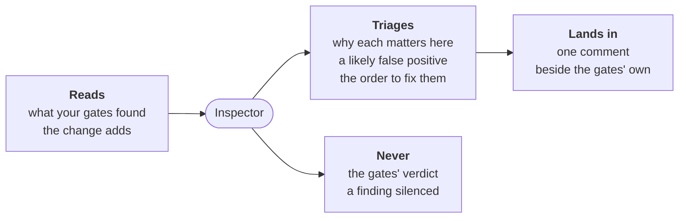

# Inspector



For people: what the role does and how to set it. The AI never reads this
file. All roles: [docs/roles.md](../../docs/roles.md).

**Does**:

- reads the findings the project's own tools report a merge request
  adds: the gates' new findings, old debt left out
  ([gates](../../docs/spec/gates.md#on-a-merge-request-the-findings-the-change-adds));
- asks the agent, in one call, why each matters in this project, what to
  fix, whether it looks like a false positive and why, and in what order
  to fix them;
- posts that in one comment on the merge request, edited on each push,
  beside the gates' own: their comment and annotations on GitHub, Code
  Quality on GitLab;
- asks nothing again about a finding it triaged before: it keeps them by
  fingerprint, which holds no line, so a finding that only moves is not
  asked again ([ADR-0013](../../docs/adr/0013-what-was-judged-is-not-asked-again.md)).

**Does not**:

- change the gates' verdict: a finding it calls a likely false positive
  still counts, a gate that blocks still blocks
  ([ADR-0049](../../docs/adr/0049-the-inspector-judges-the-new-findings-of-the-projects-tools.md#5-the-inspectors-judgement));
- lint code where no tool does
  ([ADR-0049](../../docs/adr/0049-the-inspector-judges-the-new-findings-of-the-projects-tools.md#4-no-ai-linting-as-a-check));
- run the tools: the gates do, in a job with no token;
- silence a finding, or change a tool's config: a person does.

## When, what it costs

| Event | Fired by | Reads |
|---|---|---|
| `merge-request` | CI, opt-in: `inspector` after the gates in the routing | the gates' new findings at the head; those triaged before, for their place in the order only |

- **Off the verdict's path**: the triage only warns. The templates run it
  apart from the verdict, beside the reviewer's lenses that warn, and
  post it once it answered
  ([ADR-0050](../../docs/adr/0050-each-act-has-its-moment-and-a-wait-budget.md#2-an-act-over-its-budget)).
- **Cost**: one call a push with new findings; none with no new finding,
  nor for a finding triaged before. Capped at 20 findings and 100000
  tokens a run (`findings-max`, `ai-max-tokens`).
- **The agent is your choice**: `none`, `claude`, or any command as
  `cmd:<command>`
  ([the choice](../../docs/install.md#3-the-agent-your-choice)).
- **Without an agent**: no call; the findings stand as the gates report
  them, said in the run (`not-triaged`). On a draft too, until it is
  marked ready.
- **A fork's merge request**: no triage, its run gets no secret; on
  GitHub, the gates' verdicts are in one comment
  ([what a fork gets](../../docs/gates-in-ci.md#a-forks-pull-request)).
- **Status**: beta; [where it stands](docs/status.md).

## Set it up

```yaml
# .workline/config.yaml
routing:
  events:
    merge-request: [committer, documentalist, "gate:lint", inspector]
gates:
  lint:
    checks:
      - id: golangci-lint
        run: golangci-lint run --max-issues-per-linter=0 --max-same-issues=0 --output.sarif.path={out}/lint.sarif ./...
        output: sarif
        max: {error: 0}
```

- **After the gates** in the routing: it reads the gate steps before it
  in the line.
- **In CI**: the templates' run apart gives it the gates' job's result
  ([gates in CI](../../docs/gates-in-ci.md#the-inspectors-triage)). On
  GitHub, workline-warn.yml waits for workline.yml's `gates` job on the
  same head; on GitLab, `workline:warn` runs after `workline:gates`.
- **On a machine**: `workline route merge-request --ai claude` runs the
  gates, then the inspector. A gate that blocks stops the line before
  it; to triage then, give it their result:

```sh
workline route merge-request --gates-only --json > gates.json
workline route merge-request --warn-only --gates-from gates.json --ai claude
```

## A run, in short

1. **The gates' result**: the gate steps before it in the line, or the
   file `--gates-from` gives, only for the commits the run judges.
2. **The record**: hidden in its comment on a merge request; on a
   machine, in `.git/workline/inspector-record`. A finding there is not
   asked again.
3. **One call**: the findings left, each with the head's code around it;
   those triaged before named for their place in the order only.
4. **Read back**: a triage naming no finding asked, saying not why it
   matters, or calling a false positive without why is not kept, said,
   and asked again at the next push.
5. **The comment**: every new finding triaged, in the order to fix them,
   25 at most, the run's summary holding the rest; the record hidden
   below. With nothing triaged to show, only a comment an earlier push
   left is edited. A push landing before it is posted: it is still
   posted, and the push's run, which waits for it, asks only what is
   new; both runs' records are merged
   ([#580](https://github.com/JN0V/workline/issues/580)).
6. **The verdict**: always a pass; each triage a warning in the run's
   summary. Never in code scanning: workline posts it itself.

## Settings

Under `roles: {inspector: {settings: …}}` in `.workline/config.yaml`
([config reference](../../docs/config.md)); defaults from role.yaml:

| Key | Default | |
|---|---|---|
| `findings-max` | `20` | new findings asked a run, in the gates' order; the rest said, asked at the next push; `0`: every one |
| `lines-around` | `8` | lines of the head's code shown above and below each finding, 0 to 50 |
| `forge-writes` | `true` | `false`: no comment; the triage in the verdict only, the record kept on the machine |
| `ai-max-tokens` | `100000` | tokens a run may spend, the call asked again included; `0`: no cap |
