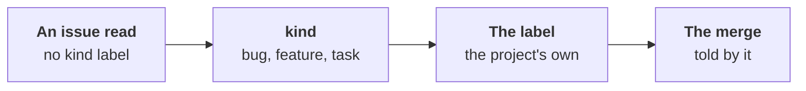

# The kind it sets

Part of [the product owner](../README.md). An issue's kind is the
forge's
([ADR-0039](../../../docs/adr/0039-issue-sections-are-read-by-meaning-the-kind-is-the-forges.md#c-the-role-sets-the-kind-label)):
bug, feature or task, read from its labels.

## Why it matters

- **A bug's fix merges by the policy** once a test that failed on the
  base proves the bug; **a feature waits** for a person's yes at
  `normal`
  ([ADR-0060](../../../docs/adr/0060-the-person-is-on-the-loop.md#4-a-person-validates-by-the-issues-kind),
  [the developer's merge](../../developer/docs/merge.md)).
- **An issue with no kind** waits for a person's yes, as a feature.

## What it does

- **On each issue it reads with no kind label**, the agent proposes
  `kind`: `bug`, `feature` or `task`, and why.
- **The label**: the first of the project's names for that kind it
  has; none, the first name, created by the forge as it labels.

  | Kind | Names read and set, the first the project has |
  |---|---|
  | bug | `bug`, `fix`, `type::bug`, `kind/bug` |
  | feature | `enhancement`, `feature`, `type::feature`, `kind/feature` |
  | task | `task`, `chore`, `type::maintenance`, `kind/task` |

- **`kinds`** names the project's own list per kind
  ([settings](settings.md)).
- **Said on the issue**, in the role's one comment: "Labelled `bug`, a
  bug. Wrong? Change the label; the role does not set it again."
- **By level**: `normal` sets 10 a run, `enterprising` 20, `cautious`
  proposes it on the issue.

## Issues it read before

An issue read before the act existed is not read again until it
changes. A light read gives it a kind
([#878](https://github.com/JN0V/workline/issues/878)):

- **What the agent reads**: each title and the first 600 characters of
  its body, never its code nor its comments.
- **Which issues**: open, no kind label, no kind the role set before,
  not set aside. First those a merge waits on: a developer on it
  (`workline:developing`), then ready; then the backlog's order.
  Gardening runs only, never a run woken for one issue.
- **How many**: the act's cap, less the issues read in full this run
  with no kind. None while the act is `off`; none at `cautious` once
  `proposals-max` issues wait on a person.
- **One call**: beside the full read when there is one; else a task of
  its own, `kind`, with a short instruction
  ([tasks/kind.md](../tasks/kind.md)). It answers `kind` or
  `note` only; anything else is dropped, said.
- **Its cost**, by the engine's estimate on a real backlog: about 400
  tokens an issue beside a full read; alone, about 6.4k tokens for 10
  issues, against 24.5k with the full instruction (measures in
  [#878's pull request](https://github.com/JN0V/workline/issues/878)).

## A person's kind holds

- **Never a swap**: an issue a kind label tells already keeps it
  (`kind-kept`), checked again just before the label is put.
- **Set once**: the label is kept in the issue's state. A person who
  changes it, or takes it off, is never undone (`kind-once`).
- **A bug is never turned into a feature**: not by the role, and not
  when its bug is not reproduced ([the tester's
  hand-over](../../tester/docs/hand-over.md#a-bug-not-reproduced)).

## Not yet

- **GitHub's issue types** are not read: the labels only.
- **`undone-max`** does not count a kind a person changed.
- **The merge** reads the names above, not the project's `kinds`.
