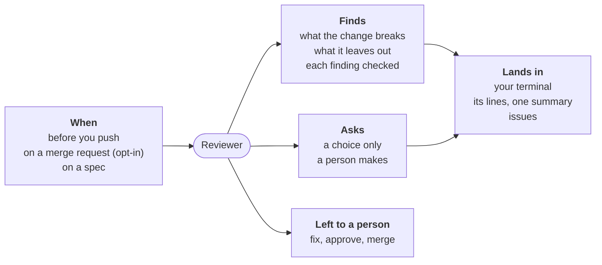

# Reviewer



For people: what the role does and how to set it. The AI never reads this
file. All roles: [docs/roles.md](../../docs/roles.md).

**Does**:

- reads the code a change brings before a person does, and says what it
  breaks, what the issue it closes asks and it leaves out, and what its
  author claims and it contradicts;
- quotes each finding; the engine finds the quote again, and a second AI
  call (the judge) checks each important one;
- asks a person what only a person decides;
- rules on the comments the change adds (an internal code), no agent; a
  lens judges one a word list flags as telling the code's history
  ([more](docs/run.md#12-the-range-the-rules));
- reads a spec before it is built too, a file or an issue: what is
  ambiguous, unverifiable, out of its scope, or contradicted by the code;
  on the forge, after the product owner refines an issue, its findings
  hold the issue from `ready` ([a spec](docs/spec.md)).

**Does not**:

- approve, change the code or merge: the author fixes, the person merges
  ([ADR-0020](../../docs/adr/0020-the-reviewer-finds-the-engine-verifies-the-person-merges.md));
- review docs and other files that are not code (`ignore`), nor the
  versions a release tool bumps on its own pull request
  ([more](docs/run.md#12-the-range-the-rules));
- comment on the merge request for a finding outside the change: that
  becomes an issue.

## When, what it costs

| Event | Fired by | Reads |
|---|---|---|
| `review` | `workline review`, on your machine before you push | `base..HEAD`, every lens |
| `merge-request` | CI, opt-in: `workline init --review` adds it to the line; without it, the developer's fix waits for a person's yes ([why](../developer/docs/merge.md#what-each-gets-at-normal)) | a draft: the rules only, no lens ([more](docs/ready.md)); every lens once, on the whole change, when it becomes ready; then the commits not reviewed yet, one lens a push, five commits a push for a lens that warns ([more](docs/ready.md#after-ready-only-what-is-new)) |
| `spec` | `workline review --spec <file>` or `--issue <n>` | the spec, every spec lens |
| `schedule` | CI gardening, opt-in: `reviewer` after `product-owner` in the `schedule` line | the issues the product owner refined, `specs-per-run` a run, every spec lens |
| `issue` | the line of states, opt-in: `reviewer` in the `issue` line, after the product owner woke on an issue to refine | that issue's spec, at once ([line of states](../../docs/spec/routing.md#the-line-of-states)) |

- **Outputs and cost**: the findings and `out/review.json` on a machine;
  on a merge request, a comment on each important finding's line and one
  summary; one call for the lenses, one judge call for each important
  finding, capped at 300000 tokens a run ([all of it](docs/cost.md)).
- **Without AI**: the rules alone; the change is left for a person
  (`not-reviewed`, [more](docs/verdict.md#8-the-verdict-and-what-goes-wrong)).
- **Status**: [beta](../../docs/adr/0036-a-roles-status-is-earned-by-written-criteria.md), released in v0.9.0; [where it stands](docs/status.md); each try in its pull request
  ([before 2026-10-13](docs/tried.md)).

## A run, in short

Step by step, with every rule: [a run on code](docs/run.md).

1. **The range**: `base..HEAD` on a machine, CI's range on a merge
   request; a change that is not code asks nobody.
2. **The rules** on the comments added, with no agent; while one blocks, no
   agent is asked.
3. **The record**: commits already reviewed whole are not asked again,
   rebased or not, nor pushed on before their review was written; a merge
   of the base is read for what it settled. After ready, the lenses that
   warn read five new commits a push, the rest at the next. A change to
   what its own pipeline runs (`.github/`, `.workline/`) skips none.
4. **The lenses**: correctness, edge cases, tests, intent (the issue the
   change closes), claims (what its author says), simplicity (more than
   the issue needs, nits only), in one call; a project adds its own
   in `.workline/roles/reviewer/prompts/lenses/`.
5. **The quotes**: each cause found again in the code, the issue or the
   author's words; not found, dropped.
6. **Whose finding**: a cause in the change goes to its author; elsewhere,
   to an issue; a choice for a person is asked as a question.
7. **The judge**: each important finding checked apart, reading the code
   it stands on, and more if it asks; a no quoting the code drops it
   ([more](docs/judge.md)). One judged before on the same patch keeps its
   verdict ([judged once](docs/once.md)).
8. **The verdict**: rules block; findings warn until measured
   (`ai-findings`); one that blocks stands until a commit answers it
   ([more](docs/verdict.md#a-block-stands-until-a-commit-answers-it)); on a
   merge request, each important finding on its line and one summary
   comment, the nits last, asking nothing.

The run's tokens are capped and said ([the budget](docs/verdict.md#the-budget)).

## On a machine

```sh
workline review                 # main..HEAD, every lens
workline review --base develop --lenses correctness --json
workline review --spec docs/x.md    # a spec before it is built
```

The findings are printed with the tokens each call used; `out/review.json`
gives them to your agent ([more](docs/run.md#on-a-machine)).

## On a merge request

`workline init --review` adds the reviewer to the project's merge-request
line. On GitHub the proposing job needs a read token (`GH_TOKEN`,
`pull-requests: read`), which the [template](../../defaults/ci/github/workline.yml)
gives it ([more](docs/run.md#on-a-merge-request)). Each important finding is a comment on its line; one still
open is not posted again ([more](docs/lines.md)). A blocked merge request
still gets its comments ([more](docs/run.md#on-a-merge-request)).

- **What it asks**: what blocks, a commit that fixes it; what warns,
  nothing. A nit is on no line, listed last in the summary comment
  ([ADR-0051, cut 4](../../docs/adr/0051-a-check-sits-where-its-catch-is-worth-its-cost.md#cut-4-no-fix-round-for-nits)).
- **To hold the merge on important findings**: the forge's own
  "conversations resolved" rule ([how](docs/lines.md#what-it-asks)).
- **What the merge policy reads**: the head its summary comment names,
  and its record for a head rebased since. The developer's fix merges
  alone only once the review covers its head
  ([the merge](../developer/docs/merge.md#what-each-gets-at-normal)).
  In a GitLab merged results pipeline, the head read is the source
  branch's, not the merge commit.

The templates read the lenses that only warn apart from the verdict, in
a run and a comment of their own: the head's verdict waits only for the
lenses that block, and a warn finding may post after it
([apart](docs/apart.md)).

## Settings

- **Where**: under `roles: {reviewer: {settings: …}}` in
  `.workline/config.yaml` ([config reference](../../docs/config.md)).
- **Which lenses, how many a push, what blocks** (`lenses`,
  `lenses-per-push`, `ai-findings`), the judge's independence
  (`judge-at-least`), and `forge-writes`.
- **Caps**: findings, issues, questions, lines read and tokens a run may
  spend ([caps](docs/settings.md#caps)).
- **Every key**, its default and what it does: [settings](docs/settings.md).
