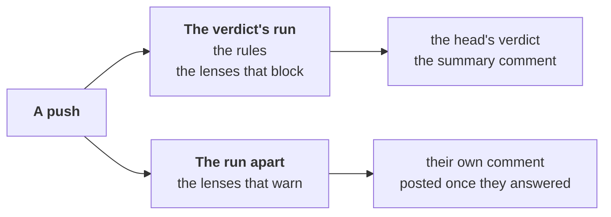

---
sources:
  - roles/reviewer/role.yaml#apart
  - roles/reviewer/role.yaml#settings.ai-findings
  - .workline/config.yaml#roles.reviewer.settings.ai-findings
  - roles/reviewer/code/reviewer.go#prepare
  - roles/reviewer/code/reviewer.go#state.side
  - roles/reviewer/code/reviewer.go#Settings.ofSide
  - roles/reviewer/code/reviewer.go#Settings.warns
  - roles/reviewer/code/reviewer.go#otherSide
  - roles/reviewer/code/reviewer.go#review
  - roles/reviewer/code/reviewer.go#final
  - roles/reviewer/code/reviewer.go#enforcement
  - roles/reviewer/code/record.go#answering
  - roles/reviewer/code/once.go#Record.leftTo
checked: cf8d4d9f
judged: a5cd2cf
verified: human:JN0V
---
# Reviewer — the lenses that warn, apart from the verdict

Part of [the reviewer](../README.md), on a merge request; why:
[ADR-0050](../../../docs/adr/0050-each-act-has-its-moment-and-a-wait-budget.md#2-an-act-over-its-budget).

The head's verdict waits only for what can block. A lens whose findings
only warn (`ai-findings: warn`, the default) reads in a run of its own,
beside the verdict's, and posts once it answered.

## Which run asks which lens

- **The lenses a push takes** are the same as in one run: one a push, in
  turn; every lens once when the merge request becomes ready
  ([the run on ready](ready.md)); none on a draft, in either run: the
  templates install no agent there.
- **The verdict's run** (`route --warn-apart`) asks, of those, the lenses
  that block — on workline itself, `ai-findings: {correctness: block}` —
  and their judges.
- **The run apart** (`route --warn-only`) asks the others and their
  judges; the diff-alone facet goes by its own `ai-findings`.
- **After ready, the run apart reads five new commits a push**
  (`commits-per-push`), the rest at the next push; the verdict's run
  reads every one ([after ready](ready.md#after-ready-only-what-is-new)).
  A change to what its own pipeline runs leaves none
  ([the record](run-record.md#3-the-record)).
- **A push whose turn is the other run's lens**: nobody asked in this
  run; the commits are recorded and the turn moves on, as in the other.
  A lens of this run whose block stands, the push changing code, is
  asked instead
  ([a block stands](verdict.md#a-block-stands-until-a-commit-answers-it)).
  A lens of this run that did not answer on them is asked instead: no
  run records what it owes
  ([#588](https://github.com/JN0V/workline/issues/588)). So is one that
  left commits past five a push: no run records what it left
  ([#591](https://github.com/JN0V/workline/issues/591)).
- **The rules** (`internal-code`
  [and the others](run.md#12-the-range-the-rules)) block on the verdict's
  run. While they block, the run apart asks no lens either, and says
  nothing of them again.
  They are read at the levels the project sets in
  `roles.<name>.enforce` first.
- **Every lens blocking** (`ai-findings: block`): the run apart asks
  nothing and writes nothing. **None blocking**: the verdict's run asks
  no lens; its summary comment still holds the rules and its record.
- **On a machine**: `workline review` asks every lens in one run
  ([as the run on ready does](ready.md#the-run-on-ready)).

## More

- **[The two comments and their records](apart-comments.md)**: the
  summary comment and the comment of the lenses that warn, each its own
  record.
- **[The verdict, and the run apart in CI](apart-ci.md)**: what the
  verdict holds and never waits for, and the jobs on GitHub and GitLab.
