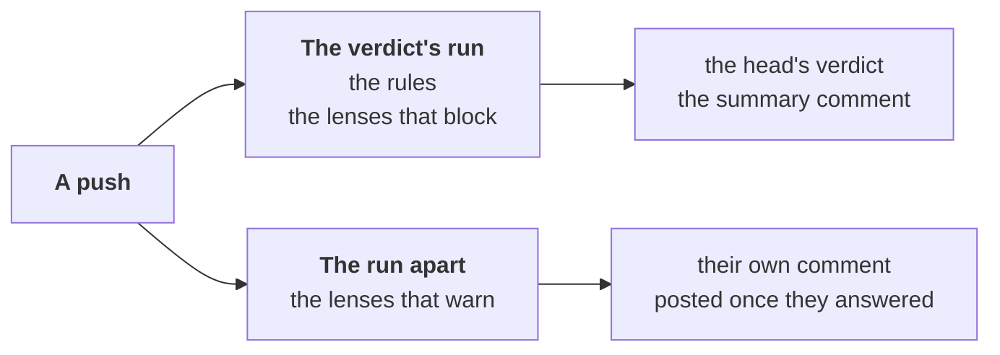

# Reviewer — the lenses that warn, apart from the verdict

Part of [the reviewer](../README.md), on a merge request; why:
[ADR-0050](../../../docs/adr/0050-each-act-has-its-moment-and-a-wait-budget.md#2-an-act-over-its-budget).

The head's verdict waits only for what can block. A lens whose findings
only warn (`ai-findings: warn`, the default) reads in a run of its own,
beside the verdict's, and posts once it answered.

## Which run asks which lens

- **The lenses a push takes** are the same as in one run: one a push, in
  turn; every lens once when the merge request becomes ready
  ([the run on ready](ready.md)); none on a draft, in either run: the
  templates install no agent there.
- **The verdict's run** (`route --warn-apart`) asks, of those, the lenses
  that block — on workline itself, `ai-findings: {correctness: block}` —
  and their judges.
- **The run apart** (`route --warn-only`) asks the others and their
  judges; the diff-alone facet goes by its own `ai-findings`.
- **After ready, the run apart reads five new commits a push**
  (`commits-per-push`), the rest at the next push; the verdict's run
  reads every one ([after ready](ready.md#after-ready-only-what-is-new)).
- **A push whose turn is the other run's lens**: nobody asked in this
  run; the commits are recorded and the turn moves on, as in the other.
- **The rules** (`bug-story`, `internal-code`) block on the verdict's
  run. While they block, the run apart asks no lens either, and says
  nothing of them again.
- **Every lens blocking** (`ai-findings: block`): the run apart asks
  nothing and writes nothing. **None blocking**: the verdict's run asks
  no lens; its summary comment still holds the rules and its record.

## Two comments, two records

- **The summary comment** is the verdict's run's: what blocks, its
  record, the blocks standing
  ([more](judge.md#a-block-stands-until-a-commit-answers-it)). It says the
  lenses that warn read apart.
- **The comment of the lenses that warn**: their findings, questions and
  record, edited each run; their comments on lines in a review of their
  own.
- **Two comments, not one**: each is written by its own applying job, one
  at a time per merge request. One comment written by both could lose a
  run's write when both apply at once.
- **Each run its own record**: neither waits for the other, nor loses
  what the other did not read. A run apart cancelled by a newer push
  leaves its record as it was: the next one reads those commits too.
- **The first run apart** on a merge request reviewed before takes up the
  summary comment's commits and turn.
- **The weekly sample** draws the findings judged from both comments
  ([ADR-0046](../../../docs/adr/0046-the-auditor-re-checks-every-roles-acts.md)).

## What the verdict holds, and what it never waits for

- **It holds** the committer, the gates, the documentalist, the rules,
  and the lenses that block with their judges.
- **It never waits** for a lens that only warns, nor its judges.
- **A warn finding arriving after the verdict** is shown, in its comment
  and on its line; it never changes a verdict given.
- **A lens that fails** — an answer that never reads, the tokens spent —
  says so in that comment (`lens-failed`), its record unmoved: the next
  push asks it again; the agent out of reach, in the job's log. It never
  turns a pass into a fail, nor a fail into a pass; the job stays green,
  only the engine's own error fails it.
- **The merge policy merges on the head's verdict**
  ([ADR-0042](../../../docs/adr/0042-the-engine-merges-by-the-projects-policy.md)):
  warn findings, and a lens that warns failing, may come after it, and
  after the merge. Read their comment before you accept, or accept
  knowing it may still post.

## In CI

- **GitHub**: workline.yml's `judge` leaves them (`--warn-apart`);
  [workline-warn.yml](../../../ci/github/workline-warn.yml) asks them
  beside it (`--warn-only`); workline-apply.yml applies both, and keeps
  the verdict from `judge` alone
  ([CI on GitHub](../../../docs/ci-github.md)). Without workline-warn.yml,
  `judge` warns that nothing reads them; with an older
  workline-apply.yml, which does not name it, `warn` warns and reads
  nothing: unposted, its record would never move.
- **GitLab**: `workline:warn`, from the pipeline's start, then
  `workline:warn:apply`, with the agent's token and the bot's; without
  the bot's, the lenses that warn read in `workline:judge`, said in its
  log and summary. Neither fails the pipeline
  ([CI on GitLab](../../../docs/ci-gitlab.md)). GitLab
  merges once the pipeline succeeds: the merge waits for them, never on
  what they find.
- **No agent, or no reviewer in the line**: the run apart ends at once.
- **On a machine**: `workline review` asks every lens in one run.
