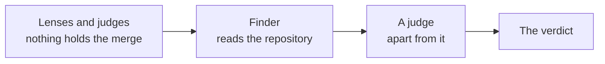

# Reviewer — the repository finder

Part of [the reviewer](../README.md), on a merge request; decided in
[ADR-0073](../../../docs/adr/0073-one-finder-reads-the-whole-repository-once.md).

The lenses read the files a change touches. The finder reads past
them, once, when nothing else holds the merge request.

## What it does

- **What it is given**: the whole change, base to head, and the
  repository's files by name, up to 400; nothing a lens found nor a
  judge said.
- **What it reads**: what it asks, as [a judge does](judge.md#when-the-judge-reads):
  a file's lines, a definition by its name, the lines naming a word,
  read from git at the head, within `judge-read-rounds` and
  `judge-read-lines-max`.
- **What it looks for**: one defect the change causes outside its own
  lines: a caller, a callee's contract, a test no workflow runs, a
  target platform's limit. Its prompt: `lenses/repository.md`, which a
  project may replace in `.workline/roles/reviewer/prompts/lenses/`.
- **Its answer**: yes, the defect in one sentence and the line causing it
  quoted; no; or unsure.

## What follows

- **A yes's quote found again** at the head is a finding of the lens
  `repository`: on the change, for its author; outside it, an issue, as
  a lens's ([the quotes](run-quotes.md#56-the-quotes-and-whose-finding-it-is)).
  Not found again: dropped, said.
- **Judged** by a judge apart from the finder: whether the code quoted
  fails as it says.
- **Holds the merge** when `ai-findings` blocks it: `{repository: block}`,
  or `block` for every lens. It stands until a commit answers it
  ([a block stands](verdict.md#a-block-stands-until-a-commit-answers-it)).

## When, and how often

- **Off by default** (`repo-finder: false`): on in workline's own line,
  warning, to measure it first. Replayed on three defects found past
  the change on DomoticsCore, it caught none
  ([ADR-0073](../../../docs/adr/0073-one-finder-reads-the-whole-repository-once.md#measure)).
- **On a merge request**, once every lens of the run answered and no
  other finding blocks; never on a draft, nor on a machine.
- **Alone** when the run asks no lens (nothing new to read, no code
  changed, no lens of its side): due, it is asked all the same.
- **A split review**: in the verdict's run when it blocks, in the run
  apart when it warns ([apart](apart.md)).
- **Once a merge request**: the record keeps the head it read
  (`<!-- workline:finder … -->`). Asked again only while its own block
  stands at a newer head; found no more, the block goes.
- **Unsure, or not run**: the try is recorded (`tries=1`), its block
  stands, and the next run asks it once more. A second time, it is not
  asked again; its own block, if any, goes to a judge, which keeps or
  drops it.
- **The summary says** what it came to, that it waits for nothing else
  to hold the merge, and what its material left out past a cap
  (`diff-lines-max`, the first 400 file names), as a warning.
- **Cost**: measured 2 to 3 calls, 35k to 70k tokens in a run, one judge
  more for a finding; within `ai-max-tokens`.
