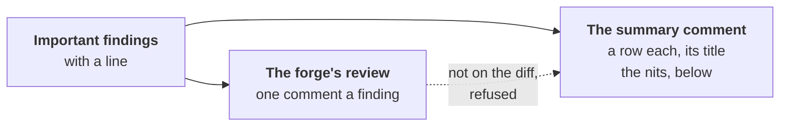

# Reviewer — each finding on its line

Part of [the reviewer](../README.md), on a merge request
([#277](https://github.com/JN0V/workline/issues/277)): each important
finding with a file and a line is a comment on that line, in the forge's
own review, as a person's review comment. A nit is shown in the summary
comment, and asks nothing
([ADR-0051, cut 4](../../../docs/adr/0051-a-check-sits-where-its-catch-is-worth-its-cost.md#cut-4-no-fix-round-for-nits)).

## What goes on a line

- **The rules' findings** (`bug-story`, `internal-code`, `long-comment`)
  and **each lens's important finding on the change**, one comment each:
  two lenses on one line, two comments, each resolved apart.
- **Each comment** says what it does to the merge request, `**blocks**` or
  `warns`, and the lens or rule; then the finding whole: its title, why,
  the fix, the author's words it contradicts, how it was verified.
- **Its line**: the line of the cause's quote that the change touched; a
  file moved, at its new path
  ([#358](https://github.com/JN0V/workline/issues/358)). For a use
  further down of a name a removed line tested, the line where the
  removal shows ([#357](https://github.com/JN0V/workline/issues/357)).
- **Not on a line**, in the summary comment as before: a finding quoted
  from the issue the change closes (`#4`), a question for a person.
  What lies outside the change is an issue, never a comment.

## What it asks

- **What blocks** stands until a commit fixes it
  ([more](judge.md#a-block-stands-until-a-commit-answers-it)).
- **What warns asks nothing**: no reply, no fix. The summary comment says
  so, and asks no answer of a comment on a line.
- **A nit is on no line**: no conversation to resolve. The summary comment
  lists the nits last, under **Nits**, "for information: no reply, no fix
  asked". A nit found on the same line as an important finding is named
  in that finding's row.
- **To hold the merge on every important finding**, turn on the forge's
  own rule: GitHub's "Require conversation resolution before merging" (a
  branch rule), GitLab's "All threads must be resolved" (merge checks).
  Nits never hold it: they open no conversation.

## The forge's own review

| Forge | What it posts | A line its diff does not show |
|---|---|---|
| GitHub | one pull request review, event `COMMENT`, each comment on its line at the head reviewed | refuses the whole review (422) |
| GitLab | a discussion on each line; a kept line given with its line before the change too | taken as a discussion on no line, silently |

- **Never an approval**, nor a request for changes
  ([ADR-0020](../../../docs/adr/0020-the-reviewer-finds-the-engine-verifies-the-person-merges.md)).
- **Once, not twice**: on a merge request, its findings stay out of the
  SARIF for code scanning, which would open a second conversation each
  ([#412](https://github.com/JN0V/workline/issues/412)).
- **The diff read first**: the pull request's files, the merge request's
  diffs; a line the forge does not show is known before anything is posted.
- **The summary comment** keeps a row for each finding on a line, its
  title only, and links to the review: the one posted, else the merge request's
  changes, where the comments show. The lenses that warn, read apart, post
  a review and rows of their own, in their own comment ([apart](apart.md)).
- **Other forges** (`local`, `cmd:`) take no comment on a line: each
  finding, in full, in the summary comment.

## Not repeated, found again

- **A key is hidden in each comment**: the lens or rule, the file, the
  line's text, spaces aside, and which of the lines reading so it is; a
  line that cannot be read, its number. Lines added above keep it; a line
  changed gets a new one.
- **Still open on the merge request**: not posted again, counted in the
  summary ("still open from before"). It matters on a later push that
  reads a line again, and when every lens reads the whole change once
  ready ([#129](https://github.com/JN0V/workline/issues/129)).
- **Resolved by a person**, and found again: posted again, in a new review.
- **Not found again**: left as it is; the forge marks it outdated when its
  line changes.
- **A block standing from a review before**, no lens reading it again
  ([#326](https://github.com/JN0V/workline/issues/326)): its row in the
  summary comment, marked `**blocks**`; its comment on the line is not
  posted again, resolved or not.

## When it cannot be on its line

Never a failed run for it: each such finding goes, in full, into the
summary comment under **Here only**, with why.

- **A line the merge request's diff does not show**: a range reviewed
  other than the merge request's, a file the forge gives no patch of
  (binary, too large).
- **A forge that refuses** (403, 422, 400; on GitLab 405, 406, 409 too):
  a token that may not review, GitHub's without `pull-requests: write`.
  Said in the run's findings too, `line-comment-refused`, a warning, and
  in the job's summary.
- **A fork's merge request**: nothing is applied there. On GitHub the
  fork workflow comments the job's summary, each finding in full; on
  GitLab nothing is commented
  ([ci-gitlab](../../../docs/ci-gitlab.md#what-the-template-does)).
- **A forge out of reach**: the run stops, resumable
  (`workline apply <run>`); the comments already posted are found open,
  not posted twice.

Tried live on both forges: [tried.md](tried.md#2026-10-12--each-finding-on-its-line-277-live).
