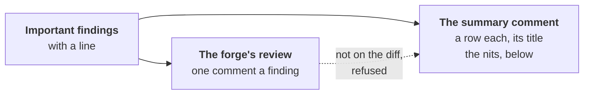

---
sources:
  - roles/reviewer/code/lines.go#lineComments
  - roles/reviewer/code/lines.go#fileLine
  - roles/reviewer/code/lines.go#holds
  - roles/reviewer/code/lines.go#lineBody
  - roles/reviewer/code/lines.go#ruleBody
  - roles/reviewer/code/lines.go#shortMessage
  - roles/reviewer/code/rules.go#storyRule
  - roles/reviewer/code/rules.go#mechanical
  - roles/reviewer/code/reviewer.go#found
  - roles/reviewer/code/reviewer.go#group
  - roles/reviewer/code/reviewer.go#members
  - roles/reviewer/code/reviewer.go#summaryComment
  - roles/reviewer/code/reviewer.go#apartNits
  - roles/reviewer/code/reviewer.go#state.standingFindings
  - roles/reviewer/code/reviewer.go#findingsTable
  - internal/forge/review.go#Reviewed.Section
checked: 60a7720e
judged: 39dcb7b
verified: agent:claude-code
---
# Reviewer — each finding on its line

Part of [the reviewer](../README.md), on a merge request
([#277](https://github.com/JN0V/workline/issues/277)): each important
finding with a file and a line is a comment on that line, in the forge's
own review, as a person's review comment. A nit is shown in the summary
comment, and asks nothing
([ADR-0051, cut 4](../../../docs/adr/0051-a-check-sits-where-its-catch-is-worth-its-cost.md#cut-4-no-fix-round-for-nits)).

## What goes on a line

- **The rules' findings** (`internal-code`, `long-comment`, `bug-story` with no agent)
  and **each lens's important finding on the change**, one comment each:
  two lenses on one line, two comments, each resolved apart.
- **Each comment** says what it does to the merge request, `**blocks**` or
  `warns`, and the lens or rule; then the finding whole: its title, why,
  the fix, the author's words it contradicts, how it was verified.
- **Its line**: the line of the cause's quote that the change touched; a
  file moved, at its new path
  ([#358](https://github.com/JN0V/workline/issues/358)). For a use
  further down of a name a removed line tested, the line where the
  removal shows ([#357](https://github.com/JN0V/workline/issues/357)).
- **Not on a line**, in the summary comment as before: a finding quoted
  from the issue the change closes (`#4`), a question for a person.
  What lies outside the change is an issue, never a comment.

## What it asks

- **What blocks** stands until a commit fixes it
  ([more](judge.md#a-block-stands-until-a-commit-answers-it)).
- **What warns asks nothing**: no reply, no fix. The summary comment says
  so, and asks no answer of a comment on a line.
- **A nit is on no line**: no conversation to resolve. The summary comment
  lists the nits last, under **Nits**, "for information: no reply, no fix
  asked". A nit found on the same line as an important finding is named
  in that finding's row.
- **To hold the merge on every important finding**, turn on the forge's
  own rule: GitHub's "Require conversation resolution before merging" (a
  branch rule), GitLab's "All threads must be resolved" (merge checks).
  Each holds it until the code answers it
  ([found again](lines-again.md#not-repeated-found-again)), or a person resolves it. Nits
  never hold it: they open no conversation.
- **A block standing from a review before**, no lens reading it again
  ([#326](https://github.com/JN0V/workline/issues/326)): its row in the
  summary comment, marked `**blocks**`; its comment on the line is not
  posted again, resolved or not.

## In detail

- [The forge's own review](lines-forge.md): what each forge posts, and
  when a finding cannot be on its line.
- [Not repeated, found again](lines-again.md): a comment's hidden key,
  and the conversations the reviewer resolves once the code answers.

Tried live on both forges: [tried.md](tried.md#2026-10-12--each-finding-on-its-line-277-live).
