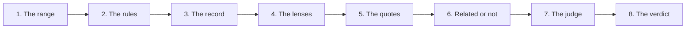

# Reviewer — a run on code

Part of [the reviewer](../README.md): what a review of a change does, step
by step. A spec is read the same way, with lenses of its own:
[a spec](spec.md). Steps 7 and 8, and what a run may spend: [the judge](judge.md).

## 1–2. The range, the rules

1. **The range.** `workline review`: `base..HEAD` (`base`, `--base`); on a
   merge request, the range CI gives. A change touching only what is not
   code (`ignore`) asks nobody.
   - **A file moved** is read as moved, as git finds a rename
     ([#358](https://github.com/JN0V/workline/issues/358)): only its
     changed lines are the change. Moved whole, it asks nobody; rewritten
     past half its lines, git's similarity, it is a new file.
   - **A release tool's pull request**
     ([#384](https://github.com/JN0V/workline/issues/384)), told by its
     branch (`release.branches`,
     [ADR-0017](../../../docs/adr/0017-the-release-manager.md)): a file
     whose every changed line is a version the tool bumps is not code.
     - A bump: the same line but for its first version, as release-please
       replaces it, on a line the tool marks — `x-release-please-version` (or `-major`, `-minor`,
       `-patch`), between `x-release-please-start-…` and
       `x-release-please-end`, `x-releaser-pleaser-version` — or in
       `.release-please-manifest.json`.
     - Only bumps and a changelog: nobody asked, the verdict passes.
     - Any other line in a file: that file is reviewed as on any branch.
2. **The rules**, on the comments the change adds, no agent:
   - a code internal to the project (`internal-code`, the committer's lists);
   - a block over `comment-block-max` lines (`long-comment`, a warning);
   - a story of the code (`story-words`), a guess never blocking ([Rule A of ADR-0065](../../../docs/adr/0065-code-only-what-converges-language-knowledge-in-packs.md#rule-a-a-guess-may-only-pass)):
     the `comments` lens judges each comment flagged, on the push adding
     it; with no agent, or no lens set to judge it (`hints: bug-story`),
     `bug-story` warns.

   While a rule blocks, no agent is asked; one the project sets to `warn`
   (`enforce`) only warns ([#550](https://github.com/JN0V/workline/issues/550)).

## 3–6. The record, the lenses, the quotes

- **3. The record**: commits a review answered whole are not asked
  again, rebased or not ([the record](run-record.md#3-the-record)).
- **4. The lenses**: what each one reads and answers
  ([the lenses](run-lenses.md#4-the-lenses)).
- **5–6. The quotes, and whose finding it is**: each cause found again;
  the change's goes to its author, the rest to an issue or a question
  ([the quotes](run-quotes.md#56-the-quotes-and-whose-finding-it-is)).

## On a machine

- The findings are printed, then the tokens each call used: the lenses',
  each judge's with its finding's place.
- The run's `out/review.json` (its path printed, or `--json`) gives them
  to the author's agent: each with its place, its cause quoted, whether
  it is the change's, and how it was verified; what each call used
  (`calls`); and what each judge read, a round each (`reads`).

## On a merge request

`workline init --review` adds the reviewer to the project's merge-request
line. The proposing job reads the summary comment, to know what was
reviewed: on GitHub it needs a read token (`GH_TOKEN`,
`pull-requests: read`), which
[defaults/ci/github/workline.yml](../../../defaults/ci/github/workline.yml) gives it. The
lenses that only warn read apart, in a comment of their own ([apart](apart.md)).

- **Each important finding on its line**, in the forge's own review; the
  summary comment keeps a row for each, its title, links to the review,
  and lists the nits last, asking nothing ([what it asks](lines.md#what-it-asks)).
- **A findings record**, hidden in the summary comment
  ([#705](https://github.com/JN0V/workline/issues/705)): one
  `workline:findings` line, each finding with its lens, whether it
  blocks, its place, severity and text. [The developer](../../developer/docs/review-loop.md)
  reads it, not the table: the table's words may change.
- **A blocked merge request still gets the comment**
  ([#226](https://github.com/JN0V/workline/issues/226)): what blocks
  first, marked `**blocks**`, then the warnings, then the nits; the issues
  outside the change opened as on a pass (role.yaml's `on-block`).
- **The record moves** as on a pass when every lens answered: the next
  push reviews only the new commits. A rule that blocks writes the comment
  too, the record left as it was: no lens ran.
- **The job still fails**: the proposing job by the verdict, while the
  applying one writes the comment (`if: always()`, `when: always`).

### The repository finder

Once nothing else holds the merge request, one call reads the whole
repository at the head, blind to the lenses, once a merge request:
[the finder](finder.md).

### Every lens once when it becomes ready

A draft asks no lens; the run when a merge request becomes ready reads
every lens once, on the whole change: what tells it on each forge, a
run on ready cancelled, a draft again, the cost: [the run on ready](ready.md).
