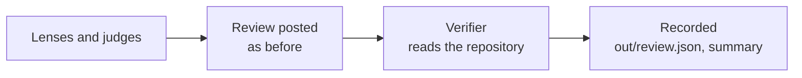

# Reviewer — the verifier, in shadow

Part of [the reviewer](../README.md): after [the verdict](verdict.md),
once the review is posted. Off by default; `verifier: shadow` turns it on.

## What it does

- **One agent call**, the task `verify` on the frontier tier (Opus with
  `claude`), 10 minutes at most, never asked again
  ([tasks/verify.md](../prompts/tasks/verify.md)).
- **Shown**: the change (up to `diff-lines-max` lines), what its author
  says, the issues it closes, and every finding and question the lenses
  raised but nits, whatever its judge said, as C1, C2…
- **Reads**: with `claude`, the repository at the change's head, through
  read and search tools only (a read tree).
- **Answers**: one note, `KEEP C<n> — why` or `DROP C<n> — why` for each
  point, `BLOCK <path>:<line> — why` for what the lenses missed, or
  `no blocking defect`.

## In shadow

- **It changes nothing**: the verdict, findings, labels, statuses and
  comments are those of `verifier: off`; its note is never applied.
- **After the review**: the engine asks it once the run's result is
  settled and applied, the comment posted. In CI, where one job judges
  and another applies, the judging job ends after it: the apply waits
  for it, 10 minutes at most.
- **Recorded**: `verifier` in the run's `out/review.json`: `shown`, the
  points as C1, C2…; `kept` and `dropped`, each `C<n> — why`; `added`,
  each `<where> — why`; and one summary line, `verifier (shadow): K
  kept, D dropped, A added`.
- **When**: a review of the whole change (on a machine, the run on
  ready); never the run apart ([apart](apart.md)) nor a push's run on
  its new commits alone.
- **No answer**, said in the summary as `the verifier gave no answer:
  <reason>`, the review as it was: no agent (`ai: none`), a `cmd:` agent
  (it reads no files), a task it could not prepare (a checkout or diff
  failing), a call failing or timing out, the run's tokens spent, or a
  refusal: an answer that does not read as its note, or in no line of
  its format.

## Why

- **Measured** on the reviewer's replay set (34 points to raise, 6 runs
  each): Sonnet lenses with an Opus verifier found 23 to 26 points,
  today's reviewer 16 to 19, no false Important on clean changes; most
  of the gain is outside the diff; about 60 % more time a review.
- **Shadow first**: real pull requests tell whether it holds, before
  its word decides anything.
