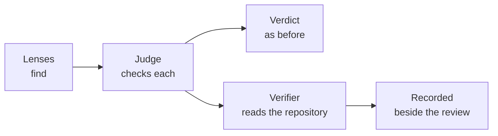

# Reviewer — the verifier, in shadow

Part of [the reviewer](../README.md): after [the judge](judge.md), before
[the verdict](verdict.md). Off by default; `verifier: shadow` turns it on.

## What it does

- **One agent call** on the frontier tier (Opus with `claude`), at the
  role's effort; any agent works: `claude`, `cmd:<any command>`.
- **Shown**: the change, what its author says, the issue it closes, and
  every important finding and question the lenses raised, whatever its
  judge said, as C1, C2…
- **Reads**: with `claude`, the repository at the change's head, through
  read and search tools only (a read tree); a `cmd:` agent has the task
  alone.
- **Answers**: `KEEP` or `DROP` each point, with why; `BLOCK` what the
  lenses missed, often outside the diff.
- **What holds a merge**: its prompt names the project's standards (the
  issue as a contract, a test that does not guard, an unannounced public
  change), [tasks/verify.md](../prompts/tasks/verify.md).

## In shadow

- **It changes nothing**: no finding dropped or added, no comment, no
  issue, the same status. Its note is not applied.
- **Recorded**: `verifier` in the run's `out/review.json` (the points
  shown and its note, whole), and a line of the summary, as
  `of 3 points shown, keeps 2, drops 1; adds 1`.
- **When**: a review that read the whole change (the run on ready, or a
  first `workline review`) and passes.
- **Never**: on a review that blocks, where an agent it cannot reach
  would turn the block into "agent unreachable"; nor on the verdict's
  run of a review split ([apart](apart.md)), whose wait it would
  lengthen: there it is asked on the run apart.
- **A failure** (no answer, one that does not read, the tokens spent)
  is said in the summary; the review stands as it was.

## Why, and what next

- **Measured** on the reviewer's replay set (24 cases, 34 planted
  points): Sonnet lenses with this verifier said 22 to 26 points a run
  by meaning, production's lenses and judge 15 to 17; no false block on
  clean cases; about 60 % longer a case. Most of the gain is reading
  the repository; a verifier can also drop true findings.
- **Shadow first**: those cases helped write its prompt; real pull
  requests tell whether it holds. `live` is not built: it would let
  the verifier's word decide, in place of the judge's.
