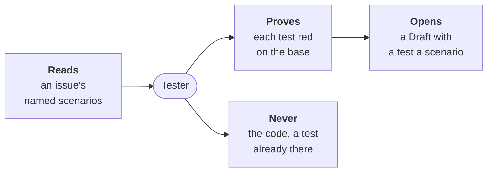

---
sources:
  - roles/tester/role.yaml
  - internal/tester
  - ci/github/workline-objection.yml
  - ci/github/workline-answer.yml
  - ci/github/workline-gardening.yml
checked: 99a14dc0
verified: agent:claude-code
---
# Tester



For people: what the role does and how to set it. The AI never reads this
file. All roles: [docs/roles.md](../../docs/roles.md). Where it stands:
[status](docs/status.md); its design:
[ADR-0055](../../docs/adr/0055-the-tester-writes-the-acceptance-tests-before-the-code.md).

**Does**, today (steps 1 to 7 of the
[build plan](../../docs/adr/0055-the-tester-writes-the-acceptance-tests-before-the-code.md#build-plan)):

- `workline test write --issue <n>`: has the agent write one test for
  each named scenario of an issue waiting for its tests, in the project's own framework;
- proves them red on the base, with no agent, then commits them on a
  work branch, opened as a Draft;
- `workline test check --base <ref>`: the same red-first check on any
  change, with no agent;
- keeps its tests from the builder, and answers an objection to one
  ([below](#frozen-tests-and-objections));
- runs on its own: an issue labelled `workline:needs-tests` at once,
  one a scheduled run, and an objection as it is posted ([below](#when-it-runs)); hands its Draft to whoever
  builds ([hand-over](docs/hand-over.md));
- proves the new tests green three runs out of three on the pull
  request that closes the issue: one red is flaky ([how](docs/green-proof.md));
- `workline test measure`: the corpus's measures, no agent, weekly in
  CI: count, time, slowest, red and flaky over time ([how](docs/curator.md));
- `workline test curate`: the agent proposes a few redundant tests
  removed; proven with no agent, coverage and killed mutants kept, a
  pull request the merge policy merges ([how](docs/removals.md)).

**Does not**, yet: adapt a test after a change ([status](docs/status.md#missing)).

## Write an issue's tests

```sh
workline test write --issue 42 --ai claude
```

- **The agent is a choice**: none, `claude`, `cmd:<any command>`
  (`--ai`, else the project's `ai` setting). With none, nothing is
  written: `no-agent` says so, and the issue waits for its tests.
- **The issue**: labelled `workline:needs-tests` (or `workline:ready`
  with no Draft), its Validation a list of
  named scenarios, as the product owner writes them
  ([writing an issue](../product-owner/docs/writing.md)):
  `- **Old debt:** Given …, When …, Then …`.
- **What the agent reads**: the scenarios, the Need, Verification and
  Scope, the files the Scope names, the tests beside them, the test
  command.
- **One test a scenario**: its name holds the scenario's name, its
  comment the Given / When / Then. A scenario no test can check is said
  in a note, listed in the Draft as not tested.
- **New test files only**: what `test-paths` names, never the code nor a
  test already there.
- **Proven red** by the check below, on the base with the tests alone.
- **In Go, a name the code lacks** breaks the package's build: no new
  test reported, `no-new-test` blocks; a bug's test, of code that
  exists, is proven ([status](docs/status.md#missing)).
- **The Draft**: branch `workline/tester/issue-<n>`, `Refs #<n>`, a
  `## Tests` table of each scenario and its test. A person builds on
  that branch; the [developer](../developer/docs/pull-request.md), on top of it.

| Finding | When; nothing is opened |
|---|---|
| `issue-not-ready` | the issue is labelled neither `workline:needs-tests` nor `workline:ready` |
| `tests-lint` | the tests do not pass the project's lint |
| `no-named-scenario` | its Validation names no scenario: asked of the product owner, never invented |
| `scenario-without-test` | no test names a scenario, and no note says why none can |
| `test-file-exists` | a patch changes a test file the base holds |
| `intention-refused` | a patch reaches a file outside `test-paths` |
| `test-green-on-base`, `no-new-test` | a test is not proven red, or none is named in the report |

## Frozen tests and objections

- **The record**: on the Draft, workline's own comment lists each test
  file, its git blob, the scenarios read. Only the tester's runs write it.
- **The guard**, no agent: route the tester on `merge-request`. On its
  branch, a test file changed or deleted by anyone else blocks,
  `tester-test-changed`. No label lifts it, and no commit trailer is
  trusted. With no record to read, `tester-record-missing` blocks.
- **An objection**: a comment on the test's line, opened by
  `workline:objection`, one field a line: `test:`, `scenario:`,
  `kind:` (wrong interface, over-specified, contradicts another
  scenario, untestable as written, the need itself), `why:`.
- **The answer**: `workline test answer --merge-request <n> --ai claude`
  takes the first objection waiting, checked out at the branch's tip.
  The agent reads the scenario first, then answers in the thread:
  - *kept*, with its reason;
  - *rewritten*: its own commit on the branch, `Refs` the thread. It
    still names the scenario and must be red on the base. The record
    and the reply follow only once the commit is pushed.
  - Either keeps a hidden line for the [weekly sample](../../docs/weekly-sample.md).
- **The need itself** goes to the product owner, with no agent: the
  issue back to `workline:to-refine`, said there and in the thread.
- **Bounded**: three answers a thread (`objection-exchanges`). The
  third first runs the [five whys](../../skills/five-whys/SKILL.md) on
  the thread and posts them with its answer: the chain, the root cause,
  one action. Missing or malformed, the answer is refused and asked
  again. After it, a person decides
  (`objection-person`: a label on the merge request, or an `@login`).
  The tester then follows the next comment of a person of the project;
  meanwhile the other objections are answered.
- **The agent is a choice** here too: with none, `no-agent`, it waits.

## When it runs

- **When an issue needs its tests**, route it on `issue` too:
  `issue: [tester, developer]`. The issue line runs it on an issue
  labelled `workline:needs-tests`
  ([the line of states](../../docs/spec/routing.md#the-line-of-states));
  its proven Draft moves the issue to ready
  ([the hand-over](docs/hand-over.md#when-the-tests-are-written)).
- **At night**, list it in the `schedule` line, after the product owner
  and the reviewer
  ([routing](../../docs/spec/routing.md#the-line)):
  `schedule: [documentalist, product-owner, reviewer, tester]`.
  - It takes **one issue a run**: the first waiting for its tests, in the backlog's
    order, whose Validation names scenarios and whose Draft is not open.
  - Then as `test write`. None waiting: it says so and passes.
  - It needs `--open-merge-request`, as the gardening templates give
    it; without, `no-merge-request` blocks.
  - Install your test runner in the gardening's judge job: the tests are
    proven red there.
- **On an objection**, in CI:
  - GitHub: [workline-objection.yml](../../ci/github/workline-objection.yml)
    notices the comment, with no token;
    [workline-answer.yml](../../ci/github/workline-answer.yml) answers,
    from the default branch. Copy both.
  - GitLab: the project's note webhook, on its own trigger URL,
    starts the template's `workline:objection:*` jobs
    ([how](../../docs/gitlab-trigger.md#a-label-or-a-comment-with-gitlab-alone)).
  - Woken by a person of the project or an App installed on it only.
- **Both** judge with no write token (`--no-apply`); a job apart
  applies, holding it and no agent's key (`workline apply <run>`; an
  objection's from the default branch, its run as data:
  [what each job holds](../../docs/objection-jobs.md)).

## Check a change

```sh
workline test check --base origin/main
```

- **Exit codes**: 0 pass, 1 block, 64 misuse; `--json`, `--repo <dir>`.
- **The head is `HEAD` as committed**: changes not committed are not read.
- **On a pull request's CI job**: the same line, the base its target
  branch; it needs the history down to the merge base (`fetch-depth: 0`
  on GitHub).

## What the check says

| Finding | Blocks | When |
|---|---|---|
| `test-green-on-base` | yes | a new test passes, or is skipped, on the base |
| `test-red-on-head` | yes | the change holds code, and a new test fails, is skipped, or did not run on the head |
| `setting-missing` | yes | `test-command` or `test-report` is not set |
| `report-missing` | yes | a run wrote no report where `test-report` says, or not JUnit XML |
| `tests-not-built` | no, warns | tests the base ran are not in the report of the base with the change's tests: their build broke there |
| `no-new-test` | no, warns | the change touches test files, but no new test is in the report |
| `build-broken` | yes | the build broke on the base with the change's tests, by more than a name the base lacks |
| `setting-invalid` | yes | a `build-errors` pattern does not compile |

- **A change with no new test** passes, and says so.
- **The change's tests alone** (no code yet, the tester's own change):
  only red on the base is asked; green is the code's job. When they
  break the build, the runner's record of it (gotestsum's `TestMain`)
  is not a new test: `tests-not-built` says so.
- **A missing name is red**: a test calling code the base lacks does
  not build there. Red only when each compiler error is such a name, in
  the change's tests ([how](docs/missing-name.md)).

## Settings

Under `roles: {tester: {settings: …}}` in `.workline/config.yaml`
([config reference](../../docs/config.md)); defaults from role.yaml:

| Key | Default | |
|---|---|---|
| `test-command` | none | runs the project's tests and writes a JUnit XML report; `{report}` is its path. The developer proves its code with it too |
| `test-report` | `junit.xml` | where the report is written, from the root: a path, or a pattern one folder deep |
| `test-paths` | each ecosystem's names | the test files, as patterns: `**/*_test.go`, `**/test_*.py`, `**/*.test.ts`, `tests/**` and others; the only files `test write` may add |
| `build-errors` | Go's | how a build broken by a missing name reads, by ecosystem ([page](docs/missing-name.md)) |
| `code-lines-max` | 1500 | lines of the Scope's code and tests given to the agent, all files together |
| `ai-max-tokens`, `ai-max-seconds` | 300000, 1200 | what one `test write` or `test answer` run may spend, and wait on its agent |
| `objection-exchanges` | 3 | the tester's answers in an objection's thread before a person decides |
| `objection-person` | `workline:human` | who decides then: a label put on the merge request, or an `@login` mentioned |
| `curator-*`, `suite-max-seconds`, `coverage-report` | 2 runs, 600 s | the curator's measures ([page](docs/curator.md#settings)) and removals ([page](docs/removals.md#settings)) |

The command, by ecosystem:

| Runner | `test-command` |
|---|---|
| Go | `gotestsum --junitfile {report} ./...` |
| pytest | `pytest --junitxml={report}` |
| Jest | `JEST_JUNIT_OUTPUT_FILE={report} npx jest --reporters=jest-junit` |
| cargo nextest | `cargo nextest run --profile ci`, `test-report` set to its JUnit path |
| Maven | `mvn test`, `test-report: target/surefire-reports/*.xml` |
