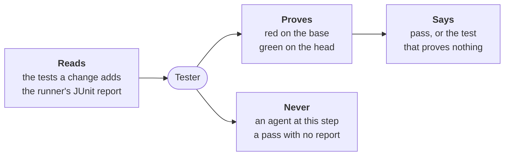

---
sources:
  - roles/tester/role.yaml
  - internal/tester
checked: d09d3c87
verified: agent:claude-code
---
# Tester



For people: what the role does and how to set it. The AI never reads this
file. All roles: [docs/roles.md](../../docs/roles.md). Where it stands:
[status](docs/status.md); its design:
[ADR-0055](../../docs/adr/0055-the-tester-writes-the-acceptance-tests-before-the-code.md).

**Does**, today (step 1 of the
[build plan](../../docs/adr/0055-the-tester-writes-the-acceptance-tests-before-the-code.md#build-plan)):

- runs `workline test check --base <ref>`: the red-first check, with no
  agent;
- runs the project's own test command three times at most, each in a
  checkout apart: on the base, on the head, and on the base with the
  test files the change adds or changes laid on it (a deleted one stays
  as the base has it);
- reads each run's JUnit XML report: pytest, gotestsum, jest-junit,
  cargo nextest, Surefire and behave write it;
- names the new tests: those the head's report holds and the base's
  does not;
- refuses a new test that passes on the base, `test-green-on-base`: it
  proves nothing new;
- when the change holds code too, refuses a new test that fails on the
  head, `test-red-on-head`.

**Does not**, yet: write the tests from an issue's criteria, freeze them
against the builder, or prune the corpus. Those are the next steps of
the plan ([status](docs/status.md#missing)).

## Run it

```sh
workline test check --base origin/main
```

- **Exit codes**: 0 pass, 1 block, 64 misuse.
- **`--json`**: the result as JSON; `--repo <dir>`: another checkout.
- **The head is `HEAD` as committed**: changes not committed are not
  read.
- **On a pull request's CI job**: the same line, the base its target
  branch; it needs the history down to the merge base (`fetch-depth: 0`
  on GitHub).

## What it says

| Finding | Blocks | When |
|---|---|---|
| `test-green-on-base` | yes | a new test passes, or is skipped, on the base |
| `test-red-on-head` | yes | the change holds code, and a new test fails, is skipped, or did not run on the head |
| `setting-missing` | yes | `test-command` or `test-report` is not set |
| `report-missing` | yes | a run wrote no report where `test-report` says, or not JUnit XML |
| `tests-not-built` | no, warns | tests the base ran are not in the report of the base with the change's tests: their build broke there |
| `no-new-test` | no, warns | the change touches test files, but no new test is in the report |

- **A change with no new test** passes, and says so.
- **The change's tests alone** (no code yet, the tester's own change):
  only red on the base is asked; green is the code's job. When they
  break the build, the runner's record of it (gotestsum's `TestMain`)
  is not a new test: `tests-not-built` says so.
- **A missing name is red**: a new test that calls code the base lacks
  does not build there, which counts as red. In Go it breaks the
  package's build, said by `tests-not-built`.

## Settings

Under `roles: {tester: {settings: …}}` in `.workline/config.yaml`
([config reference](../../docs/config.md)); defaults from role.yaml:

| Key | Default | |
|---|---|---|
| `test-command` | none | runs the project's tests and writes a JUnit XML report; `{report}` is its path |
| `test-report` | `junit.xml` | where the report is written, from the root: a path, or a pattern one folder deep |
| `test-paths` | each ecosystem's names | the test files, as patterns: `**/*_test.go`, `**/test_*.py`, `**/*.test.ts`, `tests/**` and others |

The command, by ecosystem:

| Runner | `test-command` |
|---|---|
| Go | `gotestsum --junitfile {report} ./...` |
| pytest | `pytest --junitxml={report}` |
| Jest | `JEST_JUNIT_OUTPUT_FILE={report} npx jest --reporters=jest-junit` |
| cargo nextest | `cargo nextest run --profile ci`, `test-report` set to its JUnit path |
| Maven | `mvn test`, `test-report: target/surefire-reports/*.xml` |
