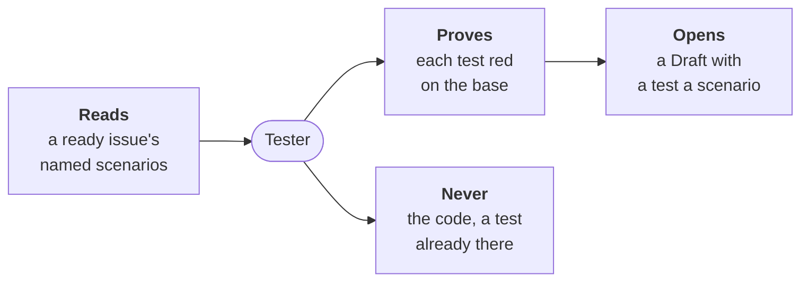

---
sources:
  - roles/tester/role.yaml
  - internal/tester
checked: d09d3c87
verified: agent:claude-code
---
# Tester



For people: what the role does and how to set it. The AI never reads this
file. All roles: [docs/roles.md](../../docs/roles.md). Where it stands:
[status](docs/status.md); its design:
[ADR-0055](../../docs/adr/0055-the-tester-writes-the-acceptance-tests-before-the-code.md).

**Does**, today (steps 1 and 2 of the
[build plan](../../docs/adr/0055-the-tester-writes-the-acceptance-tests-before-the-code.md#build-plan)):

- `workline test write --issue <n>`: has the agent write one test for
  each named scenario of a ready issue, in the project's own framework;
- proves them red on the base, with no agent, then commits them on a
  work branch, opened as a Draft;
- `workline test check --base <ref>`: the same red-first check on any
  change, with no agent.

**Does not**, yet: keep the tests from the builder, answer an
objection, run on its own on each ready issue, or prune the corpus.
Those are the next steps ([status](docs/status.md#missing)).

## Write an issue's tests

```sh
workline test write --issue 42 --ai claude
```

- **The agent is a choice**: none, `claude`, `cmd:<any command>`
  (`--ai`, else the project's `ai` setting). With none, nothing is
  written: `no-agent` says so, and the issue waits for its tests.
- **The issue**: labelled `workline:ready`, its Validation a list of
  named scenarios, as the product owner writes them
  ([writing an issue](../product-owner/docs/writing.md)):
  `- **Old debt:** Given …, When …, Then …`.
- **What the agent reads**: the scenarios, the Need, Verification and
  Scope, the files the Scope names, the tests beside them, the test
  command.
- **One test a scenario**: its name holds the scenario's name, its
  comment the Given / When / Then. A scenario no test can check is said
  in a note, listed in the Draft as not tested.
- **New test files only**: what `test-paths` names, never the code nor a
  test already there.
- **Proven red** by the check below, on the base with the tests alone.
- **In Go, a name the code lacks** breaks the package's build: the
  report names no new test, and `no-new-test` blocks. A test of code
  that exists, a bug's, is proven
  ([status](docs/status.md#missing)).
- **The Draft**: branch `workline/tester/issue-<n>`, `Refs #<n>`, a
  `## Tests` table of each scenario and its test. Whoever builds the code
  pushes on that branch.

| Finding | When; nothing is opened |
|---|---|
| `issue-not-ready` | the issue is not labelled `workline:ready` |
| `no-named-scenario` | its Validation names no scenario: asked of the product owner, never invented |
| `scenario-without-test` | no test names a scenario, and no note says why none can |
| `test-file-exists` | a patch changes a test file the base holds |
| `intention-refused` | a patch reaches a file outside `test-paths` |
| `test-green-on-base`, `no-new-test` | a test is not proven red, or none is named in the report |

## Check a change

```sh
workline test check --base origin/main
```

- **Exit codes**: 0 pass, 1 block, 64 misuse.
- **`--json`**: the result as JSON; `--repo <dir>`: another checkout.
- **The head is `HEAD` as committed**: changes not committed are not
  read.
- **On a pull request's CI job**: the same line, the base its target
  branch; it needs the history down to the merge base (`fetch-depth: 0`
  on GitHub).

## What the check says

| Finding | Blocks | When |
|---|---|---|
| `test-green-on-base` | yes | a new test passes, or is skipped, on the base |
| `test-red-on-head` | yes | the change holds code, and a new test fails, is skipped, or did not run on the head |
| `setting-missing` | yes | `test-command` or `test-report` is not set |
| `report-missing` | yes | a run wrote no report where `test-report` says, or not JUnit XML |
| `tests-not-built` | no, warns | tests the base ran are not in the report of the base with the change's tests: their build broke there |
| `no-new-test` | no, warns | the change touches test files, but no new test is in the report |

- **A change with no new test** passes, and says so.
- **The change's tests alone** (no code yet, the tester's own change):
  only red on the base is asked; green is the code's job. When they
  break the build, the runner's record of it (gotestsum's `TestMain`)
  is not a new test: `tests-not-built` says so.
- **A missing name is red**: a new test that calls code the base lacks
  does not build there, which counts as red. In Go it breaks the
  package's build, said by `tests-not-built`.

## Settings

Under `roles: {tester: {settings: …}}` in `.workline/config.yaml`
([config reference](../../docs/config.md)); defaults from role.yaml:

| Key | Default | |
|---|---|---|
| `test-command` | none | runs the project's tests and writes a JUnit XML report; `{report}` is its path |
| `test-report` | `junit.xml` | where the report is written, from the root: a path, or a pattern one folder deep |
| `test-paths` | each ecosystem's names | the test files, as patterns: `**/*_test.go`, `**/test_*.py`, `**/*.test.ts`, `tests/**` and others; the only files `test write` may add |
| `code-lines-max` | 1500 | lines of the Scope's code and tests given to the agent, all files together |
| `ai-max-tokens`, `ai-max-seconds` | 300000, 1200 | what one `test write` run may spend, and wait on its agent |

The command, by ecosystem:

| Runner | `test-command` |
|---|---|
| Go | `gotestsum --junitfile {report} ./...` |
| pytest | `pytest --junitxml={report}` |
| Jest | `JEST_JUNIT_OUTPUT_FILE={report} npx jest --reporters=jest-junit` |
| cargo nextest | `cargo nextest run --profile ci`, `test-report` set to its JUnit path |
| Maven | `mvn test`, `test-report: target/surefire-reports/*.xml` |
