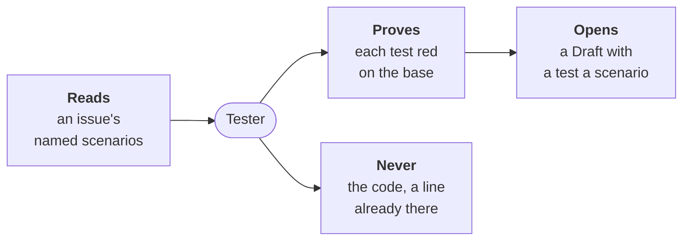

---
sources:
  - roles/tester/role.yaml
  - internal/tester
  - ci/github/workline-objection.yml
  - ci/github/workline-answer.yml
  - ci/github/workline-gardening.yml
checked: 01e06784
verified: agent:claude-code
---
# Tester



For people: what the role does and how to set it. The AI never reads this
file. All roles: [docs/roles.md](../../docs/roles.md). Where it stands:
[status](docs/status.md); its design:
[ADR-0055](../../docs/adr/0055-the-tester-writes-the-acceptance-tests-before-the-code.md).

**Does**, today (steps 1 to 7 of the
[build plan](../../docs/adr/0055-the-tester-writes-the-acceptance-tests-before-the-code.md#build-plan)):

- `workline test write --issue <n>`: has the agent write one test for
  each named scenario of an issue waiting for its tests, in the project's own framework;
- proves them red on the base, with no agent, then commits them on a
  work branch, opened as a Draft;
- `workline test check --base <ref>`: the same red-first check on any change, with no agent;
- keeps its tests from the builder, and answers an objection to one
  ([below](#frozen-tests-and-objections));
- runs on its own: an issue labelled `workline:needs-tests` at once,
  one a scheduled run, and an objection as it is posted ([below](#when-it-runs)); hands its Draft to whoever
  builds ([hand-over](docs/hand-over.md));
- proves each test it froze green three runs out of three on the pull
  request that closes the issue: one red is flaky, one missing blocks ([how](docs/green-proof.md));
- `workline test measure`: the corpus's measures, no agent, weekly in
  CI: count, time, slowest, red and flaky over time ([how](docs/curator.md));
- `workline test curate`: the agent proposes a few redundant tests
  removed; proven with no agent, coverage and killed mutants kept, a
  pull request the merge policy merges ([how](docs/removals.md)).

**Does not**, yet: adapt a test after a change ([status](docs/status.md#missing)).

## Write an issue's tests

```sh
workline test write --issue 42 --ai claude
```

- **The agent is a choice**: none, `claude`, `cmd:<any command>`
  (`--ai`, else the project's `ai` setting). With none, nothing is
  written: `no-agent` says so, and the issue waits for its tests.
- **The issue**: labelled `workline:needs-tests` (or `workline:ready`
  with no Draft), its Validation a list of
  named scenarios, as the product owner writes them
  ([writing an issue](../product-owner/docs/writing.md)):
  `- **Old debt:** Given …, When …, Then …`; a `**Scenario: Old debt**`
  or `Scenario: Old debt` line with its steps below is read too.
- **The test command runs first**, on the base, a minute at most: one
  that fails with no report (an SDK not found, a tool missing) stops the
  run before the agent, its error lines quoted (`test-command-fails`);
  `workline doctor` runs it on HEAD the same way
  ([#1333](https://github.com/JN0V/workline/issues/1333)).
- **What the agent reads**: the scenarios, the Need, a person's
  Verification and the reviewer's findings on it, the Scope, the code the issue names, found by [the code
  picker](../../docs/spec/code-picker.md) (the Scope's files, a folder's
  own, a pattern's matches; each definition of a name its title, Need or
  Scope writes as code; a long file by those pieces), the tests beside
  them, the test command. Long lines over the context budget: fewer
  lines given; still over, the issue says so and names `context.budget`,
  and goes to Blocked, where the product owner reads it at once to narrow
  its Scope ([routing](../../docs/spec/routing.md#the-line-of-states)).
  What was cut is said in the run
  (`input-cut`), with the setting that raises it.
- **With `claude`, it reads the project too**: a copy at the issue's
  base, read-only (Read, Glob, Grep; no shell), the picker's code its
  start; it finds the test helpers itself, and a helper it could not
  confirm is listed on the Draft as assumed. What it read is logged
  with the call
  ([ADR-0063 §8](../../docs/adr/0063-every-open-issue-is-due-waiting-or-done.md#8-one-code-picker-and-tools-where-the-agent-has-them)).
  Another agent reads its task alone, and names the files it lacks
  (`needs:`), given at once.
- **One test a scenario, declared**: the agent says which test covers
  which scenario, a `covers` entry each, the test's id as the report
  names it, a parametrised test by its name for all its rows; one test
  may cover several. Each id must be one of the new
  tests red on the base, or, the build broken with no report, a test a
  new file declares, or that file alone where no `test-name` names its
  tests ([#1293](https://github.com/JN0V/workline/issues/1293)); nothing is read from a test's name. A scenario no
  test can check gets a reason instead, listed in the Draft as not
  tested, for a builder to object to
  ([ADR-0065](../../docs/adr/0065-code-only-what-converges-language-knowledge-in-packs.md#4-the-agent-says-which-test-covers-which-scenario)).
- **Where the project keeps its tests**: what `test-paths` names, never
  the code. A new file, or one already there, as the agent judges: to
  that one it only adds lines, none changed nor removed.
- **Proven red** by the check below, on the base with the tests alone.
- **In Go, a name the code lacks** breaks the package's build: no new
  test reported, `no-new-test` blocks; a bug's test, of code that
  exists, is proven ([status](docs/status.md#missing)).
- **The Draft**: branch `workline/tester/issue-<n>`, `Refs #<n>`, a
  `## Tests` table of each scenario and its declared tests. A person builds on
  that branch; the [developer](../developer/docs/pull-request.md), on top of it.
- **The issue's Verification**: written from the tests, each scenario
  and its test, as a tester writes the test plan; one a person wrote is
  kept ([how](docs/verification.md)).

| Finding | When; nothing is opened |
|---|---|
| `issue-not-ready` | the issue is labelled neither `workline:needs-tests` nor `workline:ready` |
| `tests-lint` | the tests do not pass the project's lint, still after the agent is asked once more with each finding |
| `no-named-scenario` | its Validation names no scenario: asked of the product owner, never invented |
| `scenario-without-test` | a scenario has no `covers` entry, no test nor reason; asked again once with the names first |
| `declared-test-missing` | a declared test is none of the new tests red on the base, nor of the test files written; asked again once, then blocked: the product owner reads a blocked issue again |
| `declared-test-ambiguous` | a declared id is the end of several new tests (`test_x` for `a.test_x` and `b.test_x`); asked again once for a longer id, then blocked |
| `test-line-changed` | a patch changes or removes a line of a test file the base holds |
| `base-test-skipped` | a test that ran on the base is skipped with the tests laid on it |
| `intention-refused` | a patch reaches a file outside `test-paths` |
| `test-green-on-base` | a test is not proven red; asked again once, told how to mend it (one passing on the base may keep its scenario as today), then blocked. A feature's answer keeping every scenario as today is `none`, back to the product owner |
| `no-new-test` | the report names no test of the files written: the project's runner did not run them, the filter that may skip them named (a PlatformIO `test_filter`); the next run gives the agent this reason |
| `bug-not-reproduced` | a bug's tests all pass on the base: `workline:needs-repro`, its reporter asked ([how](docs/hand-over.md#a-bug-not-reproduced)) |
| `no-test-written` | no test proposed, the answer unread or refused whole; an answer that does not read is asked again once first. An answer read with no test nor kind is `none`, back to the product owner |

Each refusal is written on the issue ([how](docs/hand-over.md#when-the-tester-refuses-an-issue)).

## Frozen tests and objections

- **The record**: on the Draft, workline's own comment lists each test
  file, its git blob, the scenarios read, the tests declared for each. Only the tester's runs write it.
  What it freezes is the tester's own lines: a whole new file, or the
  lines it added to one already there.
- **The guard**, no agent: route the tester on `merge-request`. On its
  Draft, and on a pull request closing the Draft's issue (the
  developer's; each Draft of the issues it closes), a frozen line changed
  or removed, or its file deleted, by anyone else blocks,
  `tester-test-changed`, naming the test's first line. Lines added
  beside them pass. No label lifts it, and no commit trailer is
  trusted. With no record to read, `tester-record-missing` blocks.
- **An objection**: a comment on the test's line in the Draft, opened by
  `workline:objection`, one field a line: `test:`, `scenario:`,
  `kind:` (wrong interface, over-specified, contradicts another
  scenario, untestable as written, the need itself, a test missing),
  `why:`.
- **A test missing** ([#1265](https://github.com/JN0V/workline/issues/1265)):
  the review found a behaviour with no test, on code; the developer
  sends it, naming no scenario. The agent reads every scenario and
  the finding's file as the pull request has it
  ([#1416](https://github.com/JN0V/workline/issues/1416)), and
  answers:
  - *added*: the test in one of its tests of the issue, the file whole
    or a diff, proven as a rewrite;
  - *none needed*: its reason;
  - *lacks code* (`needs:`): the files it lacks, never read as *none
    needed*.
  - Its answer is said on the pull request whose review found it too,
    naming the finding's line and title: the developer reads it there,
    and the reviewer's judge weighs a *none needed*
    ([weighed](../reviewer/docs/tester-answers.md)).
- **The answer**: `workline test answer --merge-request <n> --ai claude`
  takes the first objection waiting, checked out at the branch's tip.
  The agent reads the scenario first, then answers in the thread:
  - *kept*, with its reason;
  - *rewritten*: its own commit on the branch, `Refs` the thread. It
    must be red on the base, and keep its scenarios' declared tests,
    or name the new ones in a `covers` entry. The record
    and the reply follow only once the commit is pushed.
  - Either keeps a hidden line for the [weekly sample](../../docs/weekly-sample.md).
- **The need itself** goes to the product owner, with no agent: the
  issue back to `workline:to-refine`, said there and in the thread.
- **Bounded**: three answers a thread (`objection-exchanges`). The
  third first runs the [five whys](../../skills/five-whys/SKILL.md) on
  the thread and posts them with its answer: the chain, the root cause,
  one action. Missing or malformed, the answer is refused and asked
  again. After it, the product owner settles it: the issue back to
  refine, said there and in the thread; objected to again after that,
  the issue goes `workline:blocked`, its reason on it
  ([ADR-0059](../../docs/adr/0059-an-issue-moves-by-its-state-each-step-wakes-the-next.md#6-disagreements-end-at-the-product-owner-then-blocked)).
  No person is asked; a comment of one of the project's there is
  followed. Meanwhile the other objections are answered.
- **The agent is a choice** here too: with none, `no-agent`, it waits.

## When it runs

- **At once**, routed on `issue` too: an issue labelled
  `workline:needs-tests` ([the hand-over](docs/hand-over.md#when-the-tests-are-written)).
- **At night**, list it in the `schedule` line, after the product owner
  and the reviewer
  ([routing](../../docs/spec/routing.md#the-line)):
  `schedule: [documentalist, product-owner, reviewer, tester]`.
  - It takes **one issue a run**: the first waiting for its tests, in the backlog's
    order, whose Validation names scenarios and whose Draft is not open.
  - Then as `test write`. None waiting: it says so and passes.
  - It needs `--open-merge-request`, as the gardening templates give
    it; without, `no-merge-request` blocks.
  - Install your test runner in the gardening's judge job: the tests are
    proven red there.
- **On an objection**, in CI:
  - GitHub: [workline-objection.yml](../../ci/github/workline-objection.yml)
    notices the comment, with no token;
    [workline-answer.yml](../../ci/github/workline-answer.yml) answers,
    from the default branch. Copy both.
  - GitLab: the project's note webhook, on its own trigger URL,
    starts the template's `workline:objection:*` jobs
    ([how](../../docs/gitlab-trigger.md#a-label-or-a-comment-with-gitlab-alone)).
  - Woken by a person of the project or an App installed on it only.
- **Both** judge with no write token (`--no-apply`); a job apart
  applies, holding it and no agent's key (`workline apply <run>`; an
  objection's from the default branch, its run as data:
  [what each job holds](../../docs/objection-jobs.md)).

## Check a change

```sh
workline test check --base origin/main
```

- **Exit codes**: 0 pass, 1 block, 64 misuse; `--json`, `--repo <dir>`.
- **The head is `HEAD` as committed**: changes not committed are not read.
- **On a pull request's CI job**: the same line, the base its target
  branch; it needs the history down to the merge base (`fetch-depth: 0`
  on GitHub).

## What the check says

| Finding | Blocks | When |
|---|---|---|
| `test-green-on-base` | yes | a new test passes, or is skipped, on the base |
| `test-red-on-head` | yes | the change holds code, and a new test fails, is skipped, or did not run on the head |
| `setting-missing` | yes | `test-command` or `test-report` is not set |
| `test-command-fails` | yes | writing an issue's tests: the test command, run on the base before the agent, failed with no report |
| `setting-invalid` | yes | `test-report` leaves the repository's root, a `module-files` name holds a `/`, or `build-errors` does not compile |
| `report-missing` | yes | a run wrote no report where `test-report` says, or not JUnit XML; its error lines quoted. With the change's tests and no error a row reads, the agent is asked once more ([missing name](docs/missing-name.md)) |
| `tests-not-built` | no, warns | tests the base ran are not in the report of the base with the change's tests: their build broke there |
| `suite-record` | no, informs | the change's tests alone: a new case is the runner's record of its suite, not a test, not frozen |
| `no-new-test` | no, warns | the change touches test files, but no new test is in the report |
| `red-unproven` | no, warns; `human` with no agent | the build broke on the base past the fast path, and the judge did not settle it: the Draft opens marked, the developer starts ([broken build](docs/missing-name.md#the-judge)) |
| `build-broken` | yes | the build broke on the base with the change's tests, and the judge says it is not by what the issue adds, its line quoted ([broken build](docs/missing-name.md)); writing an issue's tests, after the agent is asked once more with the error, then a machine error the line runs again ([the record](../../docs/spec/routing.md#once-a-state-the-record)) |

- **A change with no new test** passes, and says so.
- **The change's tests alone** (no code yet, the tester's own change):
  only red on the base is asked; green is the code's job. When they
  break the build, the runner's record of it (gotestsum's `TestMain`)
  is not a new test: `tests-not-built` says so.
- **A runner's record of a suite** (PlatformIO's `native:<suite>`): a
  case red by an error, a name none of the change's test files holds,
  beside the suite's tests. Not a test, never frozen: `suite-record`
  says so
  ([#1325](https://github.com/JN0V/workline/issues/1325)).
- **A broken build is read, then judged**: each compiler error a name
  the base lacks and the issue names is red at once; any other goes to
  the judge, whose yes is red and no `build-broken`
  ([how](docs/missing-name.md)).

## Settings

Under `roles: {tester: {settings: …}}` in `.workline/config.yaml`
([config reference](../../docs/config.md)); defaults from role.yaml:

| Key | Default | |
|---|---|---|
| `test-command` | none | runs the project's tests and writes a JUnit XML report; `{report}` is its path. The developer proves its code with it too |
| `draft-command` | none: `test-command` | proves a Draft red on the folders holding its tests alone, `{packages}`, not the whole suite twice ([#979](https://github.com/JN0V/workline/issues/979)) |
| `module-files` | none | the file marking a build module, by name alone: `build.gradle.kts` or `pom.xml`. `{packages}` is then the modules a change touches; with a build file at the root, a file outside any module runs the whole suite. The command turns a folder into its task ([#1176](https://github.com/JN0V/workline/issues/1176)) |
| `test-report` | `junit.xml` | where the report is written, from the root: a path, or a pattern, `**` spanning folders, each file it names read. Removed before each run, but a file git tracks, in a nested repository, or through a folder linked outside the root, as Bazel's `bazel-testlogs/*/*/test.xml`: kept, read only if the run rewrites it into a JUnit report ([#1175](https://github.com/JN0V/workline/issues/1175), [#1185](https://github.com/JN0V/workline/issues/1185), [#1189](https://github.com/JN0V/workline/issues/1189)) |
| `test-paths` | none: the packs' | the test files, as patterns; every role reads them, the one definition of a test file ([ADR-0065](../../docs/adr/0065-code-only-what-converges-language-knowledge-in-packs.md#3-one-definition-of-a-test-file)). Unset: the listed [packs'](../../docs/packs.md) with the generic pack's, else the generic pack's alone: `test/`, `tests/`, `Tests/`, `__tests__/` folders, `test_*`, `*_test.*`, `*_spec.*`, `*.test.*`, `*.spec.*`, said by `workline doctor`. The only files `test write` may add; a new one beside the Scope is not listed beyond it by the developer ([its bounds](../developer/docs/bounds.md#what-it-checks)) |
| `test-homes` | none: the packs' | where a test's code lives, for the developer's Scope: `[{tests: "**/src/test/kotlin/**", code: "**/src/main/kotlin/**"}]`, each `**` filling the next; unset, the listed [packs'](../../docs/packs.md), then the generic ones: the folder holding a `test/` or `tests/` folder; in none, the test's own folder |
| `build-errors` | Go, Kotlin, Java, Gradle, pytest | how a broken build's errors and missing names read, by ecosystem ([page](docs/missing-name.md)) |
| `judge-read-rounds`, `judge-read-lines-max` | 2, 400 | what the judge of a broken build may read of the base before it answers ([page](docs/missing-name.md#the-judge)) |
| `code-lines-max` | 1500 | lines of the code the issue names and of the tests given to the agent, all files together, fewer when long lines would pass the context budget; a longer file gives the pieces the issue names in it, inside its declarations; the files the test and the Scope include or import, two steps deep, as declarations ([the code picker](../../docs/spec/code-picker.md)); a fifth kept for a test beside when the code would fill it; files past it are named with their size |
| `ai-max-tokens`, `ai-max-seconds` | 300000, 1200 | what one `test write` or `test answer` run may spend, and wait on its agent |
| `ai-max-turns` | 40 | the turns of an agent that reads the project itself (`claude`), told in its task and enforced by the engine (`claude --max-turns`); reached before it answered: asked again once, then a machine error the line retries, never "no test possible" ([#1194](https://github.com/JN0V/workline/issues/1194)) |
| `objection-exchanges` | 3 | the tester's answers in an objection's thread before the product owner settles it |
| `curator-*`, `suite-max-seconds`, `coverage-report` | 2 runs, 600 s | the curator's measures ([page](docs/curator.md#settings)) and removals ([page](docs/removals.md#settings)); a Draft's proof stops at three times `suite-max-seconds`: its test command and the processes it started are killed on Linux and macOS, the command alone on Windows; a build daemon that detaches, as Gradle's, lives on ([#1197](https://github.com/JN0V/workline/issues/1197)) |

The command, by ecosystem:

| Runner | `test-command` |
|---|---|
| Go | `gotestsum --junitfile {report} ./...` |
| pytest | `python -m pytest --junitxml={report}`: the root on the import path, as a project not installed needs |
| Jest | `JEST_JUNIT_OUTPUT_FILE={report} npx jest --reporters=jest-junit` |
| cargo nextest | `cargo nextest run --profile ci`, `test-report` set to its JUnit path |
| Maven | `mvn test`, `test-report: "**/target/surefire-reports/*.xml"` |
| Gradle | `./gradlew test`, `test-report: "**/build/test-results/**/*.xml"` |
