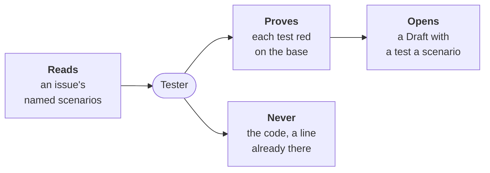

---
sources:
  - roles/tester/role.yaml
  - roles/tester/code
  - internal/kit/testmark
  - defaults/ci/github/workline-objection.yml
  - defaults/ci/github/workline-answer.yml
  - defaults/ci/github/workline-gardening.yml
checked: e81df7b34
verified: agent:claude-code
---
# Tester



For people: what the role does and how to set it. The AI never reads this
file. All roles: [docs/roles.md](../../docs/roles.md). Where it stands:
[status](docs/status.md); its design:
[ADR-0055](../../docs/adr/0055-the-tester-writes-the-acceptance-tests-before-the-code.md).

**Does**, today (steps 1 to 7 of the
[build plan](../../docs/adr/0055-the-tester-writes-the-acceptance-tests-before-the-code.md#build-plan)):

- `workline test write --issue <n>`: has the agent write one test for
  each named scenario of an issue waiting for its tests, in the project's own framework;
- proves them red on the base, with no agent, then commits them on a
  work branch, opened as a Draft;
- `workline test check --base <ref>`: the same red-first check on any change, with no agent;
- keeps its tests from the builder, and answers an objection to one
  ([below](#frozen-tests-and-objections));
- runs on its own: an issue labelled `workline:needs-tests` at once,
  one a scheduled run, and an objection as it is posted ([below](#when-it-runs)); hands its Draft to whoever
  builds ([hand-over](docs/hand-over.md));
- proves each test it froze green on the pull request that closes the
  issue, run again when red: red in one run only is flaky, in both is red, and either blocks, as does one missing ([how](docs/green-proof.md));
- **Experimental**, the curator below: it may change after 1.0, to be
  folded into the tester's own care of the corpus ([#264](https://github.com/JN0V/workline/issues/264));
- `workline test measure`: the corpus's measures, no agent, weekly in
  CI: count, time, slowest, red and flaky over time ([how](docs/curator.md));
- `workline test curate`: the agent proposes a few redundant tests
  removed; proven with no agent, coverage and killed mutants kept, a
  pull request the merge policy merges ([how](docs/removals.md)).

**Does not**, yet: adapt a test after a change ([status](docs/status.md#missing)).

## Write an issue's tests

```sh
workline test write --issue 42 --ai claude
```

- **The issue**: labelled `workline:needs-tests` (or `workline:ready`
  with no Draft), its Validation a list of named scenarios, as the
  product owner writes them
  ([writing an issue](../product-owner/docs/writing.md)).
- **The agent is a choice**: none, `claude`, `cmd:<any command>`. With
  none, nothing is written and the issue waits for its tests.
- **What comes out**: one test a scenario, proven red on the base, in
  a Draft on `workline/tester/issue-<n>`, with a `## Tests` table.
- **What it refuses**: each finding is written on the issue.
- **All of it**: [write an issue's tests](docs/write.md), and
  [what a write refuses](docs/write-findings.md).

## Frozen tests and objections

- **The record** on the Draft lists each test file, its git blob and
  the tests declared for each scenario.
- **The guard**, no agent: a frozen line changed or removed by anyone
  else blocks (`tester-test-changed`); no label lifts it.
- **An objection**: a comment on the test's line, opened by
  `workline:objection`; the tester keeps the test or rewrites it,
  three answers a thread at most.
- **All of it**: [frozen tests and objections](docs/objections.md).

## When it runs

- **At once**: an issue labelled `workline:needs-tests`.
- **On the schedule**: one waiting issue a run, weekly in the template,
  after the product owner and the reviewer.
- **On an objection**, in CI, woken by the comment, on GitHub and GitLab.
- **All of it**: [when it runs](docs/when-it-runs.md).

## Check a change

```sh
workline test check --base origin/main
```

- **Exit codes**: 0 pass, 1 block, 64 misuse.
- **The head is `HEAD` as committed**: changes not committed are not read.
- **All of it**: [check a change](docs/check.md).

## What the check says

- **Blocks**: a new test green on the base (`test-green-on-base`), red on
  the head (`test-red-on-head`), no report, a broken build the judge
  does not settle (`build-broken`).
- **Warns or informs**: a build the judge could not settle
  (`red-unproven`), a suite's own record, no new test.
- **Every finding**: [what the check says](docs/check.md#what-the-check-says).

## Settings

- **Required**: `test-command` and `test-report` (`setting-missing`
  when unset).
- **Optional**: `draft-command`, `module-files`, `test-paths`,
  `test-homes`, `build-errors`, and the agent's limits.
- **All of them**, with the command for Go, pytest, Jest, cargo nextest,
  Maven and Gradle: [settings](docs/settings.md).
