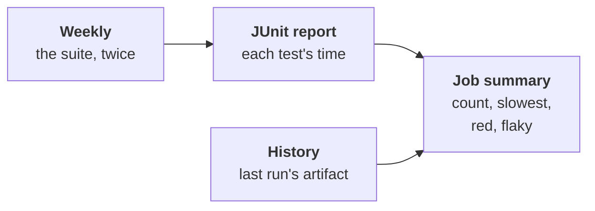

# The curator's measures

Part of [the tester](../README.md). Step 6 of
[ADR-0055's plan](../../../docs/adr/0055-the-tester-writes-the-acceptance-tests-before-the-code.md#build-plan):
keep the test corpus concise, scoped and fast, measured first. No agent;
nothing removed here: step 7 proposes removals, with their proof
([removals](removals.md)).

## What it measures

`workline test measure --history <file>`, on `HEAD` as committed, in a
checkout apart:

- **The corpus**: its tests, its total time (the report's suites), the
  measure's own time, and the trend since the last measure.
- **The slowest tests**, `curator-slowest` of them. A Go test with
  subtests is left out: its time is theirs.
- **Red and flaky**: the suite runs `curator-runs` times on one commit.
  Red in some runs is `test-flaky`; red in all, `test-red`. Both warn,
  never block: the curator is off every path
  ([ADR-0051](../../../docs/adr/0051-a-check-sits-where-its-catch-is-worth-its-cost.md)).
- **Over time**: each test's runs, red runs, flaky measures, last red
  measure, from the history file.
- **Never red** in the last `curator-window` measures: counted, and
  given to [the removals](removals.md)' agent; a test is never removed
  on this alone.
- **Coverage**, where the command writes one (`coverage-report`): Go's
  profile or LCOV; its total and the five least covered packages.
- **Mutation**: whether a tool exists for the project's language
  (Gremlins, go-mutesting, Stryker, PIT, mutmut, cargo-mutants), and
  whether one is set up here. [The removals](removals.md) run it.
- **Over `suite-max-seconds`**: `corpus-slow`, a warning.

## Where it is kept and said

- **The history**: a JSON file the CI passes from one run to the next
  as an artifact, `workline-curator`: no store of its own. GitHub keeps
  it 90 days; GitLab keeps a branch's latest. Missing: the first
  measure, said.
- **A test gone** longer than the window is dropped from it.
- **Said in the job's summary**: a person reads it there; nothing in it
  needs a person. [The removals](removals.md) open pull requests.

## In CI

- **Opt-in**: the variable `WORKLINE_CURATOR` set to `on`, the
  `test-command` set, the test runner installed in the job.
- **GitHub**: the `curator` job of
  [workline-gardening.yml](../../../ci/github/workline-gardening.yml);
  it reads the last run's artifact (`actions: read`), writes nothing.
- **GitLab**: `workline:curator` in
  [the template](../../../ci/gitlab/workline.gitlab-ci.yml); its image
  needs your test runner.

## Settings

| Key | Default | |
|---|---|---|
| `curator-command` | `test-command` | the command run, when it should also write coverage |
| `curator-runs` | 2 | runs a measure: two tell a flaky test on one commit |
| `curator-slowest` | 10 | the slowest tests named |
| `curator-window` | 12 | measures a test must stay green to count as never red |
| `suite-max-seconds` | 600 | the corpus's time over which it warns; 0, none |
| `coverage-report` | none | the coverage file the command writes |

## Its cost, on workline

Measured on a copy of workline, 2026-10-28, eight cores (the try is
told in the pull request [status](status.md) links):

- **The corpus**: 1,877 tests (Go subtests counted), 250 s of suite
  time; the conformance cases are most of it.
- **The measure**: 450 to 461 s for two runs with coverage; one run
  alone, 226 s. The coverage profile added no time worth measuring.
- **Slowest**: no test over 2.7 s; the ten slowest wait on a forge's
  retry or a commit's time budget.
- **Coverage**: 33.9 % of 33,452 statements: the conformance cases run
  the built engine, which the profile does not see.
- **The history**: 337 KB for 1,877 tests.
- **Found**: `doctor-agent-missing` red in all four runs, as it is
  whenever `WORKLINE_AI` is set in the environment; and a check of the
  workflow this change added, fixed before it was pushed.

## Not measured

- **Per-test coverage**: a run per test. On workline's
  `internal/tester`, 10 tests: 3.6 s one by one, 0.3 s together, twelve
  times; at that rate the 1,877 tests take 11 min more, the conformance
  cases also an engine built for coverage.
- **Duplicates by name or shape**: a name says little (Go's `TestRun`
  in many packages), a shape needs a parser per language.
  [The removals](removals.md) prove by a folder's coverage and mutants,
  before and after.
- **The pull requests' runs** (the green proof's three): not fed to the
  history yet.
